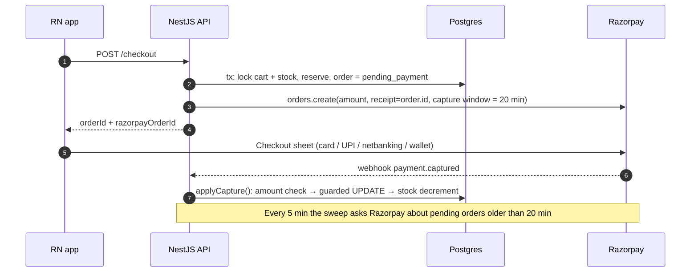
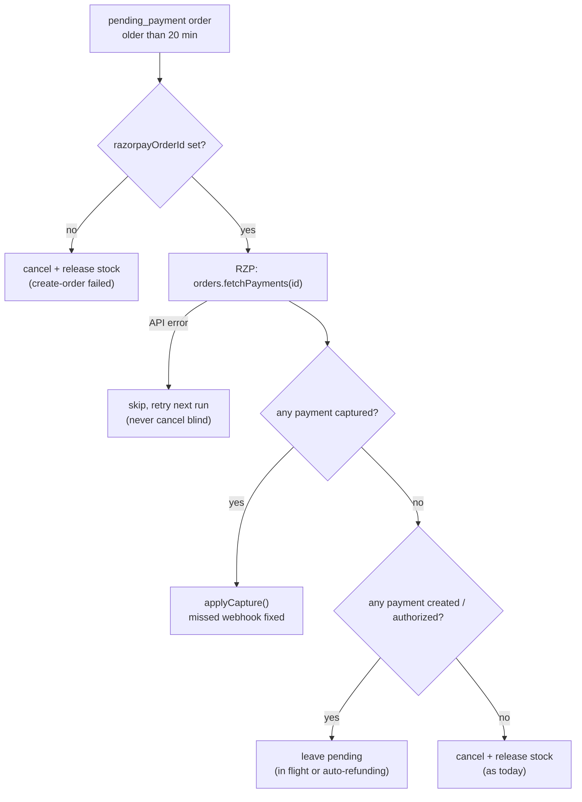
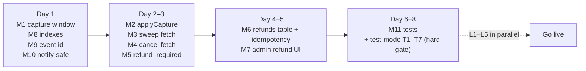

# Payment MVP scope

**One sentence:** close every path where customer money can be lost or hidden, use Razorpay's own features in place of infrastructure we would otherwise build, and write down when each deferred safeguard becomes worth building.

This report cuts down [Production payment design gap closure](Production%20payment%20design%20gap%20closure.md), the full production design, to what an MVP needs. The full report remains the reference for _why_. This one decides _what to build now_.

---

## 1. Verdict: the full design is overkill for an MVP

The full design assumes real traffic, a finance team and many simultaneous failures. At MVP volume (tens of orders a day, one admin), a person looking at the Razorpay dashboard does what recon jobs, ledgers and pollers do at scale.

The MVP keeps exactly one standard from the full design:

> **No rupee may end up somewhere the system can't see it.**

Anything that can lose or hide money stays in. Anything that only improves scale, automation or audit polish is deferred, each with a written trigger for when to build it.

|                           | Full design                      | MVP                                                                          |
| ------------------------- | -------------------------------- | ---------------------------------------------------------------------------- |
| New tables                | 8+                               | **1** (`refunds`)                                                            |
| New columns               | many                             | **2** (`payment_events.event_id`, `orders.payment_method` only if COD ships) |
| Background workers        | 4 (inbox, outbox, poller, recon) | **0 new** (extend the existing 5-minute sweep)                               |
| Gaps closed               | 30                               | **The 11 that lose or hide money**                                           |
| Razorpay test-mode checks | 21                               | **7**                                                                        |
| Effort (estimate)         | Several weeks                    | **About 6–8 dev days**                                                       |

> **Revision 2 (after external review).** Changed: refund status now follows Razorpay's real refund states; refunds use Razorpay's `X-Refund-Idempotency` header; the capture-window tests are a hard launch gate; a weekly reconciliation sheet replaces the "dashboard glance"; the race tests are spelled out; the refunds schema now works for COD; the estimate is now 6–8 days. Not adopted: `FOR UPDATE SKIP LOCKED` in the sweep (reason in §3, M3).

---

## 2. How MVP payments work



Three rules hold the design together:

| Rule                                      | What it means in code                                                                                                                                 |
| ----------------------------------------- | ----------------------------------------------------------------------------------------------------------------------------------------------------- |
| **R1. Razorpay holds late money, not us** | A per-order capture window means a payment that authorises too late is never captured. Razorpay refunds it automatically, with no fee.                |
| **R2. One capture path**                  | The webhook and the sweep both call the same `applyCapture()`, which checks the amount and moves `pending_payment → confirmed` with a guarded UPDATE. |
| **R3. Ask before cancelling**             | No code path cancels a pending order without first asking Razorpay whether a payment exists.                                                          |

---

## 3. Build now (P0): the 11 items

| #   | Item                                                                                                                             | Fixes                                                                                                                                             | Where                                                                                                                                                                                                            | Size |
| --- | -------------------------------------------------------------------------------------------------------------------------------- | ------------------------------------------------------------------------------------------------------------------------------------------------- | ---------------------------------------------------------------------------------------------------------------------------------------------------------------------------------------------------------------- | ---- |
| M1  | **Per-order capture window**                                                                                                     | Late payments captured on dead orders                                                                                                             | [razorpay-provider.service.ts:66-86](../apps/backend/src/modules/payments/razorpay-provider.service.ts#L66-L86)                                                                                                  | S    |
| M2  | **Shared** `applyCapture()` **with an amount and currency check**                                                                | Webhook confirms whatever amount arrives                                                                                                          | [webhooks.controller.ts:68-70](../apps/backend/src/modules/orders/webhooks.controller.ts#L68-L70), [:125-231](../apps/backend/src/modules/orders/webhooks.controller.ts#L125-L231)                               | S    |
| M3  | **Sweep asks Razorpay before cancelling**                                                                                        | Paid orders with a missed webhook get cancelled                                                                                                   | [orders.service.ts:266-289](../apps/backend/src/modules/orders/orders.service.ts#L266-L289)                                                                                                                      | M    |
| M4  | **Customer cancel asks Razorpay too**                                                                                            | Cancelling while a UPI payment is in flight                                                                                                       | [orders.service.ts:146](../apps/backend/src/modules/orders/orders.service.ts#L146)                                                                                                                               | S    |
| M5  | **Late capture becomes** `refund_required`**, not a log line**                                                                   | Money captured on a cancelled order is invisible                                                                                                  | [webhooks.controller.ts:71-84](../apps/backend/src/modules/orders/webhooks.controller.ts#L71-L84)                                                                                                                | S    |
| M6  | **Refund rework:** `refunds` **table, idempotency key + receipt, timeout, status follows Razorpay**                              | Lost response leaves the order `confirmed` after the money has left; double refunds; order shows `refunded` while the refund is pending or failed | [orders.service.ts:440-490](../apps/backend/src/modules/orders/orders.service.ts#L440-L490), [razorpay-provider.service.ts:104-109](../apps/backend/src/modules/payments/razorpay-provider.service.ts#L104-L109) | M    |
| M7  | **Admin refunds: full or partial, from** `confirmed` **or** `refund_required`**, with amount + reason**                          | No refund path for late money; vendor cancels a group and the customer gets nothing back                                                          | same; `Role.ADMIN` already enforced at [admin-orders.controller.ts:27-28](../apps/backend/src/modules/orders/admin-orders.controller.ts#L27-L28)                                                                 | S    |
| M8  | **Indexes and constraints**: unique `razorpay_order_id`, unique `razorpay_payment_id` (where not null), CHECK on `orders.status` | Full scans on webhook lookup; no database backstop                                                                                                | new migration                                                                                                                                                                                                    | S    |
| M9  | **Webhook event id** stored with a unique index (`ON CONFLICT DO NOTHING`)                                                       | Every redelivery adds a duplicate audit row                                                                                                       | [webhooks.controller.ts:62-66](../apps/backend/src/modules/orders/webhooks.controller.ts#L62-L66), [migration](../apps/backend/database/migrations/20261016090001-create-payment-events.js)                      | S    |
| M10 | **Notifications can't fail the webhook** (try/catch + error log)                                                                 | A notification error returns 500 and triggers needless redeliveries                                                                               | [webhooks.controller.ts:85-93](../apps/backend/src/modules/orders/webhooks.controller.ts#L85-L93)                                                                                                                | S    |
| M11 | **Tests + one Razorpay test-mode session**                                                                                       | Webhook controller and checkout have no tests; the code has never run against Razorpay                                                            | `__tests__/`                                                                                                                                                                                                     | M    |

### M1. Per-order capture window

The capture window is configuration, not code. Razorpay's default auto-capture window is 3 days, while our stock hold lasts 20 minutes. A payment that authorises at minute 30 is therefore captured onto a cancelled order. Refunding it then costs about 2.36% (2% fee + 18% GST), roughly ₹1,180 on a ₹50,000 sofa, and Razorpay keeps that fee. An _uncaptured_ payment that expires is refunded by Razorpay at no fee ([Capture settings via API](https://razorpay.com/docs/payments/payments/capture-settings/api.md)).

```ts
this.getClient().orders.create({
  amount: amountPaise,
  currency: 'INR',
  receipt: receiptId,
  payment: {
    capture: 'automatic',
    capture_options: {
      automatic_expiry_period: 20, // minutes; Razorpay minimum is 12
      manual_expiry_period: 20, // must be ≥ automatic; equal = no manual "revive" window
      refund_speed: 'normal',
    },
  },
});
```

MVP choice: `manual_expiry_period = automatic_expiry_period`. That gives no "revive the order and capture by hand" feature. Late money simply goes back to the customer. The razorpay-node types may not include `payment`; cast if needed.

### M2. One capture function for every caller

```ts
// Used by the webhook (payment.captured) AND the sweep (M3).
async applyCapture(order: Order, payment: { id: string; order_id: string; amount: number; currency: string; status: string }) {
  const expected = Math.round(Number(order.grandTotal) * 100);
  if (payment.amount !== expected || payment.currency !== 'INR' || payment.order_id !== order.razorpayOrderId) {
    logger.error(`order ${order.id}: amount mismatch ${payment.amount} vs ${expected}`);
    return markRefundRequired(order.id, payment.id);  // M5 queue, never confirm
  }
  const groups = await this.confirmOrder(order.id, payment.id); // existing guarded UPDATE
  if (groups === null) return markRefundRequiredIfCancelled(order.id, payment.id); // M5
  await notifySafely(order, groups);                  // M10
}
```

### M3. The sweep asks Razorpay before cancelling, and this replaces a poller



- **Why "leave pending" is safe:** a `created` payment resolves within about 10 minutes, since Razorpay fails no-response payments at 10 minutes. An `authorized` payment past the capture window auto-refunds once `manual_expiry_period` ends. Either way the hold is bounded, at roughly 40 minutes in the worst case.
- **Why this replaces a poller:** the only thing a separate poller adds at MVP volume is finding paid orders whose webhook never arrived. This branch already does that.
- While in there, also add the `GREATEST(…, 0)` floor to the release query, which [orders.service.ts:223](../apps/backend/src/modules/orders/orders.service.ts#L223) lacks.
- **Why the sweep needs no `FOR UPDATE SKIP LOCKED`.** If two instances sweep at once, both fetch from Razorpay, which is a harmless duplicate read. Only one guarded `UPDATE … WHERE status = 'pending_payment'` can succeed. Decision 0049 already relies on this, and `WORKER_MODE=api` keeps API-only instances from sweeping at all. Claiming rows with `FOR UPDATE` would mean holding a row lock across the Razorpay HTTP call. That is the transaction-across-external-call pattern the checkout already avoids, because it exhausts the connection pool.
- **Known window, deliberately handled:** the fetch says "no payment", the order is cancelled, then a payment captures a moment later. The guarded cancel can't see a future capture, so the capture lands on a `cancelled` order and M5 moves it to `refund_required`. M11 tests this exact sequence.
- The sweep also refreshes refund status (M6), so no refund webhooks are needed.

### M4. Customer cancel

Customer cancel runs the same fetch as the sweep. If a payment is `created` or `authorized`, return _"A payment is in progress. Try again in a few minutes."_ If one is `captured`, call `applyCapture()` and tell the customer the order went through.

### M5. Late money gets a status, not a log line

A new order status, `refund_required` ("money is here, an admin must refund it"), needs no new table because `orders.status` has no enum. The change happens in one guarded update:

```sql
UPDATE orders SET status = 'refund_required', razorpay_payment_id = :paymentId
WHERE id = :orderId AND status = 'cancelled' AND razorpay_payment_id IS NULL;
```

- An error-level log fires, which any log alert can pick up.
- The admin orders list gets a **"Needs refund"** filter that shows `refund_required` orders, oldest first.
- The customer is notified: _"Your payment arrived after the order expired. A refund will be issued."_

After M1, M3 and M4, this path should be rare. It remains reachable if a payment authorises at minute 19 and captures after the sweep has already passed it.

### M6 + M7. Refunds: admin-triggered, recorded before Razorpay is called

All refunds are **admin-triggered**. That covers customer cancellation, a vendor cancelling a group, returns and `refund_required`. This is safe because:

- Razorpay already handles the most common late-money case for free (M1).
- The remaining cases are visible in a queue (M5).

```sql
CREATE TABLE refunds (
  id UUID PRIMARY KEY DEFAULT gen_random_uuid(),
  order_id UUID NOT NULL REFERENCES orders ON DELETE RESTRICT,
  order_vendor_group_id UUID REFERENCES order_vendor_group,
  rail TEXT NOT NULL CHECK (rail IN ('razorpay','manual_payout')),  -- manual_payout = COD bank/UPI transfer
  razorpay_payment_id TEXT,
  payout_reference TEXT,                        -- UTR of a manual payout
  amount_paise BIGINT NOT NULL CHECK (amount_paise > 0),
  idempotency_key VARCHAR(64) NOT NULL UNIQUE,  -- sent as X-Refund-Idempotency; never regenerated on retry
  receipt VARCHAR(40) NOT NULL UNIQUE,          -- 'rf_' + order id without hyphens + '_' + n
  razorpay_refund_id TEXT UNIQUE,
  status TEXT NOT NULL CHECK (status IN ('requested','submitted','processed','failed')),
  reason TEXT NOT NULL,
  created_by UUID NOT NULL,                     -- admin user: who/why/how much
  created_at TIMESTAMPTZ NOT NULL DEFAULT now(),
  CHECK (rail <> 'razorpay' OR razorpay_payment_id IS NOT NULL)
);
```

The refund status follows Razorpay's real states. The order's refund status is a summary of its refund rows:

| Refund row  | Meaning                                        | Order status                                                                                                          |
| ----------- | ---------------------------------------------- | --------------------------------------------------------------------------------------------------------------------- |
| `requested` | Recorded by us; Razorpay not called yet        | unchanged                                                                                                             |
| `submitted` | Razorpay accepted it (its status is `pending`) | full refund: **`refund_pending`**; partial: stays `confirmed`                                                         |
| `processed` | Razorpay reports it done                       | full refunds all processed: **`refunded`**; partial: stays `confirmed` (the admin view shows "partially refunded ₹X") |
| `failed`    | Razorpay failed it                             | full refund: back to **`refund_required`** + error log; the admin retries                                             |

The admin refund runs in five steps:

| Step | What happens                                                                                                                                                                                                                                                                               | If it fails                                                                                                       |
| ---- | ------------------------------------------------------------------------------------------------------------------------------------------------------------------------------------------------------------------------------------------------------------------------------------------ | ----------------------------------------------------------------------------------------------------------------- |
| 1    | Transaction: lock the order row. Check that the sum of non-failed refunds plus this amount is no more than the captured amount. Insert a `refunds` row (`requested`) with a fixed receipt and a newly generated `idempotency_key`.                                                         | Rolls back. No money moved.                                                                                       |
| 2    | `POST /v1/payments/:id/refund` with header **`X-Refund-Idempotency: <idempotency_key>`**, body `{ amount, receipt, notes }`, and a **15-second timeout**                                                                                                                                   | Go to step 3                                                                                                      |
| 3    | On a timeout or 5xx, **retry with the same key and the identical body** (Razorpay: same key plus same body is safe; a different body is rejected; a request still in flight gets a 409, so wait and retry). As a fallback, fetch the payment's refunds and adopt the one with our receipt. | Still unresolved: leave it `requested` with an error log for the admin. Never mint a new key for the same refund. |
| 4    | Store `rfnd_…` and Razorpay's status (`submitted`, or `processed` if it was instant). Update the order as in the table above.                                                                                                                                                              | —                                                                                                                 |
| 5    | Each sweep run (M3) fetches the status of `submitted` refunds older than 5 minutes and moves them to `processed` or `failed`.                                                                                                                                                              | API error: try again next run                                                                                     |

Razorpay documents the idempotency header for both normal and instant refunds. Keys must be at least 10 characters (letters, digits, `-` and `_`) ([Normal refunds, idempotent](https://razorpay.com/docs/api/refunds/normal-refunds-idempotent.md)). The razorpay-node `payments.refund()` call may not pass custom headers. If it doesn't, make this one call over plain HTTPS with the same key and secret.

This fixes the bug at [orders.service.ts:466-481](../apps/backend/src/modules/orders/orders.service.ts#L466-L481). If Razorpay processed the refund but the response was lost, the order no longer goes back to `confirmed` with the money gone. It also stops an order showing `refunded` while the money hasn't moved. A double-click or two admins at once collide on the order lock, the idempotency key and the unique receipt.

MVP shortcut: no `refund.processed` / `refund.failed` webhooks. Step 5's sweep fetch does the same job at MVP volume (D6).

### M11. The seven test-mode checks (a hard launch gate)

These are the ones the MVP depends on, out of the 21 in the full report. **No live payments until every one passes.** M1 rests entirely on Razorpay timing that the docs don't state.

| #   | Check                                                                                                                                                                                                                                                                                                                                                                                      | Gates                                          |
| --- | ------------------------------------------------------------------------------------------------------------------------------------------------------------------------------------------------------------------------------------------------------------------------------------------------------------------------------------------------------------------------------------------ | ---------------------------------------------- |
| T1  | `payment.capture_options` is accepted on the account, with no support request needed. Repeat this on the live account once KYC is done.                                                                                                                                                                                                                                                    | M1                                             |
| T2  | Capture-window timing, measured from order creation and from payment creation: **(a)** authorisation at minute 19 is auto-captured; **(b)** authorisation at minute 21 stays uncaptured and auto-refunds after `manual_expiry_period`; **(c)** authorisation before expiry, captured late; **(d)** a capture that lands while the sweep is running. Note which webhooks fire in each case. | M1, M3 timing                                  |
| T3  | A failed payment, then a new Checkout on the **same** order, succeeds                                                                                                                                                                                                                                                                                                                      | Current `payment.failed` → stay-pending design |
| T4  | An abandoned UPI intent: time until the payment shows `failed`                                                                                                                                                                                                                                                                                                                             | The M3 "leave pending" bound                   |
| T5  | `X-Refund-Idempotency`: retrying with the same key and body returns the original refund; a changed body is rejected; an in-flight retry gets a 409                                                                                                                                                                                                                                         | M6 step 3                                      |
| T6  | Refund status: a normal refund goes `pending → processed`, and the fetch in M6 step 5 reflects it                                                                                                                                                                                                                                                                                          | M6 step 5                                      |
| T7  | The webhook endpoint returns 500 once, then 200: retry timing, and the `x-razorpay-event-id` is the same on the retry                                                                                                                                                                                                                                                                      | M9, M10                                        |

Note that automatic expiry only affects `authorized` payments. A payment that has already been captured is never reversed by it, which is why M5 exists.

**Code tests (real Postgres, not mocks):**

| Test                                                                                                    | Proves                                                          |
| ------------------------------------------------------------------------------------------------------- | --------------------------------------------------------------- |
| Replay `payment.captured` N times                                                                       | One confirmation, one stock decrement, one `payment_events` row |
| Webhook vs sweep vs customer cancel, all on one order                                                   | Exactly one terminal outcome                                    |
| **Cancel fetches "no payment" → cancels → the payment captures → the webhook arrives**                  | Order ends `refund_required`, not silently `cancelled`          |
| Amount, currency or order-id mismatch on capture                                                        | Never `confirmed`; goes to `refund_required`                    |
| Signature: valid raw body passes; tampered body fails; **re-serialised JSON of the same payload fails** | Verification really uses the raw bytes                          |
| Refund double-click, two admins, and a timeout followed by a retry                                      | One Razorpay refund; refunds never exceed the captured amount   |
| Notification throws after confirmation                                                                  | Webhook still returns 200; payment outcome unchanged            |

---

## 4. Deferred, each with a trigger for when to build it

| #   | Deferred from the full design                                      | MVP substitute                                                                               | Build it when…                                                                                                |
| --- | ------------------------------------------------------------------ | -------------------------------------------------------------------------------------------- | ------------------------------------------------------------------------------------------------------------- |
| D1  | Idempotency-key table with recovery points                         | App: on "cart is empty" after a retry, open the latest `pending_payment` order and resume it | Support tickets about "error, but the order exists", or any duplicate order                                   |
| D2  | `payment_attempts` / `razorpay_payments` / state-transition tables | Current columns, `payment_events` with the raw payload, guarded updates                      | More than one payment per order becomes normal (EMI, partial payments), or audits need a full payment history |
| D3  | Webhook inbox + async worker                                       | Inline handler (fast at this volume)                                                         | Webhook p95 above 2s, or any Razorpay "webhook disabled" email                                                |
| D4  | Outbox for notifications                                           | try/catch + log (notifications are log-only until Firebase anyway)                           | Push notifications go live and a lost one becomes a support issue                                             |
| D5  | Separate stuck-pending poller (3-day late-auth watch)              | The M3 sweep branch                                                                          | Late-authorisation volume is clearly above Razorpay's stated under 0.5%                                       |
| D6  | Refund and dispute webhooks                                        | Sweep fetches refund status (M6 step 5); disputes via Razorpay emails + dashboard            | More than about 20 refunds a week, or the first missed dispute deadline                                       |
| D7  | Automated daily settlement recon + bank recon                      | **Weekly reconciliation sheet** (L5): a human matches every captured rupee                   | More than about 50 orders a day, the sheet takes over an hour a week, or the first unexplained difference     |
| D8  | Double-entry ledger in paise, TCS accounts                         | Razorpay exports + an accountant                                                             | Vendor payouts are automated (Route), or GSTR-8 filing starts                                                 |
| D9  | Circuit breakers, retry budgets, downtime webhooks                 | 15s timeouts; Checkout itself hides methods that are down                                    | Razorpay outages visibly hurt conversion                                                                      |
| D10 | Automatic refunds                                                  | Admin-triggered + `refund_required` queue                                                    | Admin refund backlog regularly older than 48h                                                                 |
| D11 | Full COD rail (risk scoring, courier remittance recon, COD ledger) | Minimal COD (§6), only if the product needs it                                               | COD over about 20% of orders, or RTO losses become visible                                                    |

---

## 5. Launch blockers that aren't code

These must be settled before taking **real** customer money. None of them blocks the demo environment.

| #   | Item                                                                                                                                                                                                                                                                                                                                                                                                                                                                                                                                                      | Why                                                                                                                                                   | Who                                      |
| --- | --------------------------------------------------------------------------------------------------------------------------------------------------------------------------------------------------------------------------------------------------------------------------------------------------------------------------------------------------------------------------------------------------------------------------------------------------------------------------------------------------------------------------------------------------------- | ----------------------------------------------------------------------------------------------------------------------------------------------------- | ---------------------------------------- |
| L1  | Razorpay merchant account + KYC, live keys, webhook secret                                                                                                                                                                                                                                                                                                                                                                                                                                                                                                | The code has never touched Razorpay ([razorpay-provider.service.ts:10-14](../apps/backend/src/modules/payments/razorpay-provider.service.ts#L10-L14)) | Founder                                  |
| L2  | **Legal read on the money flow (hard blocker).** RBI's 2025 PA Master Direction (paras 10(b), 13(f)) suggests money collected for vendors should flow through Razorpay Route linked accounts, not manual payouts from the platform's account. Using Razorpay Checkout does not make the settlement structure compliant by itself. Questions to settle: **who legally receives the customer's payment; who is responsible for vendor settlement; whether Route or linked accounts are required; who carries refunds, disputes and settlement shortfalls.** | It may make Route a launch prerequisite instead of a later phase                                                                                      | Lawyer or payments compliance specialist |
| L3  | **Published cancellation and refund policy** (E-Commerce Rules 2020, Rule 4(8) symmetric cancellation charges, Rule 4(10) refund "within a reasonable period")                                                                                                                                                                                                                                                                                                                                                                                            | Admin-triggered refunds need a stated SLA. Suggest "initiated within 2 business days"                                                                 | ADR + product                            |
| L4  | Checkout shows the UPI ₹1 lakh limit for large carts                                                                                                                                                                                                                                                                                                                                                                                                                                                                                                      | Home goods aren't in NPCI's ₹5 lakh categories. Razorpay Checkout can already offer card or netbanking                                                | Small UI copy                            |
| L5  | **Weekly reconciliation sheet.** One row per captured payment: internal order id, Razorpay order id, payment id, captured amount, refunded amount, fee + GST, settlement amount, settlement date/UTR, difference, status. Sources: one SQL export from our DB and Razorpay's settlement report.                                                                                                                                                                                                                                                           | Every captured rupee is accounted for, including refunds and fee deductions, without building a recon engine                                          | Founder/ops, weekly from day one         |

On the radar but not a blocker: the E-Commerce (Amendment) Rules 2026 take effect on **1 Jan 2027**. They require a yearly dark-pattern self-audit and showing the 30-day prior price next to any discount.

---

## 6. Minimal COD (optional, only if the product needs it at launch)

| Piece         | MVP version                                                                                                                                                                                  |
| ------------- | -------------------------------------------------------------------------------------------------------------------------------------------------------------------------------------------- |
| Data          | `orders.payment_method` ∈ {`razorpay`, `cod`}                                                                                                                                                |
| Eligibility   | Fixed cart cap (e.g. ₹25,000) and a pincode allowlist. No risk scoring                                                                                                                       |
| Flow          | Skip Razorpay. The order is `confirmed` at placement and stock is decremented as today                                                                                                       |
| Collection    | Vendor or admin marks the order **cash collected** or **returned to origin** (stock goes back, cancelled)                                                                                    |
| COD fee       | None. If ever added, it must be shown upfront per payment method (Rule 5(3)(d))                                                                                                              |
| Refund        | A manual bank or UPI transfer by an admin, recorded in `refunds` with `rail = 'manual_payout'` and the transfer UTR in `payout_reference`. It never goes through Razorpay's refund handling. |
| Open question | **Who holds the cash, couriers or vendors?** It decides how accounting and GST TCS work. Ask a CA before COD volume grows                                                                    |

---

## 7. For your CV

**Suggested bullet:**

> Designed the payment flow for a multi-vendor marketplace on Razorpay (cards, UPI, netbanking, wallets), closing every money-loss path for launch: per-order capture windows aligned to stock reservations so late payments auto-refund at zero fee, a single guarded capture transition shared by webhooks and a reconciling sweep, and idempotency-keyed admin refunds whose status tracks real money movement. Deferred ledger, inbox and recon infrastructure behind measurable triggers.

Say **"designed"** until M1–M11 are merged and T1–T7 have passed. Only then say **"designed and shipped"**.

**Likely interview questions:**

| Question                                         | Answer                                                                                                                                                                                                               |
| ------------------------------------------------ | -------------------------------------------------------------------------------------------------------------------------------------------------------------------------------------------------------------------- |
| Why not build the ledger and reconciliation now? | At MVP volume a weekly reconciliation sheet (L5) accounts for every captured rupee by hand. Each deferral has a trigger (§4), so it isn't forgotten.                                                                 |
| What happens if the webhook never arrives?       | The sweep asks Razorpay before cancelling and confirms the order if the payment was captured. Webhooks are a fast signal; Razorpay's API is the truth.                                                               |
| How do you prevent double charges?               | One Razorpay order per order, and Razorpay allows only one successful payment per order. The guarded UPDATE and unique payment id stop double confirmation, and event ids stop duplicate audit rows.                 |
| How do you prevent double refunds?               | An order-row lock, a stored `X-Refund-Idempotency` key that is reused on every retry, and a unique receipt as a second guard. The refund row exists before Razorpay is called.                                       |
| Why no `SKIP LOCKED` in the sweep?               | The guarded UPDATE already makes concurrent sweeps safe. Holding a row lock across the Razorpay call would tie up DB connections on a slow network call.                                                             |
| When is an order "refunded"?                     | Only when Razorpay reports the refund `processed`. Accepted is not the same as moved.                                                                                                                                |
| Why is "late payment" the key case?              | The default 3-day capture window against a 20-minute stock hold turns late authorisations into money on dead orders. A 20-minute capture window lets Razorpay refund them for free. That is configuration, not code. |
| Why are refunds manual?                          | Policy refunds need judgement anyway. The no-judgement case (late money) is handled by Razorpay's auto-refund, and the rare remainder is in a visible queue.                                                         |

---

## 8. Build order



| Work                                   | Estimate                                        |
| -------------------------------------- | ----------------------------------------------- |
| Capture configuration + DB constraints | 0.5–1 day                                       |
| Shared capture function + sweep        | 1–1.5 days                                      |
| Cancellation + late-payment handling   | 0.5 day                                         |
| Refunds + admin UI                     | 1–1.5 days                                      |
| Tests + Razorpay test-mode integration | 1–2 days (real Razorpay behaviour may surprise) |
| **Total**                              | **6–8 days**                                    |

**Done means:** replaying any webhook N times, and racing webhook vs sweep vs customer cancel against real Postgres, gives exactly one confirmation and no captured payment left untracked. Every captured payment ends `confirmed`, `refund_required`, `refund_pending` or `refunded`, and an order is `refunded` only once Razorpay reports the refund `processed`.
