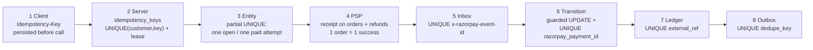
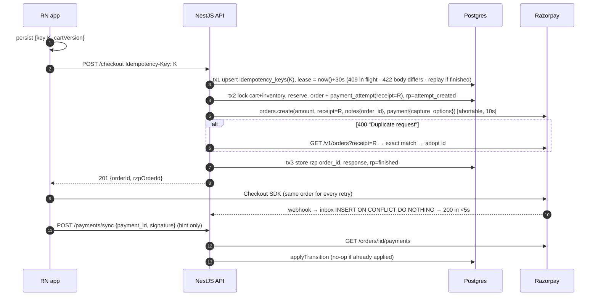
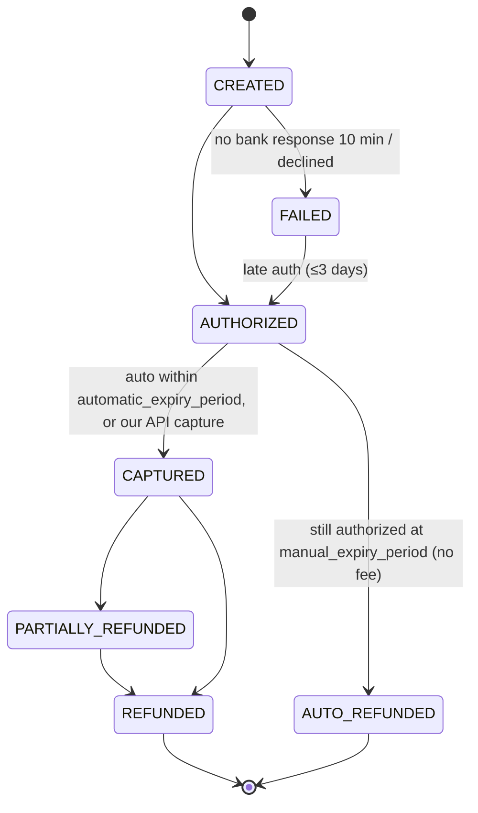
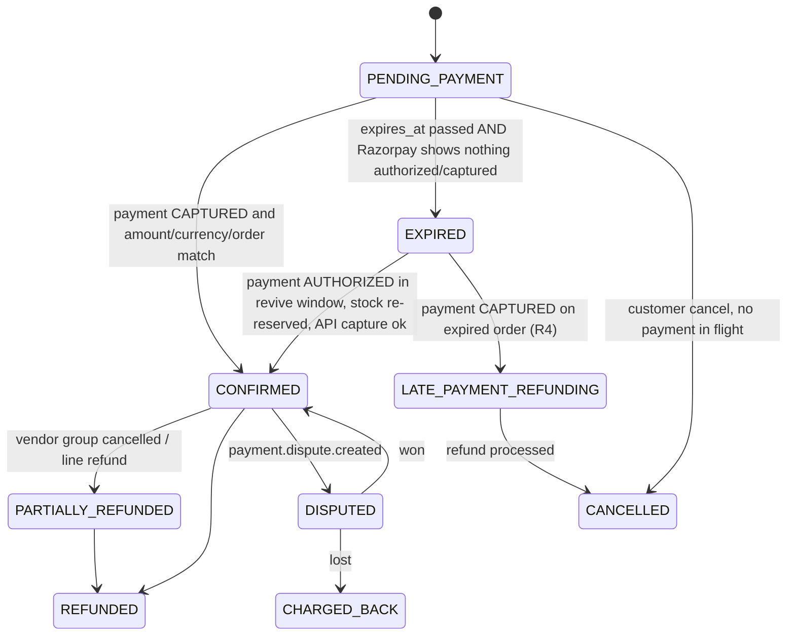
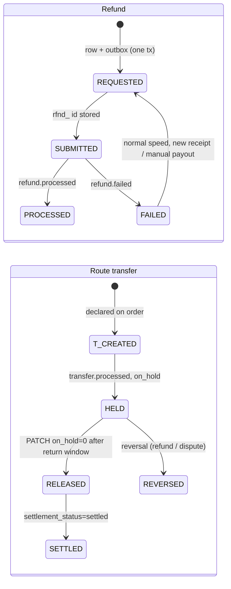
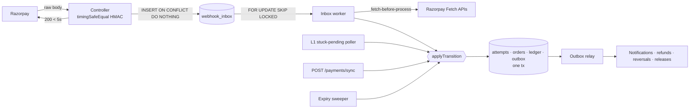
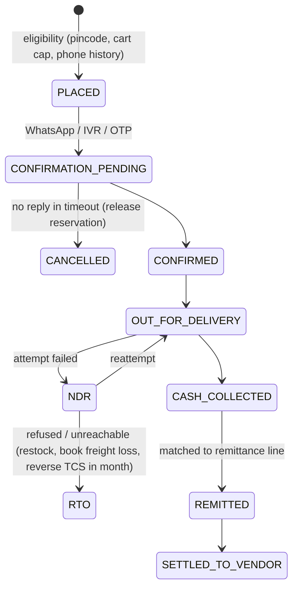
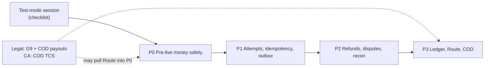

# Make every rupee move exactly once

A production-grade payment system for Golden Abode is **eight idempotency layers, three state machines, four reconciliation loops and one append-only ledger** built around Razorpay. Its organising rule is that the webhook is a hint, Razorpay's fetch APIs are the truth, and every rupee that arrives without a payable order gets revived or refunded automatically. Primary sources now settle the questions the first version left open. Razorpay lets each order set its own capture window through a `payment.capture_options` object (`automatic_expiry_period`, minimum 12 minutes, and `manual_expiry_period`). Aligning that window with our 20-minute stock reservation turns the most likely money-loss case, a capture landing on an expired order, into a **fee-free auto-refund**. The alternative is a refund that costs about **₹1,180 in non-returnable fees on a ₹50,000 sofa**. Razorpay **enforces `receipt` uniqueness and lets you look orders up by receipt**, so a timed-out create-order can be retried and the existing order adopted rather than abandoned. **Capture is not idempotent**: a repeat returns 400, so workers fetch before they retry. An order **can** take another payment after a failed one, and is blocked only while a payment on it is `authorized` or `paid`. Void-by-refund stays contradictory in the docs, so the design doesn't rely on it. The Indian rules are also sharper than before. RBI's T+5 / ₹100-a-day compensation applies only to _failed_ transactions, so merchant refunds fall under refund-to-source and the E-Commerce Rules' "reasonable period". The **2026 E-Commerce amendment takes effect on 1 Jan 2027** and adds a yearly dark-pattern self-audit. A COD fee is not banned, but it must be shown upfront. GST TCS of 0.5% applies to COD whenever the platform's model is that it collects the money. Payment-data localisation does not bind merchants directly. Measured against all this, the current code is correct on its happy path but is a single-path system. Its worst gaps are **money-correctness bugs**: late captures on cancelled orders are only logged, a lost refund response reverts the order to `confirmed`, nothing deduplicates by event id, no poller exists, and the code has never run against Razorpay. The build plan is four phases: **P0** pre-live money safety, **P1** attempts, idempotency and outbox, **P2** refunds, disputes and reconciliation, and **P3** ledger, Route and COD. A one-day Razorpay test-mode session and two professional opinions (legal on vendor payouts, CA on COD TCS) gate the plan.

---

## Eleven open questions now have primary-source answers

The first version left these points open, or rested them on secondary sources. Each answer below changes a design decision later in this report.

| #   | Open question                                                        | Answer now                                                                                                                                                                                                                                                                                                                                                                                                                                                                                                                                                                                                                        | Grade                                                                                                     | Design consequence                                                                                                        |
| --- | -------------------------------------------------------------------- | --------------------------------------------------------------------------------------------------------------------------------------------------------------------------------------------------------------------------------------------------------------------------------------------------------------------------------------------------------------------------------------------------------------------------------------------------------------------------------------------------------------------------------------------------------------------------------------------------------------------------------- | --------------------------------------------------------------------------------------------------------- | ------------------------------------------------------------------------------------------------------------------------- |
| Q1  | Can capture settings be set per order, and what are the fields?      | Yes. `POST /v1/orders` takes `payment: {capture: "automatic"\|"manual", capture_options: {automatic_expiry_period, manual_expiry_period, refund_speed}}`, in **minutes**. Auto has a minimum of 12. Manual must be ≥ auto, with max and default **7200**. It overrides the Dashboard and applies only to Orders-API payments ([Capture settings via API](https://razorpay.com/docs/payments/payments/capture-settings/api.md); [razorpay-node types](https://raw.githubusercontent.com/razorpay/razorpay-node/master/lib/types/orders.d.ts); [Capture Settings](https://razorpay.com/docs/payments/payments/capture-settings.md)) | Primary, with one conflict: the Dashboard docs say the manual max is **3 days**, the API page says 5 days | Timer alignment becomes a concrete request body (see "Align the timers"). Keep `manual_expiry_period` ≤ 4320 until tested |
| Q2  | Is capture idempotent?                                               | **No.** A second capture returns 400 "This payment has already been captured". `amount` must **equal the authorized amount** ([Capture a Payment](https://razorpay.com/docs/api/payments/capture.md))                                                                                                                                                                                                                                                                                                                                                                                                                             | Primary                                                                                                   | Fetch before retrying. Treat `captured`, or a 400 "already captured", as success                                          |
| Q3  | Can an `authorized` payment be voided?                               | Contradictory. One error implies a full-amount refund on `authorized` is a void. The same page and the Normal Refund page say refunds need `captured` ([Instant Refund](https://razorpay.com/docs/api/refunds/create-instant.md); [Normal Refund](https://razorpay.com/docs/api/refunds/create-normal.md))                                                                                                                                                                                                                                                                                                                        | Primary but conflicting                                                                                   | Don't build on void. Let the capture window lapse so Razorpay auto-refunds (no fee)                                       |
| Q4  | Is `receipt` enforced, and can you look it up?                       | Docs: it "has to be unique"; a duplicate gets 400 "Duplicate request"; "`receipt` is treated as an idempotency key". `GET /v1/orders?receipt=` exists ([Create Order](https://razorpay.com/docs/api/orders/create.md); [Fetch all Orders](https://razorpay.com/docs/api/orders/fetch-all.md))                                                                                                                                                                                                                                                                                                                                     | Primary docs, no independent confirmation                                                                 | Create-order recovery = retry, then on duplicate fetch by receipt and **adopt** the order                                 |
| Q5  | Can one order be reused after a failed payment?                      | Yes in most docs. It is blocked only when the order is `paid`, or `attempted` with an `authorized` payment. Only the Create Order page says "create a new Order" ([Orders FAQs](https://razorpay.com/docs/payments/orders/faqs.md); [S2S JSON v2](https://razorpay.com/docs/payments/payment-gateway/s2s-integration/json/v2/build-integration/single-integration-api.md); [UPI Intent](https://razorpay.com/docs/payments/payment-gateway/s2s-integration/payment-methods/upi/intent.md))                                                                                                                                        | Primary, with one dissent                                                                                 | Reuse one Razorpay order per local order. A new order only if the amount changes                                          |
| Q6  | Webhook retry schedule, settlement events, refund payload?           | Schedule unpublished ("exponential backoff … 24 hours", then disabled). `settlement.processed` exists in India with `id, amount, fees, tax, utr`. Refund payload carries `speed_requested/processed`, `receipt`, `acquirer_data.arn` (null in samples) ([Webhook FAQs](https://razorpay.com/docs/webhooks/faqs.md); [Settlement webhooks](https://razorpay.com/docs/webhooks/settlements.md); [Refund webhooks](https://razorpay.com/docs/webhooks/refunds.md))                                                                                                                                                                   | Primary                                                                                                   | Bank recon is triggered by `settlement.processed`, matched on UTR. ARN is optional at `refund.processed`                  |
| Q7  | Fees and GST on the payment entity?                                  | `fee` **includes** GST; `tax` is the GST part. 18% GST on the fee only. Standard 2% (3% Amex/Diners/corporate/Pay Later), so **2.36% effective**. `fee` is null at `authorized` and set at `captured`, except the card sample shows null ([Pricing](https://razorpay.com/pricing/); [Pricing blog](https://razorpay.com/blog/razorpay-payment-gateway-pricing-explained/); [Payments webhooks](https://razorpay.com/docs/webhooks/payments.md))                                                                                                                                                                                   | Primary                                                                                                   | Book the fee from the capture event if present, else from fetch or recon                                                  |
| Q8  | Route fields, holds, reversals, price?                               | `transfers[]` on order create: `account, amount, currency, notes, linked_account_notes, on_hold, on_hold_until`. Reversal takes only `amount, notes`, **no idempotency key**, and fails if the linked-account balance is short. Price: 0.25% (docs) vs 0.1% (pricing page) ([Transfers from Orders](https://razorpay.com/docs/api/payments/route/create-transfers-orders.md); [Reverse a Transfer](https://razorpay.com/docs/api/payments/route/reverse-a-transfer.md); [Pricing](https://razorpay.com/pricing/))                                                                                                                 | Primary, price conflicting                                                                                | Hold all vendor transfers until the return window closes. Reverse before refunding                                        |
| Q9  | Does RBI's TAT cover merchant refunds?                               | **No.** Only "failed transactions … not attributable to the customer". Card-not-present and UPI P2M: **T+5**, then ₹100/day; on-us wallet T+1 ([RBI TAT annex, PA-hosted copy](<https://cashfreelogo.cashfree.com/website/pdf/ANNEXURE%20I_%20Harmonisation%20of%20Turnaround%20Time%20(TAT)%20and%20Customer%20Compensation%20for%20Failed%20Transactions%20Using%20Authorised%20Payment%20Systems.pdf>))                                                                                                                                                                                                                        | Primary copy                                                                                              | "Debited, no order" must resolve well inside T+5. Refund SLA is our own published policy                                  |
| Q10 | Do COD fees, cancellation charges and refund timing have hard rules? | Cancellation symmetry is **Rule 4(8)**. Refunds "within a reasonable period" is **4(10)**. Payment-method fees must be disclosed (**5(3)(d)**), and the total shown as a single figure (**6(5)(b)**). The **2026 amendment (from 1 Jan 2027)** adds a dark-pattern self-audit, a 30-day prior price and a bundled-fee ban. **No COD-fee rule exists** ([Gazette copy](https://taxguru.in/wp-content/uploads/2020/07/Consumer-Protection-E-Commerce-Rules-2020.pdf); [PIB 2308759](https://www.pib.gov.in/PressReleaseDetail.aspx?PRID=2308759))                                                                                   | Primary (gazette copy, PIB)                                                                               | A COD fee is lawful only if shown upfront. We still prefer a prepaid incentive                                            |
| Q11 | TCS rate and COD; does localisation bind us?                         | TCS 0.25% CGST + 0.25% SGST via **Notification 15/2024-CT**. It applies where consideration "is to be collected by such operator", **"irrespective of the actual collection"**. Localisation responsibility sits "on the authorised / approved PSOs" ([Notif. 15/2024](https://gstcouncil.gov.in/sites/default/files/2024-09/central-tax-15-2024-11072024.pdf); [CBIC TCS FAQ](https://www.gstcouncil.gov.in/sites/default/files/2024-02/faqs_tcs.pdf); [RBI FAQ 130](https://www.rbi.org.in/Scripts/FAQView.aspx?Id=130))                                                                                                        | Primary                                                                                                   | Who collects COD cash changes the TCS scope (see the COD section). Indian hosting is a defensible default, not a mandate  |

Several earlier claims are **removed or downgraded**. The Amazon "Pay on Delivery stops above ₹30,000" figure came from an unverified mirror and is gone. The minister's "dark pattern" remark on COD fees now carries no weight beyond "a probe opened in October 2025; no published order". Kleppmann's DDIA quotes are reader-captured highlights, so the end-to-end argument is anchored instead on Saltzer, Reed and Clark's paper ([Princeton copy](https://www.cs.princeton.edu/courses/archive/fall15/cos518/papers/endtoend.pdf)). No first-party Flipkart, Meesho, PhonePe, Swiggy or Zomato engineering post on payment reliability could be found, so this report attributes no internal architecture to any Indian company.

---

## Duplicates enter through thirteen doors, and eight layers close them

Only an operation id carried from the client to the database and enforced by a uniqueness constraint rules out duplicates end to end. TCP retries, HTTP retries and DB transactions each cover only one hop. This is Saltzer, Reed and Clark's end-to-end argument: the function "can completely and correctly be implemented only with the knowledge and help of the application standing at the end points" ([Saltzer et al.](https://www.cs.princeton.edu/courses/archive/fall15/cos518/papers/endtoend.pdf); [Allegro Tech](https://blog.allegro.tech/2025/12/transactions-arent-enough.html)). Airbnb's Orpheus states the target in its own words: the system "should move money at most once". It reports "five nines in consistency" from that design ([Airbnb, Chew & Khisti 2019](https://medium.com/airbnb-engineering/avoiding-double-payments-in-a-distributed-payments-system-2981f6b070bb)). Each layer below catches a duplicate the layer above it cannot see.



### Where duplicates come from, and which layer stops each

| #   | Source                                  | Concrete case in our stack                                                                                                                      | Layer that stops it                                                                                                                                                                                                  | Golden Abode today                                                                                                                                                                 |
| --- | --------------------------------------- | ----------------------------------------------------------------------------------------------------------------------------------------------- | -------------------------------------------------------------------------------------------------------------------------------------------------------------------------------------------------------------------- | ---------------------------------------------------------------------------------------------------------------------------------------------------------------------------------- |
| D1  | Double tap                              | "Place order" tapped twice                                                                                                                      | 2: lease returns 409 while the request is in flight                                                                                                                                                                  | Cart `FOR UPDATE`; the second call gets 400 "cart is empty" ([checkout.service.ts:186-233](../apps/backend/src/modules/orders/checkout.service.ts))                                |
| D2  | Retry after a lost response             | `POST /checkout` times out on 3G                                                                                                                | 2: same key, **stored response replayed**                                                                                                                                                                            | **Broken.** The retry gets "cart is empty" and cannot find its order ([checkout.dto.ts:4-17](../apps/backend/src/modules/orders/dto/checkout.dto.ts))                              |
| D3  | New key per retry, or two devices       | App restart, or phone and tablet at once                                                                                                        | 3: partial unique index on open attempts                                                                                                                                                                             | Cart lock covers it by accident                                                                                                                                                    |
| D4  | Server retries `orders.create`          | Our 15s race fires but Razorpay created the order                                                                                               | 4: same `receipt`. On 400 duplicate, `GET /orders?receipt=` and adopt                                                                                                                                                | `receipt = order.id`; the timeout doesn't abort; the orphan is cancelled ([razorpay-provider.service.ts:64-86](../apps/backend/src/modules/payments/razorpay-provider.service.ts)) |
| D5  | Two Razorpay orders for one purchase    | A new order on re-pay while an old UPI intent completes                                                                                         | 3 + 4: reuse one Razorpay order per local order. `one_paid_attempt` index refunds any surplus                                                                                                                        | Re-pay reuses `razorpayOrderId` ✅ ([usePlaceOrder.ts:27-35](../apps/mobile/src/hooks/payments/usePlaceOrder.ts))                                                                  |
| D6  | Second payment on a `paid` order        | Late authorisation of an earlier attempt                                                                                                        | Razorpay auto-refunds it ([Auto-refunds](https://razorpay.com/docs/payments/refunds/auto-refunds)). 6: record it, never fulfil twice                                                                                 | Second payment id never recorded ([webhooks.controller.ts:139-151](../apps/backend/src/modules/orders/webhooks.controller.ts))                                                     |
| D7  | Webhook redelivery                      | At-least-once; resent if not acked in **5s** ([Webhook FAQs](https://razorpay.com/docs/webhooks/faqs/))                                         | 5: `INSERT … ON CONFLICT (event_id) DO NOTHING`                                                                                                                                                                      | Guarded UPDATE stops double confirmation, but every redelivery adds a `payment_events` row                                                                                         |
| D8  | Distinct events, same fact              | `order.paid` **and** `payment.captured` for one capture ([Orders webhooks](https://razorpay.com/docs/webhooks/orders/)); client sync vs webhook | 6: one transition function plus a unique payment id                                                                                                                                                                  | n/a (no sync path)                                                                                                                                                                 |
| D9  | Duplicate capture                       | Revive worker retries after a timeout                                                                                                           | Fetch first. A 400 "already captured" counts as success ([Capture](https://razorpay.com/docs/api/payments/capture.md))                                                                                               | No capture code                                                                                                                                                                    |
| D10 | Duplicate refund                        | Admin double-click, or a retry after a lost response                                                                                            | 4: deterministic refund `receipt` (Razorpay treats it as an idempotency key per payment ([Instant Refund](https://razorpay.com/docs/api/refunds/create-instant.md))), then fetch and adopt                           | Claim-before-call blocks the double-click. **A retry after a lost response is unsafe**                                                                                             |
| D11 | Duplicate transfer reversal             | Retry after a timeout on `/transfers/:id/reversals`                                                                                             | No PSP key exists ([Reverse a Transfer](https://razorpay.com/docs/api/payments/route/reverse-a-transfer.md)). Fetch reversals, compare amounts; local UNIQUE `(transfer_id, reason_ref)`                             | No Route                                                                                                                                                                           |
| D12 | Duplicate ledger posting or side effect | Inbox worker replays an event                                                                                                                   | 7 + 8: UNIQUE `external_ref`, UNIQUE outbox `dedupe_key`                                                                                                                                                             | No ledger, no outbox                                                                                                                                                               |
| D13 | Replica lag hides the first write       | A retry reads a stale replica                                                                                                                   | Read idempotency state from the primary. Airbnb chose "the master database" for this reason ([Airbnb](https://medium.com/airbnb-engineering/avoiding-double-payments-in-a-distributed-payments-system-2981f6b070bb)) | Single DB, so not yet relevant                                                                                                                                                     |

### Client keys: one per checkout attempt, persisted before the first byte leaves

Stripe stores the first response for a key, **500s included**. It rejects reuse of a key with different parameters, answers 409 to a concurrent duplicate, and keeps keys at least 24h ([Stripe API](https://docs.stripe.com/api/idempotent_requests)). The IETF draft standardises **400** (missing key), **422** (same key, different payload) and **409** (still in flight) ([IETF draft-08](https://datatracker.ietf.org/doc/draft-ietf-httpapi-idempotency-key-header/)). Orpheus distinguishes two kinds of key. A request-level key is "random and unique … chosen from the client". An entity-level key is "deterministic … based on the entity model", for example "payment-1234-refund" ([Airbnb](https://medium.com/airbnb-engineering/avoiding-double-payments-in-a-distributed-payments-system-2981f6b070bb)). We use both: a random key for checkout and deterministic keys for refunds and reversals.

| Choice               | Chosen                                                                           | Rejected         | Why                                                                                                                                                                   |
| -------------------- | -------------------------------------------------------------------------------- | ---------------- | --------------------------------------------------------------------------------------------------------------------------------------------------------------------- |
| Key scope            | **Per checkout attempt**: a ULID minted on the tap and stored with `cartVersion` | Per cart         | A per-cart key blocks a legitimate re-pay, and a changed cart turns into a 422                                                                                        |
| Key format           | ULID                                                                             | UUIDv4           | Shopify saw "a 50 percent decrease in INSERT statement duration" with time-prefixed ULIDs ([Shopify](https://shopify.engineering/building-resilient-payment-systems)) |
| Storage              | Secure storage/AsyncStorage, written **before** `POST /checkout`                 | In memory        | Survives the app being killed mid-UPI-intent. Cold start calls a status endpoint first                                                                                |
| Cleared              | On a definitive answer (201 with order, or a 4xx validation error)               | After each try   | Orpheus records a response only at "a deterministic end-state"                                                                                                        |
| Server scope         | `UNIQUE(customer_id, key)`, retention 72h, with a reaper                         | Global, 24h      | Per-user scope prevents cross-account collisions ([brandur.org](https://brandur.org/idempotency-keys)). 72h covers a Friday bug fixed on Monday                       |
| Pre-execution errors | Not stored                                                                       | Cache everything | Stripe doesn't cache them, so they stay retryable ([Stripe](https://docs.stripe.com/error-low-level))                                                                 |

### Server dedup: phases around the one foreign call, with a lease longer than the timeout

Orpheus splits every money call into **Pre-RPC**, **RPC** and **Post-RPC**. It allows "no service interaction over networks in Pre and Post-RPC phases" and "no database interactions in the RPC phases", because "we essentially want to avoid mixing network communication with database work". Errors default to "non-retryable": 5XX is retryable, 4XX is not. Each request takes a row lock on its key as a lease, and "a good rule of thumb is to have a higher lease expiration than the RPC timeout" ([Airbnb](https://medium.com/airbnb-engineering/avoiding-double-payments-in-a-distributed-payments-system-2981f6b070bb)). Brandur adds **recovery points**, so a retry resumes rather than restarts ([brandur.org](https://brandur.org/idempotency-keys)). Our two-phase checkout already does Pre-RPC and RPC. What it lacks is the key row that makes a crash or retry resumable.



| Recovery point      | Committed                                                    | On retry or completer pick-up                                                                                                                                                                                                                                                                                   |
| ------------------- | ------------------------------------------------------------ | --------------------------------------------------------------------------------------------------------------------------------------------------------------------------------------------------------------------------------------------------------------------------------------------------------------- |
| `started`           | Key row only                                                 | Run tx2                                                                                                                                                                                                                                                                                                         |
| `attempt_created`   | Order, attempt and reservation; Razorpay outcome **unknown** | Call `orders.create` with the **same** receipt. On 400 "Duplicate request", `GET /v1/orders?receipt=R`, compare `receipt` exactly (the filter "contain[s] the provided value", which may be a substring match ([Fetch all Orders](https://razorpay.com/docs/api/orders/fetch-all.md))), and adopt `items[0].id` |
| `rzp_order_created` | Razorpay order id stored                                     | Build and store the response                                                                                                                                                                                                                                                                                    |
| `finished`          | Response stored                                              | Replay it                                                                                                                                                                                                                                                                                                       |

This replaces the first version's "abandon the attempt and mint a new receipt", which was the right fallback only while the lookup was unverified. Two things follow. The receipt is the attempt's ULID (≤40 ASCII chars ([Create Order](https://razorpay.com/docs/api/orders/create.md))), never a fresh value per call. The lease (30s) exceeds the Razorpay client timeout (10s), and the call must be **abortable**: today's `Promise.race` rejects locally but leaves the request running. Shopify's starting point is a 1s connect and 5s read timeout, and it notes that Node's HTTP client has **no default timeout** ([Shopify](https://shopify.engineering/building-resilient-payment-systems)). That makes our refund call, which has no timeout at all, a hang risk ([razorpay-provider.service.ts:104-109](../apps/backend/src/modules/payments/razorpay-provider.service.ts)).

### PSP side: receipt on orders and refunds, nothing on captures and reversals

| Razorpay call                   | PSP-side idempotency                                                                                                                                                                                                                        | Our guard                                         |
| ------------------------------- | ------------------------------------------------------------------------------------------------------------------------------------------------------------------------------------------------------------------------------------------- | ------------------------------------------------- |
| `POST /orders`                  | `receipt` unique; duplicate gets 400, **not replayed** ([Create Order](https://razorpay.com/docs/api/orders/create.md))                                                                                                                     | Adopt by `?receipt=` lookup                       |
| Payment on an order             | "Single successful payment bound to an order"; once `paid`, no further payments; late extras auto-refunded ([About Orders](https://razorpay.com/docs/payments/orders.md); [Orders FAQs](https://razorpay.com/docs/payments/orders/faqs.md)) | Reuse the order. Record every `pay_…`             |
| `POST /payments/:id/capture`    | **None.** 400 on repeat; amount must equal authorized ([Capture](https://razorpay.com/docs/api/payments/capture.md))                                                                                                                        | Fetch first; "already captured" = success         |
| `POST /payments/:id/refund`     | `receipt` per payment acts as an idempotency key ([Instant Refund](https://razorpay.com/docs/api/refunds/create-instant.md))                                                                                                                | Deterministic receipt; fetch refunds and adopt    |
| `POST /transfers/:id/reversals` | **None** ([Reverse a Transfer](https://razorpay.com/docs/api/payments/route/reverse-a-transfer.md))                                                                                                                                         | Local unique row; fetch reversals before retrying |
| RazorpayX payout (COD refunds)  | Idempotency key: the first response is saved and replayed ([RazorpayX Idempotency](https://razorpay.com/docs/razorpayx/api/idempotency/), search summary)                                                                                   | Key = refund id                                   |

### Webhook dedup: event id first, payment id second

`x-razorpay-event-id` "is unique per event" and survives redeliveries ([Validate & Test](https://razorpay.com/docs/webhooks/validate-test/)). It stops redeliveries. It does **not** stop `order.paid` and `payment.captured` describing the same capture, which is why layer 6 exists. Hookdeck's order is the right one: INSERT first, side effects after, and treat Postgres `23505` as a silent 2xx ([Hookdeck](https://hookdeck.com/webhooks/guides/implement-webhook-idempotency)). Razorpay signatures carry no timestamp, so replay protection is event-id dedup plus terminal states absorbing stale events.

---

## Order, attempt, refund and transfer each get their own state machine

Today one `orders.status` string with four values carries payment, fulfilment and refund meaning at once. There is no CHECK constraint ([migration 20261008090003](../apps/backend/database/migrations/20261008090003-create-orders-domain.js)). Razorpay itself separates the Order (intent) from the Payment (an attempt, many per order). Its order "remains in the `attempted` state till one payment … is captured" ([Create Order](https://razorpay.com/docs/api/orders/create.md)) and stays `paid` after a refund ([Razorpay Orders](https://razorpay.com/docs/payments/orders/)). Mirroring that split gives every late or duplicate event a row to land on. Airbnb's orchestration rebuild makes the same point: "every major workflow is divided into a directed acyclic graph (DAG) of retryable idempotent steps", and "immutable data is easier to understand, audit, and reconcile" ([Airbnb 2022](https://medium.com/airbnb-engineering/rebuilding-payment-orchestration-at-airbnb-341d194a781b)).

### Razorpay payment (`pay_…`), including late authorisation and the capture window

A payment with no bank response is marked `failed` after **10 minutes**. Razorpay then polls the bank for **3 days** and may flip it to `authorized`, which happens to **under 0.5%** of payments ([Late Authorisation](https://razorpay.com/docs/payments/payments/late-authorisation)). Webhook payloads are snapshots and can arrive out of order ([Payments webhooks](https://razorpay.com/docs/webhooks/payments.md)).



### Order is our business state; refunds and disputes sit beside it





Transfer statuses come from Razorpay's SDK (`created | pending | processed | failed | reversed | partially_reversed`; settlement `pending | on_hold | settled`) ([razorpay-node transfers.d.ts](https://raw.githubusercontent.com/razorpay/razorpay-node/master/lib/types/transfers.d.ts)).

### One transition function, guarded at the row

Under Read Committed, a concurrent `UPDATE` re-checks its `WHERE` against the committed row, so `UPDATE … WHERE status = ANY(:allowedFrom)` is a safe compare-and-set ([PostgreSQL isolation](https://www.postgresql.org/docs/current/transaction-iso.html)). Every caller goes through `applyTransition(entity, to, cause)`: the webhook worker, sync endpoint, poller, sweeper and admin. It writes a `payment_state_transitions` row in the same transaction. When 0 rows change, it logs and acks without throwing. Handlers become **order-insensitive without distributed locks**. Terminal states absorb stale events, and `FAILED → AUTHORIZED` is the only backward edge.

### Target schema (Postgres, Sequelize migrations)

```sql
CREATE TABLE idempotency_keys (
  id UUID PRIMARY KEY, customer_id UUID NOT NULL, key TEXT NOT NULL CHECK (char_length(key) <= 64),
  request_path TEXT NOT NULL, request_hash TEXT NOT NULL, lease_expires_at TIMESTAMPTZ,
  recovery_point TEXT NOT NULL DEFAULT 'started', response_code INT, response_body JSONB,
  order_id UUID, created_at TIMESTAMPTZ NOT NULL DEFAULT now(), UNIQUE (customer_id, key));

CREATE TABLE payment_attempts (
  id UUID PRIMARY KEY, order_id UUID NOT NULL REFERENCES orders,
  method TEXT NOT NULL CHECK (method IN ('razorpay','cod')),
  amount_paise BIGINT NOT NULL CHECK (amount_paise > 0), currency CHAR(3) NOT NULL DEFAULT 'INR',
  receipt TEXT NOT NULL UNIQUE CHECK (receipt ~ '^[A-Za-z0-9_-]{1,40}$'), razorpay_order_id TEXT UNIQUE,
  capture_auto_min INT, capture_manual_min INT,                  -- what we asked Razorpay for
  status TEXT NOT NULL CHECK (status IN ('created','pending','paid','failed','expired','abandoned')),
  expires_at TIMESTAMPTZ NOT NULL, created_at TIMESTAMPTZ NOT NULL DEFAULT now());
CREATE UNIQUE INDEX one_open_attempt_per_order ON payment_attempts(order_id) WHERE status IN ('created','pending');
CREATE UNIQUE INDEX one_paid_attempt_per_order ON payment_attempts(order_id) WHERE status = 'paid';

CREATE TABLE razorpay_payments (                                  -- every pay_… ever seen
  razorpay_payment_id TEXT PRIMARY KEY, attempt_id UUID NOT NULL REFERENCES payment_attempts,
  status TEXT NOT NULL, method TEXT, amount_paise BIGINT NOT NULL, captured BOOLEAN NOT NULL,
  fee_paise BIGINT, tax_paise BIGINT, raw JSONB NOT NULL, updated_at TIMESTAMPTZ NOT NULL);

CREATE TABLE webhook_inbox (
  event_id TEXT PRIMARY KEY, event_type TEXT NOT NULL, payload JSONB NOT NULL,
  received_at TIMESTAMPTZ NOT NULL DEFAULT now(), status TEXT NOT NULL DEFAULT 'received',
  attempts INT NOT NULL DEFAULT 0, processed_at TIMESTAMPTZ, last_error TEXT);   -- no FK, no cascade

CREATE TABLE refunds (
  id UUID PRIMARY KEY, razorpay_payment_id TEXT REFERENCES razorpay_payments,   -- NULL for COD
  order_vendor_group_id UUID, amount_paise BIGINT NOT NULL CHECK (amount_paise > 0),
  receipt TEXT NOT NULL UNIQUE,                                  -- deterministic, e.g. rf_<ovg>_<n>
  rail TEXT NOT NULL CHECK (rail IN ('razorpay_refund','payout')),
  razorpay_refund_id TEXT UNIQUE, payout_id TEXT UNIQUE, reason TEXT NOT NULL,
  status TEXT NOT NULL CHECK (status IN ('requested','submitted','processed','failed')),
  speed_requested TEXT, speed_processed TEXT, arn TEXT, created_at TIMESTAMPTZ NOT NULL DEFAULT now());

CREATE TABLE route_transfers (
  razorpay_transfer_id TEXT PRIMARY KEY, order_vendor_group_id UUID NOT NULL UNIQUE,
  linked_account_id TEXT NOT NULL, amount_paise BIGINT NOT NULL, status TEXT NOT NULL,
  on_hold BOOLEAN NOT NULL, released_at TIMESTAMPTZ);
CREATE TABLE transfer_reversals (id UUID PRIMARY KEY, razorpay_transfer_id TEXT NOT NULL,
  reason_ref TEXT NOT NULL, amount_paise BIGINT NOT NULL, razorpay_reversal_id TEXT UNIQUE,
  status TEXT NOT NULL, UNIQUE (razorpay_transfer_id, reason_ref));

CREATE TABLE payment_state_transitions (id BIGSERIAL PRIMARY KEY, entity TEXT, entity_id TEXT,
  from_status TEXT, to_status TEXT, cause TEXT, cause_ref TEXT, at TIMESTAMPTZ DEFAULT now());

CREATE TABLE outbox (id BIGSERIAL PRIMARY KEY, event_type TEXT NOT NULL, aggregate_id TEXT NOT NULL,
  dedupe_key TEXT UNIQUE, payload JSONB NOT NULL, available_at TIMESTAMPTZ NOT NULL DEFAULT now(),
  attempts INT NOT NULL DEFAULT 0, published_at TIMESTAMPTZ);
```

The partial unique indexes are keyed on `order_id` because our cart is cleared at checkout and the order already represents the purchase ([checkout.service.ts:487-491](../apps/backend/src/modules/orders/checkout.service.ts)). The receipt CHECK enforces Razorpay's ≤40-character ASCII rule before the call, not after a 400.

---

## Thirty-seven failure scenarios collapse into four rules

Four rules resolve every scenario below. **(R1)** Persist intent before a foreign call and the outcome after it, and never hold a DB transaction across it. **(R2)** Every state change goes through the guarded transition function. **(R3)** The client is a hint, the webhook is a fast signal, and fetch/reconcile is the truth. **(R4)** Money that arrives without a payable order is revived or refunded automatically, never just logged.

### In-doubt and timeout states

| #   | Scenario                                                          | Observation                                           | Correct handling                                                                                                                                                                                                            | Rule | Today                                                                                                                                                                                                                                             |
| --- | ----------------------------------------------------------------- | ----------------------------------------------------- | --------------------------------------------------------------------------------------------------------------------------------------------------------------------------------------------------------------------------- | ---- | ------------------------------------------------------------------------------------------------------------------------------------------------------------------------------------------------------------------------------------------------- |
| T1  | Timeout on `orders.create`                                        | No order id                                           | Retry from `attempt_created` with the same receipt. On a duplicate, adopt by `?receipt=`                                                                                                                                    | R1   | Compensates and cancels; the request isn't aborted                                                                                                                                                                                                |
| T2  | Crash between the Phase-1 commit and `order.save()`               | `pending_payment`, no `razorpay_order_id`, stock held | The completer resumes from the recovery point                                                                                                                                                                               | R1   | Only the 20-min sweep recovers it ([checkout.service.ts:494-509](../apps/backend/src/modules/orders/checkout.service.ts))                                                                                                                         |
| T3  | App killed after OTP or UPI PIN                                   | No SDK callback                                       | Don't cancel on dismiss. On resume call `/payments/sync`, which fetches                                                                                                                                                     | R3   | Polls ~60s, then warns                                                                                                                                                                                                                            |
| T4  | Bank success, client callback lost                                | Webhook only                                          | The webhook confirms                                                                                                                                                                                                        | R3   | ✅                                                                                                                                                                                                                                                |
| T5  | Webhook never arrives; endpoint failing for 24h gets **disabled** | Paid order stuck pending                              | Poller plus an alert on non-2xx ([Best Practices](https://razorpay.com/docs/webhooks/best-practices/))                                                                                                                      | R3   | **No poller**; the sweep cancels a paid order                                                                                                                                                                                                     |
| T6  | **Capture lands after we expired the order**                      | `payment.captured` on a non-payable order             | Revive if stock re-reserves, else API refund plus alert                                                                                                                                                                     | R4   | **Log only**; customer charged; `adminRefund` requires `CONFIRMED` ([webhooks.controller.ts:71-84](../apps/backend/src/modules/orders/webhooks.controller.ts); [orders.service.ts:445-447](../apps/backend/src/modules/orders/orders.service.ts)) |
| T7  | Authorisation lands after expiry (inside the revive window)       | `payment.authorized`, order `EXPIRED`                 | Re-reserve, then capture (fetch first, amount = authorized). Else do nothing and Razorpay auto-refunds                                                                                                                      | R4   | `payment.authorized` ignored                                                                                                                                                                                                                      |
| T8  | **Stale Razorpay order paid days later**                          | New `pay_…` on an old order                           | No order expiry or cancel endpoint is documented (checklist #12), and the new payment's own capture window starts fresh. Server must never hand out an expired order's id; R4 catches the rest                              | R4   | "Pay" hidden once not pending ✅; stale open sheets uncovered                                                                                                                                                                                     |
| T9  | Refund call times out                                             | Unknown                                               | Retry with the same receipt. On "already used", fetch refunds and adopt the `rfnd_`                                                                                                                                         | R1   | **Reverts to `confirmed`** with the money gone ([orders.service.ts:466-481](../apps/backend/src/modules/orders/orders.service.ts))                                                                                                                |
| T10 | Crash after the refund claim, before the call                     | `refunded`, nothing sent                              | Refund row plus outbox; the worker retries                                                                                                                                                                                  | R1   | Stuck forever                                                                                                                                                                                                                                     |
| T11 | Capture call times out (revive path)                              | Unknown                                               | `GET /payments/:id`. `captured` → done; `authorized` → retry; 400 "already captured" → done; "another payment operation is in progress" → back off and fetch ([Capture](https://razorpay.com/docs/api/payments/capture.md)) | R1   | n/a                                                                                                                                                                                                                                               |
| T12 | Reversal times out                                                | Unknown                                               | Fetch the transfer's reversals and compare amounts before any retry                                                                                                                                                         | R1   | n/a                                                                                                                                                                                                                                               |

### Method-specific failures (India)

| #   | Scenario                                       | Handling                                                                                                                                                                                                                     | Evidence                                                                                                                                                                                                                                                                                                                                          |
| --- | ---------------------------------------------- | ---------------------------------------------------------------------------------------------------------------------------------------------------------------------------------------------------------------------------- | ------------------------------------------------------------------------------------------------------------------------------------------------------------------------------------------------------------------------------------------------------------------------------------------------------------------------------------------------- |
| U1  | UPI intent: no app, or the user returns unpaid | Stay pending. Re-initiate on the **same** order if not `paid` in 2–3 min                                                                                                                                                     | [UPI Intent](https://razorpay.com/docs/payments/payment-gateway/s2s-integration/payment-methods/upi/intent.md)                                                                                                                                                                                                                                    |
| U2  | UPI pending for minutes to hours               | Pending screen; poll in minutes, not seconds. PSP banks make the first status check at **90s** and at most **3 checks, "preferably within 2 hours"**. Razorpay's view can't resolve faster than that                         | NPCI OC 215 via [TeamLease RegTech](https://teamleaseregtech.com/updates/article/42023/npci-issued-a-circular-regarding-the-initial-streamlining-of-the-check/) (secondary; NPCI PDF unreachable)                                                                                                                                                 |
| U3  | UPI timeout                                    | `payment_timed_out` after a limit "typically 10 minutes"; then late-auth-able for 3 days. Checkout's own timeout is 3–15 min                                                                                                 | [UPI errors](https://razorpay.com/docs/errors/payments/upi.md); [Checkout FAQs](https://razorpay.com/docs/payments/payment-gateway/web-integration/standard/troubleshooting-faqs.md)                                                                                                                                                              |
| U4  | "Debited but failed"                           | TAT messaging. Card-not-present and UPI P2M auto-reverse within **T+5** (calendar days), then ₹100/day; on-us wallets T+1. Netbanking has no row of its own, so treat it as T+5 by analogy                                   | [RBI TAT annex copy](<https://cashfreelogo.cashfree.com/website/pdf/ANNEXURE%20I_%20Harmonisation%20of%20Turnaround%20Time%20(TAT)%20and%20Customer%20Compensation%20for%20Failed%20Transactions%20Using%20Authorised%20Payment%20Systems.pdf>)                                                                                                   |
| U5  | UPI Collect offered on Android                 | Gone. P2P collect ended 1 Oct 2025; P2M collect was deprecated from **28 Feb 2026**, with iOS (and per PayU, mobile web) exempt. Use intent on mobile and QR on desktop                                                      | [Cashfree](https://www.cashfree.com/docs/payments/manage/payment-methods/upi-collect); [PayU](https://docs.payu.in/docs/upi-collect-disablement-information); [Razorpay](https://razorpay.com/docs/payments/payment-gateway/s2s-integration/payment-methods/upi/collect/)                                                                         |
| L1  | Cart over the UPI limit                        | The ₹5 lakh tier covers **11 listed categories** for "Verified Merchants". **Home goods are not among them**, so the standard limit (₹1 lakh, secondary-reported) applies. Show the cap and steer to card, netbanking or EMI | [NPCI OC 185B](https://www.npci.org.in/uploads/UPI_OC_No185_B_FY_2025_26_Addendum_to_OC_185_A_Implementation_of_higher_per_transaction_limit_for_specific_categories_in_UPI_ba517a0902.pdf); [Outlook Money](https://www.outlookmoney.com/banking/npci-changes-upi-transaction-limits-for-key-categories-from-september-15-2025-know-the-details) |
| C1  | Wrong OTP or 3DS failure                       | Checkout redisplays for a retry; `payment.failed` leaves the order payable                                                                                                                                                   | [Integration](https://razorpay.com/docs/payments/payment-gateway/quick-integration/integration-steps/)                                                                                                                                                                                                                                            |
| C2  | Back button after OTP                          | Late-auth path (T6/T7)                                                                                                                                                                                                       | [Late Auth](https://razorpay.com/docs/payments/payments/late-authorisation)                                                                                                                                                                                                                                                                       |
| C3  | Issuer or bank downtime                        | Flag the method from `payment.downtime.*`. Circuit breaker per method/bank, the way Shopify keys circuits by country                                                                                                         | [All webhooks](https://razorpay.com/docs/webhooks/all); [Shopify](https://shopify.engineering/building-resilient-payment-systems)                                                                                                                                                                                                                 |
| N1  | Netbanking abandoned on the bank page          | Pending, then expire, then the late-auth watch                                                                                                                                                                               | —                                                                                                                                                                                                                                                                                                                                                 |

The UPI Consolidated Circular v1.0 (NPCI/UPI/CC/01, 18 Sep 2026) consolidates and withdraws earlier operating circulars ([TeamLease](https://teamleaseregtech.com/updates/article/59640/npci-issued-the-upi-consolidated-circular-version-10)). The OC numbers above may now be historical. Whether the circular changed the timers or limits is unknown.

### Our own infrastructure and races

| #   | Scenario                             | Handling                                                                                                                                                                                                                                                                                                             | Today                                                                                                                                                      |
| --- | ------------------------------------ | -------------------------------------------------------------------------------------------------------------------------------------------------------------------------------------------------------------------------------------------------------------------------------------------------------------------- | ---------------------------------------------------------------------------------------------------------------------------------------------------------- |
| I1  | DB write fails after a valid capture | Webhook retry and the poller re-drive the same transition                                                                                                                                                                                                                                                            | Webhook retry only                                                                                                                                         |
| I2  | Deploy kills a pod mid-webhook       | No 2xx, so Razorpay retries; handlers are idempotent                                                                                                                                                                                                                                                                 | ✅ guarded UPDATE                                                                                                                                          |
| I3  | Worker dies after the ack            | The raw event is in the inbox and gets reprocessed                                                                                                                                                                                                                                                                   | n/a (processing inline)                                                                                                                                    |
| I4  | Sweep races `payment.authorized`     | Sweep fetches `/orders/:id/payments` before expiring; any auth or capture wins                                                                                                                                                                                                                                       | **Never asks Razorpay** ([orders.service.ts:272-279](../apps/backend/src/modules/orders/orders.service.ts))                                                |
| I5  | Out-of-order webhooks                | Re-fetch before applying; never `CAPTURED → FAILED`                                                                                                                                                                                                                                                                  | Guard exists for capture only                                                                                                                              |
| I6  | Clock skew                           | `expires_at` from the DB's `now()`, set from the **latest** attempt                                                                                                                                                                                                                                                  | Uses `createdAt` vs app time                                                                                                                               |
| I7  | Notification throws after commit     | Outbox row, retried on its own                                                                                                                                                                                                                                                                                       | **Lost**: 5xx, redelivery, UPDATE no-ops, notification skipped ([webhooks.controller.ts:85-93](../apps/backend/src/modules/orders/webhooks.controller.ts)) |
| I8  | Reservation counter drift            | `GREATEST(…,0)` everywhere                                                                                                                                                                                                                                                                                           | `releaseAndCancel` doesn't clamp, so `CHECK >= 0` can wedge the sweep ([orders.service.ts:223](../apps/backend/src/modules/orders/orders.service.ts))      |
| I9  | Handler slower than 5s               | Ack fast, process asynchronously                                                                                                                                                                                                                                                                                     | Inline notifications put this at risk                                                                                                                      |
| I10 | Platform balance too low             | Refunds are funded from the merchant balance, and Route fees and reversals depend on balances ([Refunds API](https://razorpay.com/docs/api/refunds/create-instant.md); [Route fee example](https://razorpay.com/docs/payments/route/transfer-fees-example.md)). Alert when the balance falls below N days of refunds | n/a                                                                                                                                                        |

### Fraud and abuse

| #   | Scenario                | Handling                                                                                                                                                                                                         | Today                                             |
| --- | ----------------------- | ---------------------------------------------------------------------------------------------------------------------------------------------------------------------------------------------------------------- | ------------------------------------------------- |
| F1  | Tampered amount         | Server computes it. On confirm, assert `payment.amount == attempt.amount_paise`, currency `INR` and the order id. Capture enforces the amount too ([Capture](https://razorpay.com/docs/api/payments/capture.md)) | **No confirm-time check**                         |
| F2  | Forged success callback | HMAC of `order_id + "\|" + payment_id` with the key secret, **plus** a fetch ([Integration](https://razorpay.com/docs/payments/payment-gateway/web-integration/standard/integration-steps/))                     | No callback path                                  |
| F3  | Forged webhook          | HMAC over the **raw** body with the webhook secret ([FAQs](https://razorpay.com/docs/webhooks/faqs/))                                                                                                            | ✅ ([main.ts:12-21](../apps/backend/src/main.ts)) |
| F4  | Replayed old webhook    | Event-id dedup plus terminal-state absorption                                                                                                                                                                    | Partial                                           |
| F5  | Chargeback              | On `payment.dispute.created`, freeze the vendor transfer (keep `on_hold`) and gather evidence before `respond_by` ([Disputes webhooks](https://razorpay.com/docs/webhooks/disputes/))                            | Ignored                                           |

### Align the timers so late money lands harmlessly

The sharpest single design choice is timer alignment, and it is now a concrete request body. By default an authorised payment auto-captures for days (3 days per the Dashboard docs ([Capture Settings](https://razorpay.com/docs/payments/payments/capture-settings)); the API page says 7200 minutes). Our reservation dies at 20 minutes. Any late authorisation therefore becomes _captured money on a dead order_. Refunding it costs the fee: Razorpay keeps MDR plus GST on refunds ([Normal Refunds](https://razorpay.com/docs/payments/refunds/normal.md)). At **2% + 18% GST = 2.36%** ([Pricing blog](https://razorpay.com/blog/razorpay-payment-gateway-pricing-explained/)), a ₹50,000 sofa loses **₹1,180**. A payment that is never captured auto-refunds with "no processing fee" and stays out of settlement ([Auto-refunds](https://razorpay.com/docs/payments/refunds/auto-refunds.md)).

```json
POST /v1/orders
{ "amount": 5000000, "currency": "INR", "receipt": "01JC9Z3K8Q4M2N7P5R6S8T0V1W",
  "notes": { "order_id": "<uuid>", "attempt_id": "<ulid>" },
  "payment": { "capture": "automatic",
               "capture_options": { "automatic_expiry_period": 20,
                                    "manual_expiry_period": 60,
                                    "refund_speed": "optimum" } } }
```

```
t=0 payment attempt opened (Pay tapped) ─┬─ Checkout `timeout` (SDK session) ................ < TTL
                                          ├─ UPI: PSP bank's first status check ............. 90 s
                                          ├─ Razorpay marks no-response payment failed ....... 10 min
                                          ├─ automatic_expiry_period (≥12) ................... 20 min = TTL
                                          ├─ attempt.expires_at = reservation TTL ............ 20 min
                                          ├─ sweeper: fetch payments, then expire ............ TTL + ≤5 min
                                          ├─ manual_expiry_period: revive-by-API-capture ..... 60 min
                                          ├─ UPI: ≤3 PSP status checks, ~2 h ................. ~2 h
                                          └─ late-auth watch by poller ....................... 3 days
```

| Window                                      | Arrival of authorisation | Outcome                                                                         | Cost                       |
| ------------------------------------------- | ------------------------ | ------------------------------------------------------------------------------- | -------------------------- |
| Inside 20 min                               | Normal                   | Razorpay auto-captures; we confirm                                              | Fee (a sale)               |
| 20–60 min                                   | Late                     | Stays `authorized`. Our handler re-reserves stock and captures, or does nothing | Fee only if revived        |
| After 60 min                                | Very late                | Razorpay auto-refunds                                                           | **₹0**                     |
| Captured anyway (misconfig, stale order T8) | —                        | R4 API refund plus alert                                                        | Fee lost; defence in depth |

The 20/60 split is a starting point. The revive window should then be tuned on observed `FAILED→AUTHORIZED` latency. Setting `manual_expiry_period = automatic_expiry_period` removes the revive path entirely, which is simpler and still fee-free.

### Retry-safety matrix for Razorpay calls

| Call                                                            | Auto-retry?                                                                                                                                                     | Classification                 |
| --------------------------------------------------------------- | --------------------------------------------------------------------------------------------------------------------------------------------------------------- | ------------------------------ |
| Fetches (payment, order, payments-of-order, refunds, reversals) | Yes, capped backoff with jitter ([AWS Builders' Library](https://builder.aws.com/content/3EumjoZascWd1oZiEgL8ORlv3qE/timeouts-retries-and-backoff-with-jitter)) | Safe                           |
| `orders.create`                                                 | Yes, same receipt                                                                                                                                               | 400 duplicate → adopt          |
| Capture                                                         | Only after a fetch                                                                                                                                              | 400 already captured → success |
| Refund                                                          | Same receipt only, after fetching refunds                                                                                                                       | Duplicate receipt → adopt      |
| Transfer reversal                                               | Only after fetching reversals                                                                                                                                   | No PSP key                     |
| "Another payment operation is in progress" (400)                | Wait, fetch, retry ([Capture](https://razorpay.com/docs/api/payments/capture.md))                                                                               | The one retryable 4XX          |
| Any other 4XX                                                   | No                                                                                                                                                              | Orpheus default: non-retryable |

Retry at one layer only, budget retries, and put a circuit breaker on create-order. While it is open, show "payments temporarily unavailable, your cart is saved" ([Shopify](https://shopify.engineering/building-resilient-payment-systems)).

---

## Webhooks are hints; four reconciliation loops are the truth

Razorpay says webhooks are not enough on their own: "For business-critical, synchronous use cases, you may choose to poll our payment APIs as well" ([Best Practices](https://razorpay.com/docs/webhooks/best-practices/)). The retry schedule is unpublished beyond "exponential backoff … for 24 hours", after which the endpoint is disabled. Replays of events up to 15 days old need a support ticket, delivery logs cover only 3 hours, and bulk replay is impossible ([Webhook FAQs](https://razorpay.com/docs/webhooks/faqs.md)).



The worker re-fetches the payment before applying it. That handles stale snapshots and out-of-order delivery in one move. `SKIP LOCKED` is Postgres's documented way for several consumers to share a queue table ([PostgreSQL SELECT](https://www.postgresql.org/docs/current/sql-select.html)). Staying on Postgres plus `@nestjs/schedule` matches decision 0049, which rejected BullMQ and Redis ([0049](../docs/decisions/0049-stale-reservation-sweep.md)).

The subscription set covers each lifecycle. Payments: `payment.authorized`, `payment.captured`, `order.paid`, `payment.failed`. Refunds: `refund.created/processed/failed/speed_changed`. Disputes and availability: `payment.dispute.*` and `payment.downtime.*`. Settlement: `settlement.processed`, whose payload carries `id`, `amount`, `fees`, `tax` and `utr` ([Settlement webhooks](https://razorpay.com/docs/webhooks/settlements.md)). Route adds `transfer.processed` ([Route FAQs](https://razorpay.com/docs/payments/route/faqs.md)).

### Four loops, from cheapest to deepest

Airbnb found that conventional three-way reconciliation (platform records, processor files, bank statements) is "only done when money exchanges hands". It therefore misses non-money events such as voided authorisations. Airbnb instead compares every transaction across all internal systems, one pipeline per category, rolled into an integrity score ([Airbnb, Measuring Transactional Integrity](https://medium.com/airbnb-engineering/measuring-transactional-integrity-in-airbnbs-distributed-payment-ecosystem-a670d6926d22)). Uber's Gulfstream runs validation jobs every 24 hours and replays missing orders when version numbers show gaps ([Uber 2020](https://www.uber.com/blog/money-scale-strong-data/)). Shopify reconciles "individual records such as charges or refunds" and records each anomaly in its database ([Shopify](https://shopify.engineering/building-resilient-payment-systems)). Our loop zero borrows Airbnb's idea at a scale one SQL file can handle.

| Loop                        | Cadence                                                           | Input                                                                                                                                                       | Matches                                                                  | Breaks caught                                                                                                                                        |
| --------------------------- | ----------------------------------------------------------------- | ----------------------------------------------------------------------------------------------------------------------------------------------------------- | ------------------------------------------------------------------------ | ---------------------------------------------------------------------------------------------------------------------------------------------------- |
| **L0 internal integrity**   | Nightly                                                           | Our own tables                                                                                                                                              | `orders` ↔ `payment_attempts` ↔ `razorpay_payments` ↔ `refunds` ↔ ledger | An expired order with an `authorized` payment; a refunded order without a processed refund; an order total ≠ Σ groups ≠ ledger                       |
| **L1 stuck-pending poller** | Every 5 min for attempts older than 15 min, then hourly to 3 days | `GET /v1/orders/:id/payments` ([Razorpay](https://razorpay.com/docs/api/orders/fetch-payments/))                                                            | Attempt ↔ Razorpay status                                                | Missed or disabled webhooks, late auth, abandoned UPI. Must settle "debited, no order" well inside **T+5**                                           |
| **L2 PSP settlement recon** | Daily D+1                                                         | `GET /v1/settlements/recon/combined`: `fee`, `tax`, `order_receipt`, `settlement_utr` ([Recon API](https://razorpay.com/docs/api/settlements/fetch-recon/)) | Each payment, refund, transfer, adjustment and dispute line ↔ ledger     | Captured-not-paid; unsettled past T+2 plus slack for partial settlement ([Settlements](https://razorpay.com/docs/payments/settlements/)); fee breaks |
| **L3 bank recon**           | On `settlement.processed` (credit can take 3h)                    | Bank credit by `utr`                                                                                                                                        | Settlement net ↔ bank                                                    | Failed settlements, frozen account                                                                                                                   |

Classify breaks with Juspay's taxonomy (Missing Source, Identity, Lifecycle, Amount, Fee, Timing, Duplicate, Bank, Restatement), giving each an owner and an age ([Juspay](https://juspay.io/blog/payment-reconciliation-across-multiple-psps-architecture-that-proves-every-rupee)). Putting the attempt ULID in `receipt` and the order id in `notes` makes `order_receipt` on recon rows a direct join key.

### Alert before Razorpay gives up on us

| Signal                     | Initial threshold           | Why                                                                                                                                    |
| -------------------------- | --------------------------- | -------------------------------------------------------------------------------------------------------------------------------------- |
| Webhook non-2xx            | >0 sustained for 15 min     | 24h of failures disables the endpoint                                                                                                  |
| Webhook p95 latency        | >2s                         | 5s timeout                                                                                                                             |
| Inbox oldest unprocessed   | >5 min                      | Acked events are our responsibility                                                                                                    |
| Stuck-pending by age       | 15m / 1h / 24h / 3d buckets | Late-auth window                                                                                                                       |
| `FAILED→AUTHORIZED` rate   | ≫0.5%                       | Razorpay's baseline is <0.5%                                                                                                           |
| Captured on non-payable    | Any                         | R4 money we're holding                                                                                                                 |
| "Debited, no order" age    | > T+3                       | Stay inside RBI's T+5                                                                                                                  |
| Recon break age            | > T+2 + slack               | Settlement integrity                                                                                                                   |
| Non-zero clearing accounts | Any after settlement        | Stripe's completeness check ([Stripe Ledger](https://stripe.dev/blog/ledger-stripe-system-for-tracking-and-validating-money-movement)) |
| Merchant balance           | < N days of refunds         | Refunds draw on it                                                                                                                     |

These thresholds are engineering inference from Razorpay's documented limits. No primary source prescribes a payment metric set.

---

## Ledger, outbox and refunds turn every side effect into a row

### The outbox closes the dual write that loses notifications today

"Update the DB, then publish" is a dual write: a crash between the two loses the publish ([microservices.io outbox](https://microservices.io/patterns/data/transactional-outbox.html)). We write an `outbox` row in the **same** transaction as the state change, then a `SKIP LOCKED` relay delivers it. Delivery is at-least-once, so the consumers are idempotent: outbox `dedupe_key`, refund `receipt`, local reversal uniqueness. Checkout as a whole is an orchestrated **saga**: reserve, create the order, confirm and post. The compensations are release, and refund on a late capture ([microservices.io saga](https://microservices.io/patterns/data/saga.html)). Effectively-once = at-least-once delivery + idempotent effects.

### An insert-only double-entry ledger, the way four first-party systems build it

Four independent first-party designs agree on the rules.

| Rule                                | Fowler                                                                                                                                  | Square Books                                                                                                                                                                          | Uber Gulfstream                                                                                               | Stripe                                                                                                                               |
| ----------------------------------- | --------------------------------------------------------------------------------------------------------------------------------------- | ------------------------------------------------------------------------------------------------------------------------------------------------------------------------------------- | ------------------------------------------------------------------------------------------------------------- | ------------------------------------------------------------------------------------------------------------------------------------ |
| Balance is derived from entries     | "The balance … is derived as the sum of all the Accounting Entrys" ([Fowler](https://martinfowler.com/eaaDev/AccountingNarrative.html)) | Books change balance "only … by participating in accounting transaction" ([Square](https://developer.squareup.com/blog/books-an-immutable-double-entry-accounting-database-service/)) | Entity changelog "captures balance updates" ([Uber 2026](https://www.uber.com/blog/ubers-payments-platform/)) | —                                                                                                                                    |
| Every transaction sums to zero      | Multi-legged: "all the entries must sum to zero" ([Fowler](https://martinfowler.com/eaaDev/AccountingTransaction.html))                 | "must balance to 0"                                                                                                                                                                   | Pre-commit check that "all entries in any money order sum to zero"                                            | Non-zero clearing = break ([Stripe Ledger](https://stripe.dev/blog/ledger-stripe-system-for-tracking-and-validating-money-movement)) |
| Immutable; correct with new entries | Reversal Adjustment works "when entries are immutable" ([Fowler](https://martinfowler.com/eaaDev/ReversalAdjustment.html))              | Insert-only; offsetting entries, so "there will always be a trace"                                                                                                                    | "An order once written can't be changed in any shape or form"                                                 | Published transactions "cannot be deleted or modified"                                                                               |
| Deterministic ids, exactly-once     | Link entries to the domain event ([Fowler](https://martinfowler.com/eaaDev/AccountingEntry.html))                                       | —                                                                                                                                                                                     | Deterministic ids; processed-order ids ([Uber 2020](https://www.uber.com/blog/money-scale-strong-data/))      | —                                                                                                                                    |

Square ran this on three tables with "a small team of three people" ([Square](https://developer.squareup.com/blog/books-an-immutable-double-entry-accounting-database-service/)), which is the right existence proof for a small team. Ours is `ledger_accounts`, `ledger_transactions(external_ref UNIQUE)` and `ledger_entries(amount_paise BIGINT signed)`. A deferred constraint trigger enforces Σ=0 per transaction, and UPDATE/DELETE grants are revoked. A refund is a **new business event** with its own transaction, not an adjustment.

The illustration below is a ₹1,000 two-vendor order on Route with a 10% commission. The commission model is still undefined ([0042:218-225](../docs/decisions/0042-cart-and-order-structure.md)). The fee is Razorpay's 2% + 18% GST.

| Event (`external_ref`)                                              | Debit                                             | Credit                                                                           | Paise                            |
| ------------------------------------------------------------------- | ------------------------------------------------- | -------------------------------------------------------------------------------- | -------------------------------- |
| `capture:pay_X`                                                     | `psp_receivable` 100000                           | `vendor_payable:A` 54000 · `vendor_payable:B` 36000 · `commission_revenue` 10000 | 100000                           |
| `fee:pay_X` (from `payment.captured` if non-null, else fetch/recon) | `psp_fee_expense` 2000 · `gst_input_credit` 360   | `psp_receivable` 2360                                                            | 2360                             |
| `transfer:trf_A` / `trf_B` (`transfer.processed`, held)             | `vendor_payable:A/B`                              | `vendor_held:A/B`                                                                | 54000 / 36000                    |
| `transfer_fee:trf_*` (rate TBC: 0.25% or 0.1% + GST)                | `route_fee_expense` · `gst_input_credit`          | `psp_receivable`                                                                 | f                                |
| `release:trf_A` (return window closed)                              | `vendor_held:A`                                   | `psp_receivable` (paid out by Razorpay)                                          | 54000                            |
| `settlement:setl_Y`                                                 | `bank`                                            | `psp_receivable`                                                                 | net                              |
| `reversal:trf_B` → `refund:rfnd_Z` (vendor B cancelled)             | `vendor_held:B` 36000 · `commission_revenue` 4000 | `psp_receivable` 40000 → `refund_clearing`                                       | 40000                            |
| `tcs:<vendorGSTIN>:<YYYY-MM>`                                       | `vendor_payable:*`                                | `tcs_payable`                                                                    | 0.5% × monthly net taxable value |

The fee is **never reversed on refund**, because Razorpay keeps it ([Normal Refunds](https://razorpay.com/docs/payments/refunds/normal.md)). `fee` includes GST and `tax` is the GST part. The base fee is therefore `fee − tax`, worked from Razorpay's own sample: ₹118 = ₹100 + ₹18 on ₹5,000 ([Refund webhooks](https://razorpay.com/docs/webhooks/refunds.md)). Card `payment.captured` samples show `fee: null` ([Payments webhooks](https://razorpay.com/docs/webhooks/payments.md)), so fee posting must tolerate a late source. TCS nets returns per vendor GSTIN per month, and negative months are ignored, not carried forward ([CBIC FAQ 11, 20–21](https://www.gstcouncil.gov.in/sites/default/files/2024-02/faqs_tcs.pdf)). Money moves to **BIGINT paise** everywhere. Commission is `round_half_up(gross × bps / 10000)`, and the vendor share is computed by subtraction so the split always sums. Today `grand_total` is `DECIMAL(12,2)` with `Math.round(grandTotal*100)` ([checkout.service.ts:496-509](../apps/backend/src/modules/orders/checkout.service.ts)).

### Refunds: deterministic receipt, row-backed, webhook-settled, partial by vendor group

Razorpay refunds go back to source and are funded from the **merchant balance**. They can be partial and repeated up to the captured amount, are blocked during a dispute, and **cannot** be issued for COD ([Refunds API](https://razorpay.com/docs/api/refunds/create-instant.md)). `speed: optimum` tries instant first. Instant refunds are immediate up to ₹5 lakh and carry a fee, which is returned if Razorpay falls back to normal speed. A normal refund on a payment older than 6 months fails ([Instant Refunds](https://razorpay.com/docs/payments/refunds/instant.md); [Normal Refunds](https://razorpay.com/docs/payments/refunds/normal.md)).

| Step | Tx / call                                                                                                                                                          | On failure                                                            |
| ---- | ------------------------------------------------------------------------------------------------------------------------------------------------------------------ | --------------------------------------------------------------------- |
| 1    | Tx: lock the `razorpay_payments` row; check `Σ(refunds) + amount ≤ captured`; insert `refunds(requested, receipt=rf_<ovg>_<n>)` + outbox + ledger `refund_pending` | Rolls back cleanly                                                    |
| 2    | If on Route: reverse the vendor's held transfer first (fetch reversals before any retry)                                                                           | Insufficient LA balance → 400; escalate (only possible once released) |
| 3    | Worker: `POST /payments/:id/refund {amount, receipt, speed: optimum, notes}` with a 10s abortable timeout                                                          | Timeout → same receipt; "already used" → fetch and adopt              |
| 4    | Tx: store `rfnd_…`, status `submitted`                                                                                                                             | Worker retries                                                        |
| 5    | `refund.processed` / `refund.failed` ([Refund webhooks](https://razorpay.com/docs/webhooks/refunds.md)). Fill ARN later by re-fetching; it is null in samples      | `failed` → re-submit at normal speed with a new receipt, or pay out   |

The order's refund status becomes a _projection_ of its refund rows rather than a claim the code reverts. A vendor cancelling a group creates a partial refund for that group's subtotal; today that transition triggers nothing ([orders.service.ts:372-391](../apps/backend/src/modules/orders/orders.service.ts)). Reversal must come before refund because a reversal "fails if the linked account does not have sufficient balance" ([Reverse a Transfer](https://razorpay.com/docs/api/payments/route/reverse-a-transfer.md)). Keeping transfers on hold until the refund risk lapses is what makes the clawback reliable.

---

## Indian rules decide where money may sit, not just the paperwork

| Rule                                                                                                                                                                                                                                                                                                                             | Primary source                                                                                                                                                                                                                                                                                                                           | Design consequence                                                                                                                                                                                              | Golden Abode today                                                                                            |
| -------------------------------------------------------------------------------------------------------------------------------------------------------------------------------------------------------------------------------------------------------------------------------------------------------------------------------- | ---------------------------------------------------------------------------------------------------------------------------------------------------------------------------------------------------------------------------------------------------------------------------------------------------------------------------------------- | --------------------------------------------------------------------------------------------------------------------------------------------------------------------------------------------------------------- | ------------------------------------------------------------------------------------------------------------- |
| A marketplace is a "merchant" (4(f)). A PA "shall not carry out marketplace business" (10(b)), must ensure a marketplace "does not accept payments for a seller not onboarded" (13(f)), and must validate that funds reach the right merchant (13(g))                                                                            | [RBI PA MD 2025](https://rbi.org.in/ScriptS/BS_ViewMasDirections.aspx?id=12896)                                                                                                                                                                                                                                                          | Onboard every vendor as a KYC'd **Route linked account**; gate prepaid selling on activation; hold transfers until the return window closes                                                                     | Manual payouts from the platform account ([0042:218-225](../docs/decisions/0042-cart-and-order-structure.md)) |
| 2025 MD reading: a PA "can settle with marketplaces (now included in merchant definition)"                                                                                                                                                                                                                                       | [Cyril Amarchand](https://www.cyrilshroff.com/wp-content/uploads/2025/10/Client-Alert-RBI-Introduces-Consolidated-Framework-for-Payment-Aggregators-3.pdf) (secondary)                                                                                                                                                                   | Manual vendor payouts are **less clearly prohibited than under 2020**, but holding third-party funds still looks like aggregation and 13(f) still applies. **Keep Route; get legal advice**                     | —                                                                                                             |
| Third-party settlement (Table 1 debit iv) only for merchants above ₹40 lakh turnover, where the third party "interfaces with the payer"                                                                                                                                                                                          | [RBI PA MD](https://rbi.org.in/ScriptS/BS_ViewMasDirections.aspx?id=12896); [Khaitan](https://www.khaitanco.com/sites/default/files/2025-10/ERGO%20-%20PA%20Master%20Directions%20-%203%20Oct%202025_0.pdf)                                                                                                                              | Not the tool for vendor splits                                                                                                                                                                                  | —                                                                                                             |
| COD means **banknotes** at delivery (4(a)); escrow "shall not be operated" for COD (18(b)). Doorstep UPI or card is **not** COD and stays in the PA regime                                                                                                                                                                       | [RBI PA MD](https://rbi.org.in/ScriptS/BS_ViewMasDirections.aspx?id=12896); [Cyril Amarchand](https://www.cyrilshroff.com/wp-content/uploads/2025/10/Client-Alert-RBI-Introduces-Consolidated-Framework-for-Payment-Aggregators-3.pdf)                                                                                                   | Cash COD gets its own rail and ledger. "Pay by UPI at the door" should be a Razorpay payment on **our** account (link/QR), so it enters escrow and Route like any prepaid order                                 | No COD                                                                                                        |
| Refunds to the original method unless the payer instructs otherwise (10(f)); refunds routed back through escrow (18(h))                                                                                                                                                                                                          | [RBI PA MD](https://rbi.org.in/ScriptS/BS_ViewMasDirections.aspx?id=12896)                                                                                                                                                                                                                                                               | Prepaid: Razorpay refund API only. COD: payout to the customer's validated own account on their instruction                                                                                                     | Full refund via API ✅                                                                                        |
| TAT T+5 / ₹100 a day for failed card-not-present and UPI P2M; T+1 for on-us wallets. **Failed transactions only**                                                                                                                                                                                                                | [RBI TAT annex copy](<https://cashfreelogo.cashfree.com/website/pdf/ANNEXURE%20I_%20Harmonisation%20of%20Turnaround%20Time%20(TAT)%20and%20Customer%20Compensation%20for%20Failed%20Transactions%20Using%20Authorised%20Payment%20Systems.pdf>)                                                                                          | L1 poller resolves "debited, no order" well inside T+5. Merchant refunds follow our published SLA                                                                                                               | No poller                                                                                                     |
| No cancellation charge unless the entity bears a similar one when it cancels (**4(8)**); refunds "within a reasonable period" (**4(10)**); grievance ack 48h, redress in 1 month (4(4)–(5)); seller can't refuse refunds for defective or late goods (6(3))                                                                      | [Gazette copy](https://taxguru.in/wp-content/uploads/2020/07/Consumer-Protection-E-Commerce-Rules-2020.pdf)                                                                                                                                                                                                                              | The cancellation/refund ADR needs symmetry and a published SLA. A 5–7 working-day SLA is industry-typical (inference)                                                                                           | ADR missing ([0042:251-255](../docs/decisions/0042-cart-and-order-structure.md))                              |
| Disclose payment methods and "any fees or charges payable by users" (**5(3)(d)**); total "in single figure" with a breakup of all charges (**6(5)(b)**); collect seller GSTIN and PAN (6(4))                                                                                                                                     | [Gazette copy](https://taxguru.in/wp-content/uploads/2020/07/Consumer-Protection-E-Commerce-Rules-2020.pdf)                                                                                                                                                                                                                              | Any COD or method fee appears in the cart total **before** checkout                                                                                                                                             | Fee is 0 today; vendor GSTIN capture unverified                                                               |
| **2026 amendment (G.S.R. 789(E), effective 1 Jan 2027)**: comply with the 2023 Dark Patterns Guidelines, a **yearly self-audit with a displayed certificate**, prior price = lowest of the previous 30 days, sponsored labels, seller name on invoices, **no bundled unrelated fees**. 4(8) and 4(10) unchanged; no COD-fee rule | [PIB 2308759](https://www.pib.gov.in/PressReleaseDetail.aspx?PRID=2308759); [TaxGuru summary](https://taxguru.in/corporate-law/consumer-protection-commerce-amendment-rules-2026.html)                                                                                                                                                   | Payment-adjacent: no fee that appears after method selection (drip pricing), no pre-ticked add-ons (basket sneaking). Deadline is ~2 months out                                                                 | Not assessed                                                                                                  |
| "Drip pricing" = price elements "not revealed upfront", or charging more than shown at checkout                                                                                                                                                                                                                                  | [Verdictum reproduction](https://www.verdictum.in/news/central-consumer-protection-authority-dark-patterns-guidelines-notification-1507072)                                                                                                                                                                                              | The legal hook for COD fees. A probe opened Oct 2025 with no published order ([Inc42](https://inc42.com/buzz/ccpa-probing-ecommerce-platforms-for-cash-on-delivery-dark-patterns/)). Prefer a prepaid incentive | n/a                                                                                                           |
| Card-on-File tokenisation; merchants must not store card credentials (PA MD Annex-1 2.1)                                                                                                                                                                                                                                         | [RBI PA MD](https://rbi.org.in/ScriptS/BS_ViewMasDirections.aspx?id=12896); [SBI CoFT FAQ](https://www.sbi.co.in:443/documents/16012/78812/300922-FAQ+COFT+VER.pdf)                                                                                                                                                                      | Razorpay SDK only; card data never reaches us ([shared responsibility](https://razorpay.com/docs/security/shared-responsibility-model.md))                                                                      | ✅ `react-native-razorpay`                                                                                    |
| Localisation binds PSOs; "responsibility … would be on the authorised / approved PSOs". Merchants not named                                                                                                                                                                                                                      | [RBI FAQ 130](https://www.rbi.org.in/Scripts/FAQView.aspx?Id=130)                                                                                                                                                                                                                                                                        | Host the payments DB in ap-south-1 as a cheap, defensible default; it binds us directly only if we start aggregating                                                                                            | Railway region unverified                                                                                     |
| GST TCS **0.5%** (0.25% CGST + 0.25% SGST, Notif. 15/2024-CT; 0.5% IGST per Notif. 01/2024-IT, secondary) on net taxable supplies where the operator "is to collect" the consideration, **irrespective of actual collection**                                                                                                    | [Notif. 15/2024](https://gstcouncil.gov.in/sites/default/files/2024-09/central-tax-15-2024-11072024.pdf); [CBIC FAQ 3, 12–13](https://www.gstcouncil.gov.in/sites/default/files/2024-02/faqs_tcs.pdf); [Mondaq](https://www.mondaq.com/india/sales-taxes-vat-gst/1516974/reduction-in-rate-of-gst-collected-by-the-e-commerce-operators) | `tcs_payable` per vendor GSTIN per month, booked at supply even for COD (see below); GSTR-8                                                                                                                     | None                                                                                                          |
| 18% GST on PA fees, charged on the fee                                                                                                                                                                                                                                                                                           | [Razorpay Pricing](https://razorpay.com/pricing/)                                                                                                                                                                                                                                                                                        | `gst_input_credit` on every fee posting                                                                                                                                                                         | None                                                                                                          |
| E-mandate Framework 2026: no AFA up to ₹15,000 per recurring debit (₹1 lakh for insurance, MF, credit-card bills); 24h pre-debit notice; first debit needs AFA                                                                                                                                                                   | [RBI Id=13374](https://www.rbi.org.in/Scripts/NotificationUser.aspx?Id=13374)                                                                                                                                                                                                                                                            | Out of scope for one-off checkout. Future EMI or subscription for home goods over ₹15,000 needs AFA each debit                                                                                                  | n/a                                                                                                           |

### COD is a separate rail, and who holds the cash decides its tax and legal shape

COD dominates Indian demand. Razorpay puts it at **60–65%** of e-commerce orders, with **25–30%** returning to origin against **2–3%** for prepaid ([Razorpay Blog](https://razorpay.com/blog/cash-on-delivery/)). Over 76% of Meesho's FY2025 orders were COD ([Whalesbook, citing DRHP](https://www.whalesbook.com/news/English/consumer-products/Meeshos-IPO-Faces-Headwinds-as-Cash-on-Delivery-Dominates-Small-Town-Orders/68fa09c6b501b60a20d21674)), and only about **75.5%** of them were fulfilled ([Upstox](https://upstox.com/news/upstox-originals/investing/is-cash-on-delivery-quietly-costing-you-more/article-184260)). Razorpay's COD method is **off by default** and takes 7–10 business days to activate. It takes a `cod_fee` in paise on the order (a negative value is treated as no fee) and emits only `payment.pending` with `method=cod`. "Razorpay does not settle COD amounts" and does not absorb RTO losses ([Razorpay COD](https://razorpay.com/docs/payments/payment-gateway/web-integration/standard/cod.md)). Magic Checkout's COD Intelligence and RTO Protection are priced only through sales ([Pricing](https://razorpay.com/pricing/)). The recommendation is therefore **native COD** (`payment_attempts.method='cod'`). Razorpay COD is worth adopting only for Magic Checkout's RTO model, and then its slab fees must be the single source of truth so a fee is never applied twice.



| Question | Courier collects, remits to platform                                                                                                                                                                                                                                                                | Vendor delivers and collects (0036 pattern)                                           |
| -------- | --------------------------------------------------------------------------------------------------------------------------------------------------------------------------------------------------------------------------------------------------------------------------------------------------- | ------------------------------------------------------------------------------------- |
| Ledger   | `courier_receivable` clears in D+2–D+14 (Shiprocket: 8–9 days after delivery ([Shiprocket](https://support.shiprocket.in/support/solutions/articles/43000607415-shiprocket-app-when-will-i-receive-my-cod-payment-))), freight netted ([Delhivery](https://help.delhivery.com/docs/cod-remittance)) | Flips: the vendor owes us commission, netted against prepaid payouts                  |
| GST TCS  | Consideration "to be collected by the operator", so TCS applies at supply, regardless of when cash arrives (CBIC FAQ 13; natural reading, no ruling)                                                                                                                                                | Arguably outside s.52 if the model is that the vendor collects. **CA opinion needed** |
| RBI      | Platform pays vendors cash it collected for them: outside escrow, MD silent. **Legal opinion needed**                                                                                                                                                                                               | Platform never holds the vendor's sale proceeds                                       |
| Refund   | RazorpayX payout to the customer's validated account, idempotency key = refund id                                                                                                                                                                                                                   | Same, funded by netting from the vendor                                               |

The choice is a product decision the repo doesn't record. It is also the single most consequential COD decision, because it changes the ledger, the tax filing and the regulatory posture at once. For high-ticket home goods, cap COD by cart value or take a token prepaid advance. The cap is set by RTO data, not a cited benchmark.

---

## Thirty gaps separate today's code from production

Priorities: **P0** can lose or misplace customer money, or blocks going live. **P1** is correctness or operability at real traffic, or a dated compliance deadline. **P2** is financial controls and maturity. **P3** is new rails and the regulatory build.

| ID  | Gap                                                                                                                       | Evidence                                                                                                                                                                                                         | Consequence                                                                                             | Pri                        |
| --- | ------------------------------------------------------------------------------------------------------------------------- | ---------------------------------------------------------------------------------------------------------------------------------------------------------------------------------------------------------------- | ------------------------------------------------------------------------------------------------------- | -------------------------- |
| G1  | Late capture on a non-pending order only logged; `adminRefund` needs `CONFIRMED`                                          | [webhooks.controller.ts:71-84](../apps/backend/src/modules/orders/webhooks.controller.ts); [orders.service.ts:445-447](../apps/backend/src/modules/orders/orders.service.ts)                                     | Customer charged, no goods, manual dashboard refund                                                     | **P0**                     |
| G2  | `orders.create` sends no `payment.capture_options` and no `notes`; `payment.authorized` ignored                           | [razorpay-provider.service.ts:68-72](../apps/backend/src/modules/payments/razorpay-provider.service.ts)                                                                                                          | Multi-day auto-capture feeds G1; on manual capture _nothing_ confirms                                   | **P0**                     |
| G3  | Sweep expires without fetching Razorpay; age from `createdAt`, not the last attempt                                       | [orders.service.ts:272-279](../apps/backend/src/modules/orders/orders.service.ts)                                                                                                                                | Paid orders cancelled; resume at minute 19 gets ~1 minute                                               | **P0**                     |
| G4  | Refund reverts on a lost response; crash after claim leaves `refunded`; no receipt, stored id, timeout or refund webhooks | [orders.service.ts:440-481](../apps/backend/src/modules/orders/orders.service.ts); [razorpay-provider.service.ts:104-109](../apps/backend/src/modules/payments/razorpay-provider.service.ts)                     | `confirmed` with money gone, or `refunded` with none sent; a hanging call (Node has no default timeout) | **P0**                     |
| G5  | No event-id dedup; no UNIQUE on Razorpay ids; webhook lookup on an unindexed column                                       | [20261008090003](../apps/backend/database/migrations/20261008090003-create-orders-domain.js); [20261016090001](../apps/backend/database/migrations/20261016090001-create-payment-events.js)                      | Duplicate audit rows, no DB backstop, sequential scans                                                  | **P0**                     |
| G6  | No amount/currency/order-id assertion on confirm                                                                          | [webhooks.controller.ts:68-70](../apps/backend/src/modules/orders/webhooks.controller.ts)                                                                                                                        | No defence in depth                                                                                     | **P0**                     |
| G7  | Webhook is a single point of failure: no poller, `markCaptured` no-op, no alerts                                          | [razorpay-provider.service.ts:95-102](../apps/backend/src/modules/payments/razorpay-provider.service.ts)                                                                                                         | A 24h outage disables it; paid orders silently lost; T+5 exposure                                       | **P0**                     |
| G8  | Never run on Razorpay test mode; `WebhooksController` and `checkout()` untested; races mocked                             | [razorpay-provider.service.ts:10-14](../apps/backend/src/modules/payments/razorpay-provider.service.ts); [checkout.service.spec.ts:15-20](../apps/backend/src/modules/orders/__tests__/checkout.service.spec.ts) | The test-mode checklist items stay assumptions                                                          | **P0**                     |
| G9  | Vendor money flows through the platform's account with manual payouts                                                     | [0042:218-225](../docs/decisions/0042-cart-and-order-structure.md)                                                                                                                                               | PA MD 13(f) exposure; less stark after 2025 but unresolved                                              | **P0 decision** / P3 build |
| G10 | No post-confirmation cancellation and refund policy (4(8) symmetry, 4(10) SLA)                                            | [0042:251-255](../docs/decisions/0042-cart-and-order-structure.md)                                                                                                                                               | Refund code has no spec to implement                                                                    | **P0 decision**            |
| G11 | No checkout idempotency key; a timed-out retry gets "cart is empty"                                                       | [checkout.dto.ts:4-17](../apps/backend/src/modules/orders/dto/checkout.dto.ts)                                                                                                                                   | Error shown while the order exists                                                                      | P1                         |
| G12 | No PaymentAttempt or Razorpay-payment table; one payment id per order                                                     | [order.model.ts:21-54](../apps/backend/src/modules/orders/models/order.model.ts)                                                                                                                                 | Second payments live only in JSON                                                                       | P1                         |
| G13 | Notifications inline in the webhook, outside the dedup gate                                                               | [webhooks.controller.ts:85-93](../apps/backend/src/modules/orders/webhooks.controller.ts)                                                                                                                        | Lost on retry; latency against 5s                                                                       | P1                         |
| G14 | Synchronous webhook processing; no inbox worker                                                                           | same                                                                                                                                                                                                             | Redelivery storms under load                                                                            | P1                         |
| G15 | Phase-2 crash window; `Promise.race` doesn't abort; compensation releases before claiming; no adopt-by-receipt            | [checkout.service.ts:496-558](../apps/backend/src/modules/orders/checkout.service.ts)                                                                                                                            | Stock held up to 25 min; orphan orders                                                                  | P1                         |
| G16 | No CHECK on `orders.status`; `payment_events` cascades on delete                                                          | [20261016090001](../apps/backend/database/migrations/20261016090001-create-payment-events.js)                                                                                                                    | Invalid states; deletable audit                                                                         | P1                         |
| G17 | App discards the signature, polls 60s; no sync or resume endpoint                                                         | [razorpay.service.ts:46-47](../apps/mobile/src/services/razorpay.service.ts); [useOrderPaymentPoll.ts](../apps/mobile/src/hooks/payments/useOrderPaymentPoll.ts)                                                 | Slow UX; full webhook dependence                                                                        | P1                         |
| G18 | `releaseAndCancel` lacks a `GREATEST` clamp                                                                               | [orders.service.ts:223](../apps/backend/src/modules/orders/orders.service.ts)                                                                                                                                    | A drifted row wedges the sweep                                                                          | P1                         |
| G19 | No cancellation reason field (0049 open item)                                                                             | [0049:161-165](../docs/decisions/0049-stale-reservation-sweep.md)                                                                                                                                                | Can't separate sweep, customer and R4 cancels                                                           | P1                         |
| G20 | No UPI-limit handling for large carts                                                                                     | grep: no limit logic                                                                                                                                                                                             | Payment fails at the bank for >₹1 lakh UPI                                                              | P1                         |
| G21 | 2026 amendment readiness unassessed: fee display, single-figure total, dark-pattern self-audit, 30-day prior price        | [PIB 2308759](https://www.pib.gov.in/PressReleaseDetail.aspx?PRID=2308759)                                                                                                                                       | Non-compliance from **1 Jan 2027**                                                                      | P1 (dated)                 |
| G22 | Full refunds only; vendor-group cancel triggers nothing                                                                   | [orders.service.ts:372-391](../apps/backend/src/modules/orders/orders.service.ts)                                                                                                                                | Customer pays for goods never delivered                                                                 | P2                         |
| G23 | Dispute webhooks ignored; no payout freeze                                                                                | [webhooks.controller.ts:68-117](../apps/backend/src/modules/orders/webhooks.controller.ts)                                                                                                                       | Missed `respond_by`; vendor already paid                                                                | P2                         |
| G24 | No L0–L3 reconciliation                                                                                                   | —                                                                                                                                                                                                                | Fee, settlement and lifecycle breaks unseen                                                             | P2                         |
| G25 | No ledger; `DECIMAL` plus float conversion                                                                                | [checkout.service.ts:496-509](../apps/backend/src/modules/orders/checkout.service.ts)                                                                                                                            | Vendor payable, commission, TCS unprovable                                                              | P2                         |
| G26 | No payment metrics or alerts                                                                                              | —                                                                                                                                                                                                                | Customers report outages first                                                                          | P2                         |
| G27 | Payments DB region unconfirmed                                                                                            | —                                                                                                                                                                                                                | Defensible-default gap, not a direct RBI duty                                                           | P2 (was P1)                |
| G28 | No COD                                                                                                                    | grep: none                                                                                                                                                                                                       | Shuts out the majority of Indian demand                                                                 | P3                         |
| G29 | No Route linked accounts, holds or reversals                                                                              | —                                                                                                                                                                                                                | See G9                                                                                                  | P3 (→ P0 if legal says so) |
| G30 | No TCS/GST ledger accounts; vendor GSTIN/PAN capture unverified                                                           | —                                                                                                                                                                                                                | Manual GSTR-8; Rule 6(4) gap                                                                            | P3                         |

---

## Build it in four phases, each ending in a provable property

Each phase opens with an ADR in `docs/decisions/`, per the repo's practice. The first resolves G10.



| Phase                                | Goal                                         | Closes              | Deliverables                                                                                                                                                                                                                                                                                                                                                                                                                                                                                    | Exit test (the property you can claim)                                                                                                                |
| ------------------------------------ | -------------------------------------------- | ------------------- | ----------------------------------------------------------------------------------------------------------------------------------------------------------------------------------------------------------------------------------------------------------------------------------------------------------------------------------------------------------------------------------------------------------------------------------------------------------------------------------------------- | ----------------------------------------------------------------------------------------------------------------------------------------------------- |
| **P0 Pre-live money safety**         | No rupee is kept without goods               | G1–G10              | Cancellation/refund ADR. Unique indexes and status CHECKs. `webhook_inbox` on event id. Amount/currency/order assertion. `payment.capture_options` 20/60 + `notes`. `payment.authorized` handler (revive or let lapse). R4 refund + alert. Sweep fetches before expiring and uses `expires_at`. Minimal `refunds` table with deterministic receipt, fetch-before-retry, 10s abortable timeout. L1 poller. Non-2xx alert. Controller tests and real-Postgres race tests. Test-mode checklist run | Replaying any webhook N times and racing webhook vs sweep vs cancel on real Postgres yields exactly one confirmation and zero captured-on-dead orders |
| **P1 Attempts, idempotency, outbox** | Every retry is safe from tap to webhook      | G11–G21             | `idempotency_keys` with recovery points, lease and reaper; ULID key in secure storage. `payment_attempts`, `razorpay_payments`, `payment_state_transitions`, one `applyTransition`. Adopt-by-receipt. Inbox worker on `SKIP LOCKED`. Outbox for notifications. `POST /payments/sync`. Resume check. Cancellation reason. UPI-limit UX. 2026-amendment checkout audit                                                                                                                            | Kill the API at every recovery point: the retry yields the same order, one Razorpay order and one notification                                        |
| **P2 Refunds, disputes, recon**      | Every refund and settlement is accounted for | G22–G27             | Partial refunds per vendor group (Σ ≤ captured under a row lock). Refund and dispute webhooks. Dispute freeze. L0 nightly integrity diff, L2 `recon/combined`, L3 on `settlement.processed` by UTR. Break taxonomy. Metrics. Region move                                                                                                                                                                                                                                                        | L0–L3 show zero unexplained breaks older than T+2 + slack                                                                                             |
| **P3 Ledger, Route, COD**            | Money is provable per vendor and per rail    | G25 (full), G28–G30 | Insert-only double-entry ledger in BIGINT paise, Σ=0 trigger, `external_ref` unique. Route linked accounts; `transfers[]` with `on_hold`; release after the return window; reverse-before-refund via the outbox. Native COD rail with remittance recon and payout refunds. TCS per GSTIN per month                                                                                                                                                                                              | Clearing accounts net to zero after each settlement, and every order has balanced ledger entries                                                      |

### Defending each decision

| Decision                                                                | Rejected alternative               | The defence                                                                                                                                                                                                                                |
| ----------------------------------------------------------------------- | ---------------------------------- | ------------------------------------------------------------------------------------------------------------------------------------------------------------------------------------------------------------------------------------------ |
| Server-to-server signal confirms; client is a hint                      | Trust the SDK callback             | Skipping server verification lets "anyone … fake a successful payment" ([Razorpay](https://razorpay.com/docs/api/orders/create))                                                                                                           |
| Pre-RPC / RPC / Post-RPC with recovery points                           | One DB transaction around checkout | You can't roll back Razorpay. Orpheus forbids "mixing network communication with database work" ([Airbnb](https://medium.com/airbnb-engineering/avoiding-double-payments-in-a-distributed-payments-system-2981f6b070bb))                   |
| Lease > RPC timeout; abortable calls                                    | `Promise.race`                     | Orpheus's rule of thumb. Node has no default timeout ([Shopify](https://shopify.engineering/building-resilient-payment-systems))                                                                                                           |
| Reserve-then-pay with a TTL                                             | Pay-then-reserve                   | Single-unit artisan stock would oversell and force post-payment refunds                                                                                                                                                                    |
| `automatic_expiry_period` = TTL, `manual_expiry_period` = revive window | Default multi-day auto-capture     | Late money auto-refunds for ₹0 instead of a ₹1,180 fee on a ₹50,000 order ([Capture API](https://razorpay.com/docs/payments/payments/capture-settings/api.md); [Auto-refunds](https://razorpay.com/docs/payments/refunds/auto-refunds.md)) |
| Adopt by receipt on duplicate                                           | Abandon and mint a new order       | Receipt is enforced and searchable; adopting keeps "one order, one success" protection ([Create Order](https://razorpay.com/docs/api/orders/create.md))                                                                                    |
| Reuse one Razorpay order per local order                                | New order per retry                | Blocked only by `authorized`/`paid`; reuse is what makes Razorpay auto-refund duplicates ([Orders FAQs](https://razorpay.com/docs/payments/orders/faqs.md))                                                                                |
| Fetch-before-capture                                                    | Blind retry                        | Capture returns 400 on repeat ([Capture](https://razorpay.com/docs/api/payments/capture.md))                                                                                                                                               |
| No reliance on void                                                     | Void authorised payments           | Docs contradict each other; auto-refund is documented and free                                                                                                                                                                             |
| Random key per checkout, deterministic keys for refunds and reversals   | One key style                      | Orpheus's request-level vs entity-level keys                                                                                                                                                                                               |
| Event-id inbox + guarded CAS                                            | Distributed locks, Redis           | At-least-once + idempotent receivers = effectively-once on Postgres alone                                                                                                                                                                  |
| Order ≠ Attempt ≠ Refund ≠ Transfer                                     | One status column                  | Mirrors Razorpay; late and duplicate payments get a row, not a log line                                                                                                                                                                    |
| L0 internal integrity diff                                              | Three-way money recon only         | Airbnb: money recon misses non-money events ([Airbnb](https://medium.com/airbnb-engineering/measuring-transactional-integrity-in-airbnbs-distributed-payment-ecosystem-a670d6926d22))                                                      |
| Poller alongside webhooks                                               | Webhooks only                      | 24h disable, 3h logs, no bulk replay ([FAQs](https://razorpay.com/docs/webhooks/faqs.md)); RBI T+5                                                                                                                                         |
| Outbox for side effects                                                 | Notify after commit                | The dual write loses notifications today (G13)                                                                                                                                                                                             |
| Insert-only ledger in paise                                             | Mutable balances                   | Fowler, Square, Uber and Stripe agree; Square ran it with three people                                                                                                                                                                     |
| Postgres `SKIP LOCKED` + cron                                           | Kafka, BullMQ                      | Matches 0049; one fewer stateful system                                                                                                                                                                                                    |
| Route with holds; reverse before refund                                 | Collect and pay vendors manually   | PA MD 13(f)/(g); reversal fails once the linked balance is drained                                                                                                                                                                         |
| Native COD; fee only if upfront, prefer prepaid incentive               | Razorpay COD, or a hidden fee      | Outside escrow (18(b)); Razorpay doesn't settle COD; drip pricing; 5(3)(d)/6(5)(b)                                                                                                                                                         |
| Decide who collects COD cash before building                            | Build first                        | It changes TCS scope, the ledger and RBI exposure at once                                                                                                                                                                                  |

---

## Razorpay test-mode checklist: what only a live call can settle

Everything below is documented ambiguously or not at all. Each item names the decision it gates, so a failed check maps straight to a design change. One session against a fresh test account covers rows 1–17. Rows 18–21 need people, not API calls.

| #   | Check                                                                                            | How                                       | Docs say                                     | Gates                          |
| --- | ------------------------------------------------------------------------------------------------ | ----------------------------------------- | -------------------------------------------- | ------------------------------ |
| 1   | `payment` object accepted on a fresh account, no support enablement                              | Create an order with `capture_options`    | No enablement step mentioned                 | Timer alignment (G2)           |
| 2   | `manual_expiry_period` > 4320 accepted                                                           | Create with 7200                          | API: max 7200; Dashboard: 3 days             | Max revive window              |
| 3   | `refund_speed: "optimum"` accepted; is the setting echoed on the order/payment?                  | Create, then fetch                        | Table lists `normal`; example uses `optimum` | Auto-refund speed              |
| 4   | Is the expiry clock measured from payment creation or from authorisation?                        | Delay the auth on a test payment          | Not stated                                   | Revive and late-auth behaviour |
| 5   | An `authorized` payment past `manual_expiry_period` auto-refunds; which webhooks fire            | Manual-capture order, never capture       | Auto-refund, no fee                          | R4 vs no-op path               |
| 6   | Second capture: exact `error.code` / `error.reason`                                              | Capture twice                             | 400 "already captured" (description only)    | Matching on code, not text     |
| 7   | Void: `POST /payments/:id/refund` without `amount` on `authorized`                               | Call it                                   | Contradictory                                | Whether void is a fast path    |
| 8   | Duplicate `receipt`: error code, uniqueness window, live = test?                                 | Create twice; retry after days            | 400 "Duplicate request"                      | Adopt-by-receipt (G15)         |
| 9   | `GET /orders?receipt=` exact or substring                                                        | Receipts `A1`, `A12`                      | "contain the provided value"                 | Exact-match filter in code     |
| 10  | Re-pay the same order after a failed payment, from a new Checkout session                        | Fail, reopen                              | Allowed (one page dissents)                  | Order reuse                    |
| 11  | Re-initiate UPI while the first attempt is `created`; time to `payment.failed` when abandoned    | Intent, abandon                           | ~10 min typical                              | UPI TTL and pending UX         |
| 12  | Order still payable hours or days after creation                                                 | Pay an old order                          | No expiry or cancel endpoint documented      | T8 stale-order risk            |
| 13  | Webhook retry intervals and attempt count                                                        | Endpoint returns 500; log arrivals        | Unpublished                                  | Alert thresholds               |
| 14  | `fee`/`tax` populated on card `payment.captured` and Fetch Payment                               | Card test payment                         | Card sample shows null                       | Fee posting source             |
| 15  | Refund duplicate `receipt` error text; fetch-and-adopt works; ARN fills later                    | Refund twice, then re-fetch               | "treated as an idempotency key"              | Refund worker (G4)             |
| 16  | Route: `transfer.processed` at authorisation or capture; held settlement; reversal on held funds | Order with `transfers[]`, `on_hold: true` | "upon successful payment"                    | Reverse-before-refund          |
| 17  | `settlement.processed` and `recon/combined` row shape (incl. linked accounts)                    | Wait for a test settlement                | Fields documented                            | L2/L3 parsers                  |
| 18  | Route pricing (0.25% vs 0.1% + platform fee) and Route activation                                | Razorpay sales                            | Conflicting                                  | Commission model               |
| 19  | COD activation and `cod_fee`, only if Razorpay COD is chosen; Magic Checkout pricing             | Razorpay sales                            | 7–10 business days                           | COD rail choice                |
| 20  | Manual vendor payouts and COD cash payouts under the 2025 PA MD                                  | Legal opinion                             | Silent on COD                                | G9: Route in P0 or P3          |
| 21  | s.52 TCS on vendor-collected COD                                                                 | CA opinion                                | No ruling                                    | COD model and GSTR-8           |

---

## Conclusion

The current code was built for a single assumption: the webhook arrives once, on time, and before the sweep runs. Primary sources sharpen what breaks when that assumption fails, and they show the cheapest fix is configuration. Razorpay's per-order `capture_options` let the reservation TTL and the capture window move together, so most late-money cases become a free auto-refund instead of a 2.36% loss. Razorpay's own behaviour also sets the shape of the idempotency design. Receipt is enforced but not replayed, so recovery means adopting the existing order. Capture and reversal carry no idempotency at all, so they need fetch-first workers. A reused order makes Razorpay itself refund duplicate payments. That alignment is the strongest point to lead with on a CV. It shows the design follows how this particular PSP behaves and what it charges, not just generic idempotency patterns.

The regulatory picture changes the order of work more than its content. The TAT clock gives the poller a hard deadline, T+5, rather than a nice-to-have. The 2026 E-Commerce amendment gives checkout disclosure a date, 1 Jan 2027. The question of who holds COD cash turns out to be one decision with ledger, tax and RBI consequences together. The remaining uncertainty is now small and specific: twenty-one items, most of them settled in one test-mode session. Two of them, the legal and CA opinions, could move Route from the last phase to a launch prerequisite. Nothing else in the plan depends on information we can't get.
