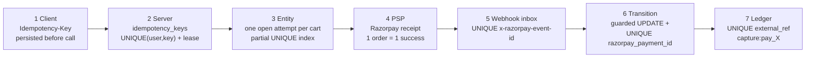
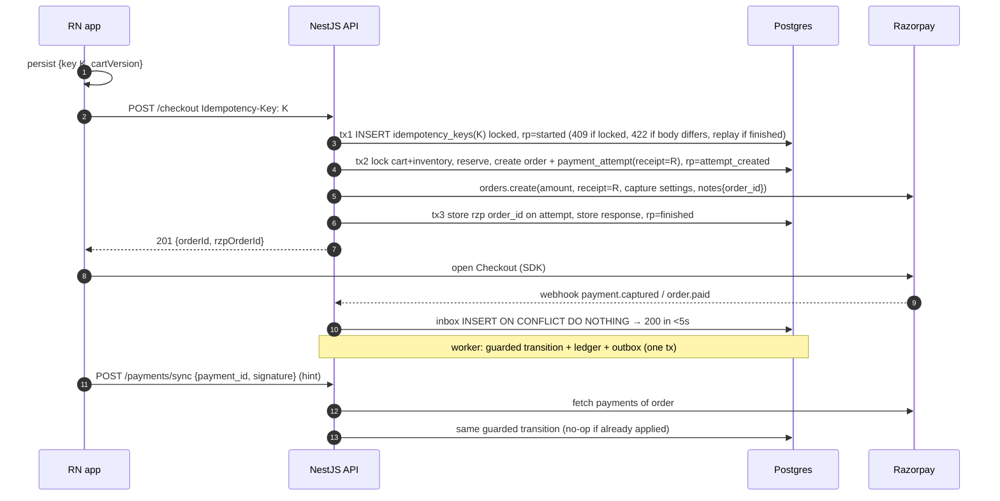
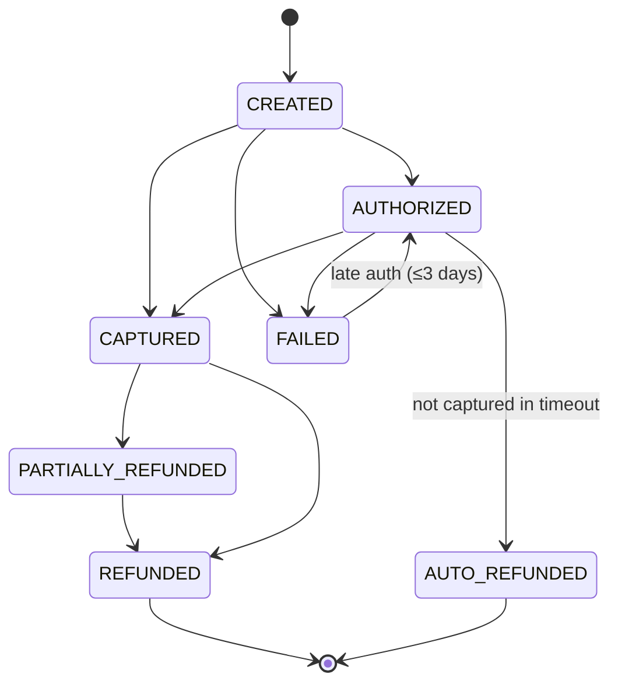
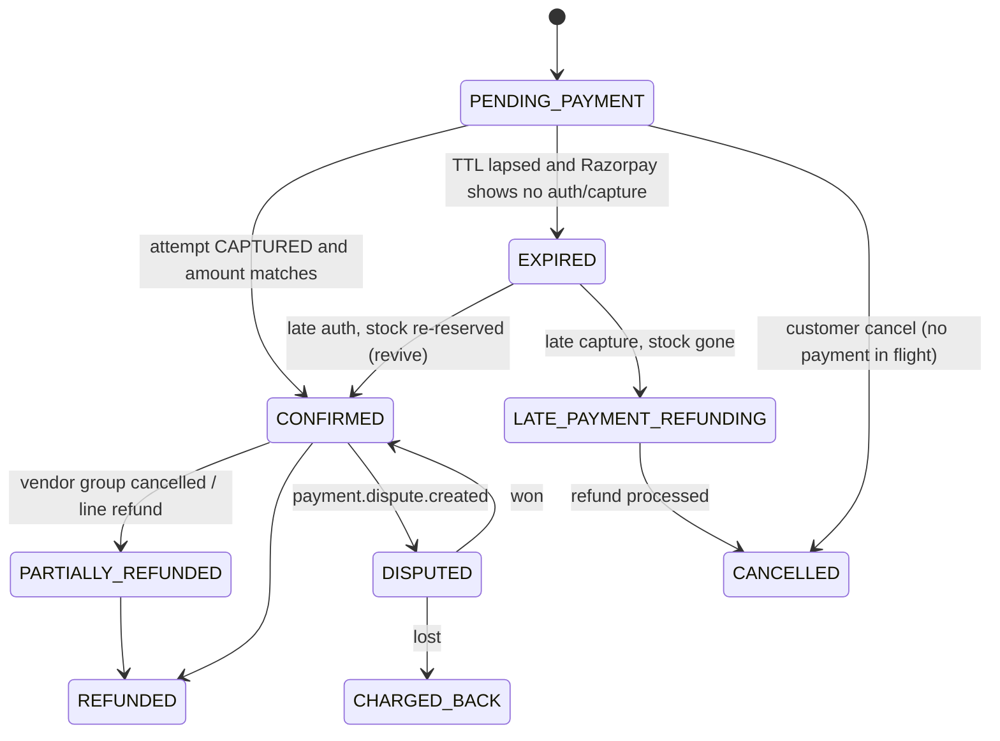
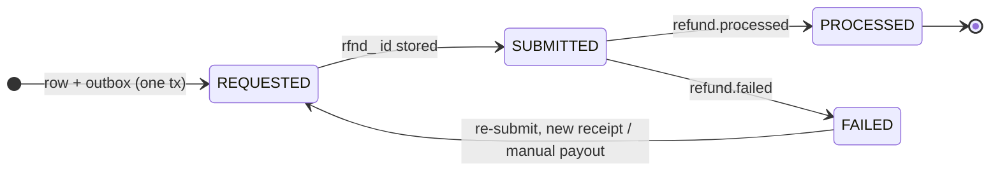
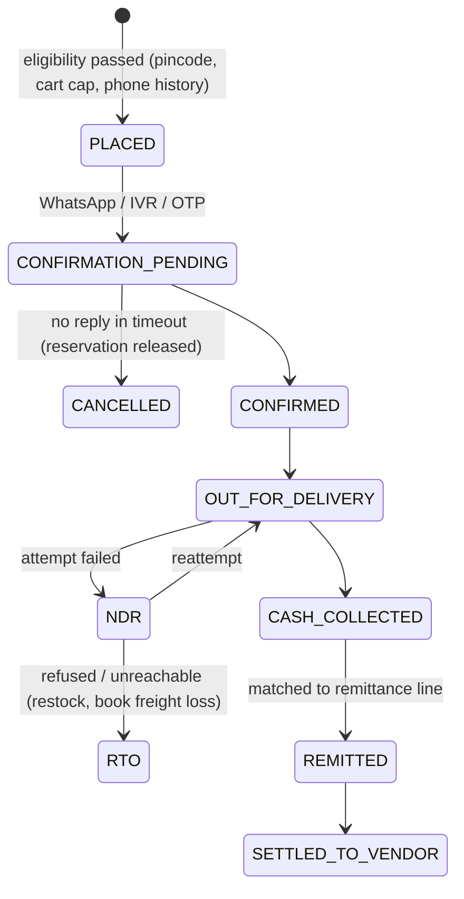
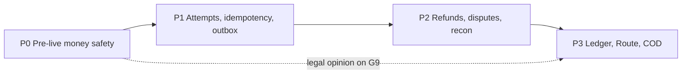

# Make every rupee move exactly once

Golden Abode's checkout already gets the hard _local_ parts right. It never holds a DB transaction open across the Razorpay call. It locks cart and inventory rows. Every status change is a guarded compare-and-set. The webhook HMAC is checked over the raw body, and only the webhook confirms an order. Where it falls short of production grade is that it is a **single-path system**: one webhook, one status column, and no durable record of what Razorpay was asked or what it answered. A production design adds six things. The first is **layered idempotency**: a client `Idempotency-Key`, then a server key table with recovery points, then Razorpay `receipt`, then an event-id inbox, then unique payment ids, then a ledger `external_ref`. The others are separate state machines for Order, PaymentAttempt and Refund; webhooks treated as hints that fetch-and-reconcile jobs confirm; side effects routed through an outbox; an append-only ledger; and COD as its own payment rail. The worst current gaps are **money-correctness bugs, not scale problems**. A capture that lands after the 20-minute sweep leaves the customer charged on a `cancelled` order with no API refund path, and Razorpay's default auto-capture window is 3 days, so this can happen. If a refund's HTTP response is lost, the order reverts to `confirmed` even though the money has gone. With no event-id dedup, no unique constraints and no reconciliation, a missed webhook loses paid orders silently, and Razorpay _disables_ an endpoint after 24h of failures. There is also a regulatory gap. Under RBI's 2025 Payment Aggregator Master Direction, prepaid money owed to vendors should flow through Razorpay Route linked accounts, not through the current manual payouts from the platform's own account. COD sits outside PA escrow entirely and needs its own state machine and ledger path. The recommended build runs in four phases: **P0** pre-live money safety, **P1** attempts, idempotency and outbox, **P2** reconciliation, refunds and disputes, and **P3** ledger, Route and COD.

---

## Duplicates enter through five doors, and each needs its own lock

TCP retries, DB transactions and the PSP's own guarantees cannot rule out duplicates by themselves. Kleppmann's end-to-end argument is that only an operation id carried through every layer and enforced by a uniqueness constraint can do that ([Allegro Tech](https://blog.allegro.tech/2025/12/transactions-arent-enough.html)). Airbnb's Orpheus states the goal precisely: when a money-moving call is made many times, **money moves at most once** ([Airbnb Engineering](https://medium.com/airbnb-engineering/avoiding-double-payments-in-a-distributed-payments-system-2981f6b070bb)). Each layer below catches a duplicate the layer above cannot see, so the design needs all of them.



### Where duplicates come from, and which layer stops each

| #   | Source of duplicate                                           | Concrete case in our stack                                                                                                         | Layer that stops it                                                                                                                                                               | Golden Abode today                                                                                                                                                                                     |
| --- | ------------------------------------------------------------- | ---------------------------------------------------------------------------------------------------------------------------------- | --------------------------------------------------------------------------------------------------------------------------------------------------------------------------------- | ------------------------------------------------------------------------------------------------------------------------------------------------------------------------------------------------------ |
| D1  | Double tap or double submit                                   | User taps "Place order" twice                                                                                                      | Disabled button (UX only) plus a server lease that returns 409 while the request is in flight                                                                                     | Cart `FOR UPDATE`; the second call gets 400 "cart is empty" ([checkout.service.ts:186-233](../apps/backend/src/modules/orders/checkout.service.ts))                                                    |
| D2  | Retry after a lost response                                   | `POST /checkout` times out on a 3G network and the app retries                                                                     | The same key is replayed and the server returns the **stored response**                                                                                                           | **Broken.** The retry gets "cart is empty" and has no way to find the order it created ([checkout.dto.ts:4-17](../apps/backend/src/modules/orders/dto/checkout.dto.ts))                                |
| D3  | Client mints a new key per retry, or two devices share a cart | App restart, or tablet and phone open at once                                                                                      | Entity-level guard: partial unique index "one open attempt per cart"                                                                                                              | Cart lock covers this by accident                                                                                                                                                                      |
| D4  | Server retries the PSP call                                   | Our 15s `Promise.race` fires, but Razorpay created the order anyway                                                                | Phase split plus a stable `receipt`. On an uncertain outcome, never show the customer a second order                                                                              | `receipt = order.id`, but the timeout doesn't abort the request and the orphan order is left ([razorpay-provider.service.ts:64-86](../apps/backend/src/modules/payments/razorpay-provider.service.ts)) |
| D5  | Two Razorpay orders for one cart, both paid                   | A new order is created on retry and an old UPI intent completes late                                                               | Reuse one Razorpay order per attempt. A cart-level "one paid attempt" index refunds the surplus                                                                                   | Re-pay reuses `razorpayOrderId` (good) ([usePlaceOrder.ts:27-35](../apps/mobile/src/hooks/payments/usePlaceOrder.ts))                                                                                  |
| D6  | Second payment on the same, already-paid Razorpay order       | Late authorisation of an earlier attempt                                                                                           | Razorpay **auto-refunds it immediately** ([Razorpay Auto-refunds](https://razorpay.com/docs/payments/refunds/auto-refunds)). We must not fulfil twice                             | Second payment id never recorded ([webhooks.controller.ts:139-151](../apps/backend/src/modules/orders/webhooks.controller.ts))                                                                         |
| D7  | Webhook redelivery                                            | Razorpay is at-least-once and resends anything not acked within **5s** ([Razorpay FAQs](https://razorpay.com/docs/webhooks/faqs/)) | `INSERT … ON CONFLICT (event_id) DO NOTHING`                                                                                                                                      | Guarded UPDATE prevents double confirmation, but every redelivery inserts another `payment_events` row and `x-razorpay-event-id` is never read                                                         |
| D8  | Callback and webhook both say "paid"                          | Client verify and webhook race                                                                                                     | Both paths call **one** idempotent transition function                                                                                                                            | No verify path exists (by design, [0041:119-121](../docs/decisions/0041-cart-owner-reservation-and-real-instock.md))                                                                                   |
| D9  | Duplicate refund                                              | Admin double-click, or a retry after a timeout                                                                                     | Refund `receipt` (Razorpay treats it as an idempotency key per payment) plus fetch-before-retry ([Razorpay Refunds API](https://razorpay.com/docs/api/refunds/create-instant.md)) | Claim-before-call blocks the double-click. A **retry after a lost response is unsafe**                                                                                                                 |
| D10 | Replica lag hides the first write                             | A retry reads a stale replica and charges again                                                                                    | Read idempotency state from the **primary** ([Airbnb](https://medium.com/airbnb-engineering/avoiding-double-payments-in-a-distributed-payments-system-2981f6b070bb))              | Single DB, so not yet relevant                                                                                                                                                                         |

### Client keys: one per checkout attempt, persisted before the first byte leaves

Stripe saves the status code and body of the first request for a key, **500s included**, and replays them on retry. It rejects a reused key whose parameters differ with `idempotency_error`, answers 409 to a concurrent in-flight duplicate without caching it, and keeps keys at least 24h ([Stripe API](https://docs.stripe.com/api/idempotent_requests)). The IETF draft standardises the status codes: **400** for a missing key, **422** for a key reused with a different payload, and **409** for one still in flight. It lists Razorpay among its implementers ([IETF draft-08](https://datatracker.ietf.org/doc/draft-ietf-httpapi-idempotency-key-header/)). Airbnb adds the client's side of the contract: persist the key _before_ calling, never change the payload between retries, and back off with jitter ([Airbnb](https://medium.com/airbnb-engineering/avoiding-double-payments-in-a-distributed-payments-system-2981f6b070bb)).

| Choice       | Option chosen                                                                              | Rejected alternative   | Why                                                                                                                                      |
| ------------ | ------------------------------------------------------------------------------------------ | ---------------------- | ---------------------------------------------------------------------------------------------------------------------------------------- |
| Key scope    | **Per checkout attempt** (UUID minted on the "Place order" tap, stored with `cartVersion`) | Per cart               | A per-cart key blocks a legitimate re-pay after a definitive failure, and a changed cart changes the body, which produces a 422 mismatch |
| Storage      | AsyncStorage/secure storage, written **before** `POST /checkout`                           | In-memory              | Survives the app being killed mid-UPI-intent. On cold start the app calls a status endpoint before showing Pay again                     |
| Cleared when | A definitive response arrives (201 with order, or a 4xx validation error)                  | After each attempt     | Airbnb: nullify the key only after the success has been consumed                                                                         |
| Server scope | `UNIQUE(customer_id, key)`                                                                 | Global uniqueness      | Brandur scopes keys per user so different accounts can't collide ([brandur.org](https://brandur.org/idempotency-keys))                   |
| Retention    | 72h, with a reaper                                                                         | 24h                    | Gives time to complete a Friday bug on Monday ([brandur.org](https://brandur.org/idempotency-keys))                                      |
| Not stored   | Requests that fail validation before execution                                             | Caching every response | Stripe doesn't cache pre-execution errors, so they can be retried ([Stripe](https://docs.stripe.com/error-low-level))                    |

### Server dedup: checkout split into atomic phases around the one foreign call

Brandur's rule is that each foreign state mutation is its own phase. Local writes between foreign calls commit as one transaction, and the key row records a **recovery point** so a retry resumes rather than restarts ([brandur.org](https://brandur.org/idempotency-keys)). Orpheus enforces the same split as _Pre-RPC / RPC / Post-RPC_. Airbnb found that network calls inside DB transactions caused "rapid connection pool exhaustion" ([Airbnb](https://medium.com/airbnb-engineering/avoiding-double-payments-in-a-distributed-payments-system-2981f6b070bb)). Our two-phase checkout is already half of this. What it lacks is the key row that makes a crash or a retry resumable.



| Recovery point      | Committed state                                                    | On retry or completer pick-up                                                                                                                                                                                                                                                                                 |
| ------------------- | ------------------------------------------------------------------ | ------------------------------------------------------------------------------------------------------------------------------------------------------------------------------------------------------------------------------------------------------------------------------------------------------------- |
| `started`           | Key row only                                                       | Run tx2                                                                                                                                                                                                                                                                                                       |
| `attempt_created`   | Order, attempt and reservation exist; Razorpay outcome **unknown** | Call `orders.create` with the same receipt. On "Duplicate request" (400), mark the attempt `abandoned` and create a fresh attempt with a new receipt. The orphan Razorpay order's id never reached the customer, so it can't be paid ([failure catalogue T1/T2](https://razorpay.com/docs/api/orders/create)) |
| `rzp_order_created` | Razorpay order id stored                                           | Build and store the response                                                                                                                                                                                                                                                                                  |
| `finished`          | Response stored                                                    | Replay the stored response                                                                                                                                                                                                                                                                                    |

### PSP side: Razorpay's `receipt` is the only idempotency handle on Orders

Razorpay Orders has **no idempotency header**. The current docs say `receipt` (≤40 ASCII chars) "has to be unique" and is "treated as an idempotency key". A second create with the same receipt is **rejected** with 400 "Duplicate request", not replayed ([Razorpay Create Order](https://razorpay.com/docs/api/orders/create)). One Razorpay order binds a **single successful payment**. Once it is `paid`, no further payments are allowed, and a late-authorised earlier attempt is auto-refunded ([Razorpay Orders](https://razorpay.com/docs/payments/orders/)). Two points are still unverified and need a test-mode check before going live. First, older community material treated `receipt` as free-form and unenforced. Second, Razorpay contradicts itself on whether an order can be reused after a failed attempt. The Create Order page says "you must create a new Order", while the Orders overview and UPI Intent docs allow re-initiation on the same order ([Create Order](https://razorpay.com/docs/api/orders/create); [UPI Intent](https://razorpay.com/docs/payments/payment-gateway/s2s-integration/payment-methods/upi/intent)). The conservative design is to reuse the order for in-session Checkout retries and UPI re-initiation, mint a new attempt only after a _definitive_ failure, and keep the cart-level surplus-refund guard as a backstop.

### Webhook dedup: event id first, payment id second

`x-razorpay-event-id` "is unique per event" and stays the same across redeliveries ([Razorpay Validate & Test](https://razorpay.com/docs/webhooks/validate-test/)). Stripe adds a subtlety that also applies here: _distinct_ events can describe the same fact, for example both `order.paid` and `payment.captured` fire for one capture ([Razorpay Orders webhooks](https://razorpay.com/docs/webhooks/orders/)). Event-id dedup therefore stops redeliveries, and the `UNIQUE(razorpay_payment_id)` plus guarded-transition layer stops semantically duplicate events. Hookdeck's ordering is the right one: INSERT first, do side effects after, and treat Postgres `23505` as a silent 2xx ([Hookdeck](https://hookdeck.com/webhooks/guides/implement-webhook-idempotency)).

---

## Order, attempt and refund need three state machines, not one status column

Today one `orders.status` string with four values carries payment, fulfilment and refund meaning at once, with no CHECK constraint ([migration 20261008090003](../apps/backend/database/migrations/20261008090003-create-orders-domain.js)). Razorpay separates the Order (intent) from the Payment (an attempt; many per order), and Stripe's PaymentIntent records many attempts under one intent ([Razorpay Orders](https://razorpay.com/docs/payments/orders/); [Stripe lifecycle](https://docs.stripe.com/payments/paymentintents/lifecycle)). Mirroring that split is the main structural change. It also gives every late or duplicate event a row to land on instead of being dropped.

### PaymentAttempt mirrors Razorpay's `pay_…` lifecycle, including late authorisation

Razorpay marks a payment with no bank response `failed` after **10 minutes**. It then polls the bank for **3 days** and may flip the payment to `authorized`. This affects **under 0.5%** of payments ([Razorpay Late Authorisation](https://razorpay.com/docs/payments/payments/late-authorisation)). An `authorized` payment that isn't captured within the capture timeout is auto-refunded ([Razorpay About Payments](https://razorpay.com/docs/payments/payments/)). Webhook payloads are snapshots and arrive out of order, so a `payment.authorized` can carry a `captured` entity ([Razorpay Payments webhooks](https://razorpay.com/docs/webhooks/payments/)).



### Order is our business state, and refunds and disputes live beside it

Razorpay's order stays `paid` even after a refund ([Razorpay Orders](https://razorpay.com/docs/payments/orders/)), so refund and dispute state must live in our own tables.





### One transition function, guarded at the row, shared by every caller

Under Read Committed, a concurrent `UPDATE` re-evaluates its `WHERE` against the committed row, so `UPDATE … WHERE status = ANY(:allowedFrom)` is a safe compare-and-set ([PostgreSQL isolation](https://www.postgresql.org/docs/current/transaction-iso.html)). Every caller (webhook worker, sync endpoint, poller, sweeper, admin) goes through `applyTransition(entity, to, cause)`. It updates with the allowed-from guard, writes a `payment_state_transitions` audit row in the same transaction, and when 0 rows change it logs and acks without throwing. That makes handlers **order-insensitive without distributed locks**. Terminal states absorb stale events, and the explicit `FAILED → AUTHORIZED` edge is the only allowed move backwards.

### Target schema (Postgres, Sequelize migrations)

```sql
CREATE TABLE idempotency_keys (
  id UUID PRIMARY KEY, customer_id UUID NOT NULL, key TEXT NOT NULL CHECK (char_length(key) <= 100),
  request_path TEXT NOT NULL, request_hash TEXT NOT NULL, locked_at TIMESTAMPTZ,
  recovery_point TEXT NOT NULL DEFAULT 'started', response_code INT, response_body JSONB,
  order_id UUID, created_at TIMESTAMPTZ NOT NULL DEFAULT now(), UNIQUE (customer_id, key));

CREATE TABLE payment_attempts (
  id UUID PRIMARY KEY, order_id UUID NOT NULL REFERENCES orders, method TEXT NOT NULL,      -- 'razorpay' | 'cod'
  amount_paise BIGINT NOT NULL CHECK (amount_paise > 0), currency CHAR(3) NOT NULL DEFAULT 'INR',
  receipt TEXT NOT NULL UNIQUE, razorpay_order_id TEXT UNIQUE,
  status TEXT NOT NULL CHECK (status IN ('created','pending','paid','failed','expired','abandoned')),
  expires_at TIMESTAMPTZ NOT NULL, created_at TIMESTAMPTZ NOT NULL DEFAULT now());
CREATE UNIQUE INDEX one_open_attempt_per_order ON payment_attempts(order_id) WHERE status IN ('created','pending');
CREATE UNIQUE INDEX one_paid_attempt_per_order ON payment_attempts(order_id) WHERE status = 'paid';

CREATE TABLE razorpay_payments (                       -- every pay_… ever seen
  razorpay_payment_id TEXT PRIMARY KEY, attempt_id UUID NOT NULL REFERENCES payment_attempts,
  status TEXT NOT NULL, method TEXT, amount_paise BIGINT NOT NULL, captured BOOLEAN NOT NULL,
  fee_paise BIGINT, tax_paise BIGINT, raw JSONB NOT NULL, updated_at TIMESTAMPTZ NOT NULL);

CREATE TABLE webhook_inbox (
  event_id TEXT PRIMARY KEY, event_type TEXT NOT NULL, payload JSONB NOT NULL,
  received_at TIMESTAMPTZ NOT NULL DEFAULT now(), status TEXT NOT NULL DEFAULT 'received',
  attempts INT NOT NULL DEFAULT 0, processed_at TIMESTAMPTZ, last_error TEXT);  -- no FK, no cascade

CREATE TABLE refunds (
  id UUID PRIMARY KEY, razorpay_payment_id TEXT NOT NULL REFERENCES razorpay_payments,
  order_vendor_group_id UUID, amount_paise BIGINT NOT NULL CHECK (amount_paise > 0),
  receipt TEXT NOT NULL UNIQUE, razorpay_refund_id TEXT UNIQUE, reason TEXT NOT NULL,
  status TEXT NOT NULL CHECK (status IN ('requested','submitted','processed','failed')),
  speed_requested TEXT, speed_processed TEXT, acquirer_ref TEXT, created_at TIMESTAMPTZ NOT NULL DEFAULT now());

CREATE TABLE payment_state_transitions (id BIGSERIAL PRIMARY KEY, entity TEXT, entity_id TEXT,
  from_status TEXT, to_status TEXT, cause TEXT, cause_ref TEXT, at TIMESTAMPTZ DEFAULT now());

CREATE TABLE outbox (id BIGSERIAL PRIMARY KEY, event_type TEXT NOT NULL, aggregate_id TEXT NOT NULL,
  dedupe_key TEXT UNIQUE, payload JSONB NOT NULL, available_at TIMESTAMPTZ NOT NULL DEFAULT now(),
  attempts INT NOT NULL DEFAULT 0, published_at TIMESTAMPTZ);
```

The partial unique indexes are keyed on `order_id` rather than cart. In our model the cart is cleared at checkout and the order already represents the purchase ([checkout.service.ts:487-491](../apps/backend/src/modules/orders/checkout.service.ts)). "Two paid attempts for one order" is the condition that triggers a surplus refund.

---

## Thirty failure scenarios collapse into four rules

Each scenario below comes from Razorpay's documented behaviour, our code, or both. Four rules resolve every one of them. **(R1)** Persist intent before a foreign call and the outcome after it, never holding a DB transaction across it. **(R2)** Every state change goes through the guarded transition function. **(R3)** The client is a hint, the webhook is a fast signal, and fetch/reconcile is the truth. **(R4)** Any money that arrives without a payable order gets revived or refunded automatically, never just logged.

### In-doubt and timeout states

| #   | Scenario                                                      | What we observe                                                    | Correct handling                                                                                                                                                                     | Rule | Today                                                                                                                                                                                                                         |
| --- | ------------------------------------------------------------- | ------------------------------------------------------------------ | ------------------------------------------------------------------------------------------------------------------------------------------------------------------------------------ | ---- | ----------------------------------------------------------------------------------------------------------------------------------------------------------------------------------------------------------------------------- |
| T1  | Timeout on `orders.create`                                    | No order id                                                        | Retry with the same receipt from `attempt_created`. An orphan order is harmless because its id was never shown                                                                       | R1   | Compensates and cancels, rethrows. The request isn't aborted                                                                                                                                                                  |
| T2  | Crash between Phase-1 commit and `order.save()`               | `pending_payment` with no `razorpay_order_id`, stock held          | The completer resumes from the recovery point                                                                                                                                        | R1   | Recovers only through the 20-min sweep ([current_implementation Q1](../apps/backend/src/modules/orders/checkout.service.ts))                                                                                                  |
| T3  | App killed after OTP or UPI PIN                               | No SDK callback, payment `created`, later `failed` or `authorized` | Don't cancel on dismiss. On resume call `/payments/sync`, which fetches from Razorpay                                                                                                | R3   | Polls about 60s, then shows a warning                                                                                                                                                                                         |
| T4  | Bank success, client callback lost                            | Webhook arrives without a client call                              | The webhook alone confirms                                                                                                                                                           | R3   | ✅                                                                                                                                                                                                                            |
| T5  | Webhook never arrives (endpoint down >24h means **disabled**) | Paid order stuck `pending_payment`                                 | Stuck-pending poller plus an alert on non-2xx ([Razorpay Best Practices](https://razorpay.com/docs/webhooks/best-practices/))                                                        | R3   | **No poller.** The sweep cancels a paid order                                                                                                                                                                                 |
| T6  | **Late capture after we cancelled**                           | `payment.captured` on a `cancelled` order                          | Revive if stock can be re-reserved, else refund through the API, then alert                                                                                                          | R4   | **Log only.** Customer charged, no refund path ([webhooks.controller.ts:71-84](../apps/backend/src/modules/orders/webhooks.controller.ts), [orders.service.ts:445-447](../apps/backend/src/modules/orders/orders.service.ts)) |
| T7  | Client sync races the webhook                                 | Two confirm calls                                                  | One guarded transition plus a unique payment id                                                                                                                                      | R2   | n/a                                                                                                                                                                                                                           |
| T8  | Refund call times out                                         | Unknown whether the refund exists                                  | Retry with the same refund receipt. On "already processed", fetch refunds and adopt the `rfnd_` id ([Razorpay Refunds API](https://razorpay.com/docs/api/refunds/create-instant.md)) | R1   | **Reverts to `confirmed`** while the money has gone ([orders.service.ts:466-481](../apps/backend/src/modules/orders/orders.service.ts))                                                                                       |
| T9  | Crash after the refund claim, before the API call             | `refunded` with no refund issued                                   | Refund row plus outbox: the worker retries                                                                                                                                           | R1   | Stuck forever                                                                                                                                                                                                                 |

### Method-specific failures (India)

| #   | Scenario                                               | Handling                                                                                                                                         | Notes                                                                                                                                                                                                                                                                                                                                                                                                 |
| --- | ------------------------------------------------------ | ------------------------------------------------------------------------------------------------------------------------------------------------ | ----------------------------------------------------------------------------------------------------------------------------------------------------------------------------------------------------------------------------------------------------------------------------------------------------------------------------------------------------------------------------------------------------- |
| U1  | UPI intent: no UPI app, or user returns without paying | Keep the order pending and retry on the **same** Razorpay order                                                                                  | Re-initiation is allowed unless the order is `authorized`/`paid` ([Razorpay Orders](https://razorpay.com/docs/payments/orders/))                                                                                                                                                                                                                                                                      |
| U2  | UPI pending for minutes                                | Show a pending screen. Don't offer an immediate re-pay with a _new_ order                                                                        | Razorpay: re-initiate only if not `paid` within 2–3 min ([Razorpay UPI Collect](https://razorpay.com/docs/payments/payment-gateway/s2s-integration/payment-methods/upi/collect/)). NPCI reportedly allows status checks only after **90s**, at most **3 in 2h** ([MediaNama](https://www.medianama.com/2025/05/223-npci-banks-balance-upi-transaction-guidelines/)), so our poll backs off in minutes |
| U3  | "Debited but failed"                                   | Show TAT messaging and keep watching for late auth                                                                                               | UPI P2M auto-reversal is T+5 with ₹100/day compensation after that ([RBI](https://www.rbi.org.in/Commonperson/english/scripts/Notification.aspx?Id=3074))                                                                                                                                                                                                                                             |
| U4  | Paid from another UPI app or device                    | Nothing special: the order id binds the payment                                                                                                  | Webhook confirmation covers it                                                                                                                                                                                                                                                                                                                                                                        |
| C1  | Wrong OTP or 3DS failure                               | Checkout re-displays for retry ([Razorpay Integration](https://razorpay.com/docs/payments/payment-gateway/quick-integration/integration-steps/)) | `payment.failed` leaves the order payable (current behaviour is correct)                                                                                                                                                                                                                                                                                                                              |
| C2  | Back button after OTP                                  | Late auth path (T3/T6)                                                                                                                           | Razorpay names this as a cause ([Late Auth](https://razorpay.com/docs/payments/payments/late-authorisation))                                                                                                                                                                                                                                                                                          |
| C3  | Issuer or bank downtime                                | Hide or flag the method using `payment.downtime.*` webhooks and the Downtime API ([Razorpay Webhooks](https://razorpay.com/docs/webhooks/all))   | Circuit breaker per method/bank, as Shopify scopes per country ([Shopify](https://shopify.engineering/building-resilient-payment-systems))                                                                                                                                                                                                                                                            |
| N1  | Netbanking abandoned on the bank page                  | Pending, then expire, then the late auth watch                                                                                                   |                                                                                                                                                                                                                                                                                                                                                                                                       |
| L1  | Cart over ₹1 lakh paid by UPI                          | Show the UPI limit and steer to card or netbanking                                                                                               | P2M default is ₹1 lakh. The ₹5 lakh categories don't include home goods ([Outlook Money](https://www.outlookmoney.com/banking/npci-changes-upi-transaction-limits-for-key-categories-from-september-15-2025-know-the-details))                                                                                                                                                                        |

### Our own infrastructure and races

| #   | Scenario                             | Handling                                                                  | Today                                                                                                                                                                                              |
| --- | ------------------------------------ | ------------------------------------------------------------------------- | -------------------------------------------------------------------------------------------------------------------------------------------------------------------------------------------------- |
| I1  | DB write fails after a valid capture | Webhook retry and poller re-drive the same transition                     | Webhook retry only                                                                                                                                                                                 |
| I2  | Deploy kills a pod mid-webhook       | No 2xx, so Razorpay retries. Handlers are idempotent                      | ✅ (guarded UPDATE)                                                                                                                                                                                |
| I3  | Worker dies after the 2xx ack        | Raw event is already in the inbox and gets reprocessed                    | n/a (processing is inline)                                                                                                                                                                         |
| I4  | Sweep races `payment.authorized`     | Sweep fetches Razorpay payments before expiring. Any auth or capture wins | **Sweep never asks Razorpay** ([orders.service.ts:272-279](../apps/backend/src/modules/orders/orders.service.ts))                                                                                  |
| I5  | Out-of-order webhooks                | Monotonic guard. Never `CAPTURED → FAILED`                                | Guard exists for capture only                                                                                                                                                                      |
| I6  | Clock skew between app and DB        | `expires_at` computed with the DB `now()`                                 | Uses `createdAt` vs app time                                                                                                                                                                       |
| I7  | Notification throws after commit     | Outbox row, retried independently                                         | **Lost forever**: the 5xx makes Razorpay redeliver, the UPDATE no-ops, and the notification is skipped ([webhooks.controller.ts:85-93](../apps/backend/src/modules/orders/webhooks.controller.ts)) |
| I8  | Reservation counter drift            | `GREATEST(…,0)` clamp everywhere                                          | `releaseAndCancel` doesn't clamp, so `CHECK >= 0` could wedge the sweep for that order                                                                                                             |
| I9  | Webhook handler slower than 5s       | Ack fast and process asynchronously                                       | Inline notifications put this at risk under load                                                                                                                                                   |

### Fraud and abuse

| #   | Scenario                   | Handling                                                                                                                                                                                                       | Today                                             |
| --- | -------------------------- | -------------------------------------------------------------------------------------------------------------------------------------------------------------------------------------------------------------- | ------------------------------------------------- |
| F1  | Tampered amount in the app | Server computes the amount. On confirm, assert `payment.amount == attempt.amount_paise` and the order id matches                                                                                               | Server amount ✅. **No confirm-time check**       |
| F2  | Forged success callback    | HMAC of `stored_order_id` + "\|" + `payment_id` with the key secret, **plus** a fetch ([Razorpay Integration](https://razorpay.com/docs/payments/payment-gateway/web-integration/standard/integration-steps/)) | No callback path, so not exposed                  |
| F3  | Forged webhook             | HMAC over the **raw** body with the webhook secret (not the API secret) ([Razorpay FAQs](https://razorpay.com/docs/webhooks/faqs/))                                                                            | ✅ ([main.ts:12-21](../apps/backend/src/main.ts)) |
| F4  | Replayed old webhook       | Razorpay signatures carry no timestamp, so dedup by event id plus terminal-state absorption                                                                                                                    | Partial                                           |
| F5  | Chargeback                 | On `payment.dispute.created`, freeze the vendor payout and gather evidence before `respond_by` ([Razorpay Disputes](https://razorpay.com/docs/webhooks/disputes))                                              | Ignored                                           |

### Align the timers so late money lands harmlessly

The sharpest single design choice is timer alignment. Razorpay's default is **auto-capture for 3 days** ([Capture Settings](https://razorpay.com/docs/payments/payments/capture-settings)), while our reservation dies at 20–25 minutes, so any late authorisation becomes _captured money on a dead order_. Refunding a captured payment costs us the MDR plus GST, because Razorpay keeps them on refunds ([Normal Refunds](https://razorpay.com/docs/payments/refunds/normal.md)). An **uncaptured** payment that gets auto-refunded carries no fee and stays out of settlement ([Auto-refunds](https://razorpay.com/docs/payments/refunds/auto-refunds)). Capture settings can be passed per order through the Orders API and override the Dashboard. The minimum is **12 minutes** ([Capture Settings](https://razorpay.com/docs/payments/payments/capture-settings)). Razorpay's own example is a 20-minute timeout that "will automatically fail any payment that is authorized later than 20 minutes and will automatically initiate a refund" ([Razorpay Blog](https://razorpay.com/blog/capture-settings-manage-failed-transactions/)).

```
t=0 attempt created ─┬─ Checkout `timeout` option (SDK unusable after) ............ < TTL
                     ├─ Razorpay marks no-response payment `failed` ................ 10 min
                     ├─ auto-capture timeout (per order, ≥12 min) ................ ≈ TTL (20 min)
                     ├─ attempt.expires_at = reservation TTL (from LAST attempt) ... 20 min
                     ├─ sweeper grace: fetch Razorpay, then expire ................. TTL + buffer
                     ├─ manual-capture window: revive-and-capture if stock free .... > sweeper grace
                     └─ late-auth watch (poller keeps checking) .................... ≤ 3 days
```

With these timers, a payment authorised inside the hold is auto-captured and confirms normally. One authorised after the hold stays `authorized`. Our handler then either re-reserves stock and captures through the API (revive), or does nothing and Razorpay auto-refunds it at no fee. Only a capture that slips through anyway (a misconfiguration, or a resume started late) reaches the R4 API-refund path, which remains as defence in depth. **Uncertainty:** the API parameter names for per-order capture settings, and whether capturing an already-captured payment is idempotent, weren't verified. Both belong on the test-mode checklist.

### Retry-safety matrix for Razorpay calls

| Call                                                | Auto-retry?                                                                                                                                                         | Guard                                                            |
| --------------------------------------------------- | ------------------------------------------------------------------------------------------------------------------------------------------------------------------- | ---------------------------------------------------------------- |
| Fetch payment / order / payments-of-order / refunds | Yes, with capped backoff and jitter ([AWS Builders' Library](https://builder.aws.com/content/3EumjoZascWd1oZiEgL8ORlv3qE/timeouts-retries-and-backoff-with-jitter)) | None needed                                                      |
| `orders.create`                                     | Yes, from the recovery point                                                                                                                                        | Same receipt. A duplicate means abandon and create a new attempt |
| Capture                                             | Only after a fetch                                                                                                                                                  | Unverified idempotency                                           |
| Refund                                              | Only with the same receipt, after fetching refunds                                                                                                                  | A blind retry risks a double refund                              |
| "Another operation in progress" (400)               | Wait a few seconds, fetch, then retry ([Razorpay](https://razorpay.com/docs/api/orders/create))                                                                     |                                                                  |

Retry at a single layer, budget retries with a token bucket, and open a circuit breaker on create-order. While the circuit is open, show "payments temporarily unavailable, your cart is saved" ([AWS](https://builder.aws.com/content/3EumjoZascWd1oZiEgL8ORlv3qE/timeouts-retries-and-backoff-with-jitter); [Shopify](https://shopify.engineering/building-resilient-payment-systems)). Shopify starts from a 1s open timeout and a 5s read timeout. Our 15s create-order race and the _missing_ refund timeout both deserve a second look.

---

## Webhooks are hints; reconciliation is the truth

Razorpay is explicit that webhooks aren't sufficient on their own: "For business-critical, synchronous use cases, you may choose to poll our payment APIs as well" ([Razorpay Best Practices](https://razorpay.com/docs/webhooks/best-practices/)). Its operating limits make an independent record mandatory. Delivery logs cover only **3 hours**, replay needs a support ticket for events **≤15 days** old, and bulk replay is not possible ([Razorpay FAQs](https://razorpay.com/docs/webhooks/faqs/)). Shopify gives the same advice: "use reconciliation jobs to periodically fetch data" ([Shopify](https://shopify.dev/docs/apps/build/webhooks)).

```mermaid
flowchart LR
  RZ[Razorpay] -->|POST raw body| C[Controller<br/>timingSafeEqual HMAC]
  C -->|INSERT ON CONFLICT DO NOTHING| IN[(webhook_inbox)]
  C -->|200 < 5s| RZ
  IN -->|FOR UPDATE SKIP LOCKED| W[Inbox worker<br/>@Cron / loop]
  W -->|fetch-before-process| API[Razorpay Fetch APIs]
  W --> T{{applyTransition}}
  P[Stuck-pending poller<br/>every 5 min] --> T
  S[POST /payments/sync<br/>client hint] --> T
  SW[Expiry sweeper] --> T
  T --> DB[(attempts / orders /<br/>ledger / outbox) one tx]
  DB --> O[Outbox relay] --> N[Notifications · refunds · transfers]
```

The worker re-fetches the payment before applying it. This deals with stale snapshot payloads and out-of-order delivery in one move, because the authoritative state comes from the API and not from the event. The worker runs on `SELECT … FOR UPDATE SKIP LOCKED`, which Postgres documents as the way to let several consumers share a queue-like table ([PostgreSQL SELECT](https://www.postgresql.org/docs/current/sql-select.html)). Keeping this on Postgres and `@nestjs/schedule` is consistent with decision 0049, which rejected BullMQ and Redis because guarded updates already make concurrent sweeps safe ([0049](../docs/decisions/0049-stale-reservation-sweep.md)). The subscription set is: `payment.authorized`, `payment.captured`, `order.paid`, `payment.failed`, `refund.created/processed/failed/speed_changed`, `payment.dispute.*` and `payment.downtime.*`, plus `payment.pending` if COD goes through Razorpay ([Razorpay All Webhooks](https://razorpay.com/docs/webhooks/all)).

### Three layers of reconciliation

| Layer                   | Cadence                                                               | Input                                                                                                                                                                                      | Matches                                                    | Breaks it catches                                                                                                                                                                         |
| ----------------------- | --------------------------------------------------------------------- | ------------------------------------------------------------------------------------------------------------------------------------------------------------------------------------------ | ---------------------------------------------------------- | ----------------------------------------------------------------------------------------------------------------------------------------------------------------------------------------- |
| L1 stuck-pending poller | Every ~5 min for attempts older than 15 min, then daily out to 3 days | `GET /v1/orders/:id/payments` ([Razorpay](https://razorpay.com/docs/api/orders/fetch-payments/))                                                                                           | Attempt status ↔ Razorpay payment status                   | Missed or disabled webhooks, late auth, abandoned UPI                                                                                                                                     |
| L2 PSP settlement recon | Daily (D+1)                                                           | `GET /v1/settlements/recon/combined`, ≤1000 rows/page, with `fee`, `tax`, `order_receipt`, `settlement_utr` ([Razorpay Recon API](https://razorpay.com/docs/api/settlements/fetch-recon/)) | Each payment, refund, adjustment and dispute line ↔ ledger | Captured-not-paid, paid-not-settled past T+2 (with slack for partial settlement ([Razorpay Settlements](https://razorpay.com/docs/payments/settlements/))), amount, fee and refund breaks |
| L3 bank recon           | Per settlement                                                        | Bank statement credit by `settlement_utr`                                                                                                                                                  | Settlement net ↔ bank credit                               | Failed settlements, frozen account                                                                                                                                                        |

Juspay's taxonomy is a good scheme for classifying breaks: Missing Source, Identity, Lifecycle, Amount, Fee, Timing, Currency, Duplicate, Bank and Restatement. Each match records the rule that produced it, and each exception gets an owner and an age ([Juspay](https://juspay.io/blog/payment-reconciliation-across-multiple-psps-architecture-that-proves-every-rupee)). Putting our order id in `receipt` and `notes` matters for this, because `order_receipt` comes back on recon rows and links them to our records.

### Alert before Razorpay gives up on us

| Signal                      | Alert threshold (initial)        | Why                                                                                                                                           |
| --------------------------- | -------------------------------- | --------------------------------------------------------------------------------------------------------------------------------------------- |
| Webhook non-2xx rate        | Sustained >0 for 15 min          | Razorpay disables the endpoint after 24h of failures                                                                                          |
| Webhook p95 latency         | >2s                              | Razorpay times out at 5s                                                                                                                      |
| Inbox backlog depth and age | Oldest unprocessed event >5 min  | Acked events are our responsibility                                                                                                           |
| Stuck-pending by age        | 15m / 1h / 24h / 3d buckets      | Late auth window                                                                                                                              |
| `FAILED→AUTHORIZED` rate    | ≫0.5%                            | Razorpay baseline is <0.5%                                                                                                                    |
| Captured-on-non-payable     | Any                              | R4 money we're holding                                                                                                                        |
| Recon breaks                | Any break older than T+2 + slack | Settlement integrity                                                                                                                          |
| Non-zero clearing accounts  | Any after settlement             | Stripe's ledger completeness check ([Stripe Ledger](https://stripe.dev/blog/ledger-stripe-system-for-tracking-and-validating-money-movement)) |

These thresholds are engineering inference from Razorpay's documented limits. No primary source in the research prescribes a payment metric set.

---

## Ledger, outbox and refunds turn side effects into rows

### The outbox closes the dual-write hole that currently loses notifications

"Update the DB, then call or publish" is a dual write. A send inside the transaction might belong to a transaction that never commits, and a send after commit might never happen because the process crashes first ([microservices.io outbox](https://microservices.io/patterns/data/transactional-outbox.html)). The fix is to write an `outbox` row in the **same** transaction as the state change, then have a relay deliver it. The relay can deliver twice, so consumers must be idempotent. Here that means the unique `dedupe_key` on the outbox and the refund receipt at Razorpay. In a modular monolith no broker is needed: the relay is a `SKIP LOCKED` poller that calls in-process handlers (push notification, vendor alert) or Razorpay (refund, transfer). Checkout as a whole is then an orchestrated **saga**: reserve, create the Razorpay order, then confirm and post to the ledger. The compensations are to release the reservation, or to refund when a late capture finds the stock gone. Our existing sweep already acts as the compensation timer ([microservices.io saga](https://microservices.io/patterns/data/saga.html)).

### An append-only double-entry ledger makes reconciliation a query

Stripe's Ledger is an immutable log where "transactions previously published … cannot be deleted or modified". It processes **5 billion events/day** and gives "over 99.9999% explainability of money movement". Its key check is a single query: clearing accounts with a non-zero balance ([Stripe Ledger](https://stripe.dev/blog/ledger-stripe-system-for-tracking-and-validating-money-movement)). Modern Treasury puts the reason directly: "Mutating balances directly creates a system that is prone to errors" ([Modern Treasury](https://www.moderntreasury.com/journal/accounting-for-developers-part-i)). For us it needs three tables: `ledger_accounts`, `ledger_transactions(external_ref UNIQUE)` and `ledger_entries(amount_paise BIGINT signed)`. A deferred constraint trigger enforces Σ=0 per transaction, and grants are revoked so rows can't be updated or deleted.

Illustrative ₹1,000 two-vendor order with a 10% commission (the commission model isn't defined in the repo yet, see [0042:218-225](../docs/decisions/0042-cart-and-order-structure.md)):

| Event (`external_ref`)                                  | Debit                                                | Credit                                                         | Paise                                                                                                                                                            |
| ------------------------------------------------------- | ---------------------------------------------------- | -------------------------------------------------------------- | ---------------------------------------------------------------------------------------------------------------------------------------------------------------- |
| `capture:pay_X`                                         | `psp_receivable`                                     | `vendor_payable:A` / `vendor_payable:B` / `commission_revenue` | 100000 = 54000 + 36000 + 10000                                                                                                                                   |
| `fee:pay_X` (from webhook `fee`/`tax` or the recon row) | `psp_fee_expense` + `gst_input_credit`               | `psp_receivable`                                               | fee + tax                                                                                                                                                        |
| `settlement:setl_Y`                                     | `bank`                                               | `psp_receivable`                                               | net                                                                                                                                                              |
| `refund:rfnd_Z` (vendor B group cancelled)              | `vendor_payable:B` + `commission_revenue` (pro rata) | `refund_clearing` → `psp_receivable`                           | 40000                                                                                                                                                            |
| `tcs:order_N`                                           | `vendor_payable:*`                                   | `tcs_payable`                                                  | 0.5% of net taxable supplies ([Mondaq](https://www.mondaq.com/india/sales-taxes-vat-gst/1516974/reduction-in-rate-of-gst-collected-by-the-e-commerce-operators)) |

The fee is never reversed on refund, because Razorpay keeps it ([Normal Refunds](https://razorpay.com/docs/payments/refunds/normal.md)). Money moves to **BIGINT paise** everywhere. Commission is `round_half_up(gross × bps / 10000)`, and the vendor share is computed by subtraction so the split always sums exactly. Today `grand_total` is `DECIMAL(12,2)` and the paise conversion is `Math.round(grandTotal*100)` ([checkout.service.ts:496-509](../apps/backend/src/modules/orders/checkout.service.ts)). That works, but a ledger built on float arithmetic will drift.

### Refunds: receipt-keyed, row-backed, webhook-settled, and partial by vendor group

Razorpay refunds always go back to source and are funded from the **merchant balance**: an insufficient balance blocks them. They can be partial and repeated up to the captured amount. They are blocked during a dispute, and they **cannot** be issued for COD ([Razorpay Refunds API](https://razorpay.com/docs/api/refunds/create-instant.md)). `speed: optimum` tries an instant refund first. Instant refunds are credited immediately up to ₹5 lakh and carry a fee, which is returned if Razorpay falls back to normal speed. Normal speed is quoted at 5–7 or 7–10 working days depending on the page ([Instant Refunds](https://razorpay.com/docs/payments/refunds/instant.md); [Normal Refunds](https://razorpay.com/docs/payments/refunds/normal.md)). A normal refund on a payment older than 6 months fails, so a manual payout fallback has to exist. The call pattern is outbox-driven:

| Step | Tx / call                                                                                                                                                                            | On failure                                                                                |
| ---- | ------------------------------------------------------------------------------------------------------------------------------------------------------------------------------------ | ----------------------------------------------------------------------------------------- |
| 1    | Tx: lock the `razorpay_payments` row. Check `Σ(refunds) + amount ≤ captured`. Insert `refunds(requested, receipt=rf_<id>)` plus the outbox row and the ledger `refund_pending` entry | Rolls back cleanly                                                                        |
| 2    | Worker: `POST /payments/:id/refund {amount, receipt, speed: optimum, notes}` with a timeout                                                                                          | Timeout: retry with the same receipt. "Already processed": fetch refunds and adopt the id |
| 3    | Tx: store `rfnd_…`, status `submitted`                                                                                                                                               | Retried by the worker                                                                     |
| 4    | `refund.processed` / `refund.failed` webhooks (and auto-refund variants with `captured=false`) ([Refund webhooks](https://razorpay.com/docs/webhooks/refunds/))                      | `failed`: re-submit at normal speed with a new receipt, or pay out manually               |

That table also fixes the order-level bugs. The order's refund status becomes a _projection_ of its refund rows instead of a claim the code reverts, and a vendor cancelling a group (`CONFIRMED → CANCELLED` today triggers nothing, [orders.service.ts:372-391](../apps/backend/src/modules/orders/orders.service.ts)) creates a partial refund row for that group's subtotal. Before capture, a full-amount void avoids MDR altogether. Razorpay's docs contradict themselves on whether authorized payments can be voided through the refund endpoint ([Razorpay Refunds API](https://razorpay.com/docs/api/refunds/create-instant.md)), so this goes on the test-mode list too.

---

## Indian rules shape the architecture, not just the paperwork

| Rule                                                                                                                                                               | Source                                                                                                                                                                                                                                                                                | Design consequence                                                                                                                                                                                                                                 | Golden Abode today                                                                                                                                                                                                                                                         |
| ------------------------------------------------------------------------------------------------------------------------------------------------------------------ | ------------------------------------------------------------------------------------------------------------------------------------------------------------------------------------------------------------------------------------------------------------------------------------- | -------------------------------------------------------------------------------------------------------------------------------------------------------------------------------------------------------------------------------------------------- | -------------------------------------------------------------------------------------------------------------------------------------------------------------------------------------------------------------------------------------------------------------------------- |
| A PA "shall not carry out marketplace business". A marketplace onboarded by a PA must not accept payments for sellers the PA hasn't onboarded (paras 10(b), 13(f)) | [RBI PA Master Direction 2025](https://rbi.org.in/ScriptS/BS_ViewMasDirections.aspx?id=12896)                                                                                                                                                                                         | Onboard each vendor as a KYC'd **Razorpay Route linked account**. Gate prepaid selling on activation. Settle with `on_hold` until delivery plus the return window ([Route transfers](https://www.razorpay.com/docs/api/payments/route/transfers/)) | Manual payouts from the platform's account using `vendors.upi_id/bank_details` ([0042:218-225](../docs/decisions/0042-cart-and-order-structure.md)). Collecting for third parties into our own account looks like unlicensed aggregation (inference; **get legal advice**) |
| "Escrow account shall not be operated for Cash-on-Delivery" (para 18(b))                                                                                           | [RBI PA MD](https://rbi.org.in/ScriptS/BS_ViewMasDirections.aspx?id=12896)                                                                                                                                                                                                            | COD money needs a separate ledger and payout rail                                                                                                                                                                                                  | No COD                                                                                                                                                                                                                                                                     |
| Refunds go to the original payment method unless the payer instructs a different mode **of their own**                                                             | [RBI PA MD](https://rbi.org.in/ScriptS/BS_ViewMasDirections.aspx?id=12896)                                                                                                                                                                                                            | Prepaid: Razorpay refund API only. COD: payout to the customer's validated bank/VPA                                                                                                                                                                | Full refund via API ✅                                                                                                                                                                                                                                                     |
| Card-on-File tokenisation since 1 Oct 2022: merchants store no PAN, CVV or expiry                                                                                  | [SBI CoFT FAQ](https://www.sbi.co.in:443/documents/16012/78812/300922-FAQ+COFT+VER.pdf)                                                                                                                                                                                               | Use the Razorpay SDK or hosted checkout only. Card data never reaches our servers (stays in minimal PCI scope, [Razorpay shared responsibility](https://razorpay.com/docs/security/shared-responsibility-model.md))                                | ✅ `react-native-razorpay`                                                                                                                                                                                                                                                 |
| Payment-system data stored only in India (2018). Binds PSOs, may flow down by contract                                                                             | [RBI FAQ](https://rbi.org.in/Scripts/FAQView.aspx?Id=130)                                                                                                                                                                                                                             | Host the payments DB in an Indian region (AWS ap-south-1)                                                                                                                                                                                          | Railway demo region unverified                                                                                                                                                                                                                                             |
| Failed-transaction TAT: UPI P2M and cards T+5, on-us wallets T+1, ₹100/day after that                                                                              | [RBI TAT](https://www.rbi.org.in/Commonperson/english/scripts/Notification.aspx?Id=3074)                                                                                                                                                                                              | Binds banks and PAs. For us it means "debited, no order" cases must be resolved and refunded **well inside T+5**, which is the poller's job                                                                                                        | No poller                                                                                                                                                                                                                                                                  |
| P2P collect ended 1 Oct 2025. Razorpay says merchant collect is deprecated from 28 Feb 2026, with iOS and mobile web exempt                                        | [Business Today](https://www.businesstoday.in/personal-finance/banking/story/npci-to-tighten-upi-rules-peer-to-peer-collect-feature-to-end-in-october-489244-2025-08-13); [Razorpay](https://razorpay.com/docs/payments/payment-gateway/s2s-integration/payment-methods/upi/collect/) | UPI **intent** is the default on mobile. Sources disagree on merchant collect's status; treat it as legacy                                                                                                                                         | SDK handles it                                                                                                                                                                                                                                                             |
| UPI P2M limit ₹1 lakh default; ₹5 lakh only in select categories                                                                                                   | [Outlook Money](https://www.outlookmoney.com/banking/npci-changes-upi-transaction-limits-for-key-categories-from-september-15-2025-know-the-details)                                                                                                                                  | Large home-goods carts need card, netbanking or EMI. Show the limit                                                                                                                                                                                | Not handled                                                                                                                                                                                                                                                                |
| E-Commerce Rules 2020: no consumer cancellation charge unless the marketplace bears a similar charge itself; refunds within a reasonable period                    | [Mondaq](https://www.mondaq.com/india/dodd-frank-consumer-protection-act/971026/key-facets-of-the-consumer-protection-act-2019-and-e-commerce-rules)                                                                                                                                  | The cancellation and refund ADR must respect symmetry and a published SLA                                                                                                                                                                          | ADR missing ([0042:251-255](../docs/decisions/0042-cart-and-order-structure.md))                                                                                                                                                                                           |
| Minister called extra COD fees a **"dark pattern"** (Oct 2025)                                                                                                     | [PTC News](https://www.ptcnews.tv/nation/govt-to-take-action-against-e-commerce-platforms-imposing-extra-charges-on-cod-orders-4415403)                                                                                                                                               | Prefer prepaid incentives over a COD surcharge. Any fee must be shown upfront                                                                                                                                                                      | n/a                                                                                                                                                                                                                                                                        |
| GST TCS (Sec. 52) is **0.5%** since 10 Jul 2024 (was 1%), filed in GSTR-8                                                                                          | [Mondaq](https://www.mondaq.com/india/sales-taxes-vat-gst/1516974/reduction-in-rate-of-gst-collected-by-the-e-commerce-operators)                                                                                                                                                     | `tcs_payable` ledger account, withheld from vendor payouts                                                                                                                                                                                         | None                                                                                                                                                                                                                                                                       |

### COD is a separate rail with its own risk model

In India, **60–65%** of e-commerce orders are COD, and **25–30%** of COD orders return to origin (RTO), against **2–3%** of prepaid ([Razorpay Blog](https://razorpay.com/blog/cash-on-delivery/)). In Meesho's filings only about **75.5%** of COD orders are fulfilled, against about **96.3%** of prepaid ([Upstox](https://upstox.com/news/upstox-originals/investing/is-cash-on-delivery-quietly-costing-you-more/article-184260)). On Razorpay, a COD order is a `payment.pending` event with `method=cod` and `captured=false`. No `payment.captured` follows, no money moves through Razorpay, and the merchant owns eligibility, RTO losses and cash reconciliation ([Razorpay COD](https://razorpay.com/docs/payments/payment-gateway/web-integration/standard/cod.md)). That gives us two options. We can model COD natively as `payment_attempts.method='cod'`, which is simpler and has no PSP dependency. Or we can use Razorpay's COD method, which is worth it only if we adopt Magic Checkout's RTO intelligence and blocklists ([Razorpay Magic Checkout](https://razorpay.com/docs/payments/magic-checkout/rto-reduction/allowlist-blocklist)). The native path is the recommendation.



One question changes the COD ledger completely, and the repo doesn't answer it: **who collects the cash?** If a courier collects it, the ledger books a _courier receivable_ that should clear in D+2 to D+14. Shiprocket standard is 8–9 days after delivery ([Shiprocket](https://support.shiprocket.in/support/solutions/articles/43000607415-shiprocket-app-when-will-i-receive-my-cod-payment-)), and freight is netted against remittances ([Delhivery](https://help.delhivery.com/docs/cod-remittance)). If vendors deliver themselves, which the loading/unloading capability in 0036 suggests, the cash sits with the vendor. The ledger then flips: the _vendor owes us commission_, netted against their prepaid payouts. This is an inference that needs a product decision. Either way, COD refunds can't go back to source. They need validated customer bank or UPI details and a payout, and Amazon.in's NEFT-to-own-account practice is a reference ([ecommerceportal mirror](https://ecommerceportal.freshdesk.com/en/support/solutions/articles/25000016355-about-pay-on-delivery), unverified). For high-ticket home goods, cap COD by cart value or require a token prepaid advance. Amazon reportedly stops Pay on Delivery above ₹30,000 (same unverified mirror).

---

## Gap list: what changes between today and production

Priorities: **P0** means it can lose or misplace customer money, or block going live. **P1** means correctness or operability at real traffic. **P2** means financial controls and maturity. **P3** means new rails and the regulatory build.

| ID  | Gap                                                                                                                              | Evidence                                                                                                                                                                                                         | Consequence                                                                                 | Pri                        |
| --- | -------------------------------------------------------------------------------------------------------------------------------- | ---------------------------------------------------------------------------------------------------------------------------------------------------------------------------------------------------------------- | ------------------------------------------------------------------------------------------- | -------------------------- |
| G1  | Late capture on `cancelled` order only logged; `adminRefund` requires `CONFIRMED`                                                | [webhooks.controller.ts:71-84](../apps/backend/src/modules/orders/webhooks.controller.ts); [orders.service.ts:445-447](../apps/backend/src/modules/orders/orders.service.ts)                                     | Customer charged, no goods, manual dashboard refund                                         | **P0**                     |
| G2  | No capture settings on `orders.create`; `payment.authorized` ignored                                                             | [razorpay-provider.service.ts:68-72](../apps/backend/src/modules/payments/razorpay-provider.service.ts)                                                                                                          | 3-day auto-capture produces G1. If the account uses manual capture, _nothing ever confirms_ | **P0**                     |
| G3  | Sweep expires without asking Razorpay; age measured from `createdAt`, not last attempt                                           | [orders.service.ts:272-279](../apps/backend/src/modules/orders/orders.service.ts)                                                                                                                                | Paid orders cancelled; a resume at minute 19 gets about 1 minute                            | **P0**                     |
| G4  | Refund reverts on a lost response; crash after claim leaves `refunded`; no receipt, no stored id, no timeout, no refund webhooks | [orders.service.ts:440-481](../apps/backend/src/modules/orders/orders.service.ts)                                                                                                                                | Order shows `confirmed` with money gone, or `refunded` with no refund                       | **P0**                     |
| G5  | No event-id dedup; no UNIQUE on `razorpay_order_id`/`razorpay_payment_id`; webhook lookup on an unindexed column                 | migrations [20261008090003](../apps/backend/database/migrations/20261008090003-create-orders-domain.js), [20261016090001](../apps/backend/database/migrations/20261016090001-create-payment-events.js)           | Duplicate audit rows; no DB-level backstop; sequential scans                                | **P0**                     |
| G6  | No amount/currency/order-id assertion on capture                                                                                 | [webhooks.controller.ts:68-70](../apps/backend/src/modules/orders/webhooks.controller.ts)                                                                                                                        | No defence in depth against mis-binding                                                     | **P0**                     |
| G7  | Webhook is the single point of failure: no poller, `markCaptured` no-op, no alerts                                               | [razorpay-provider.service.ts:95-102](../apps/backend/src/modules/payments/razorpay-provider.service.ts)                                                                                                         | A 24h outage disables the webhook and paid orders are silently lost                         | **P0**                     |
| G8  | Never run against Razorpay test mode; `WebhooksController` and `checkout()` untested; races tested via mocks only                | [razorpay-provider.service.ts:10-14](../apps/backend/src/modules/payments/razorpay-provider.service.ts); [checkout.service.spec.ts:15-20](../apps/backend/src/modules/orders/__tests__/checkout.service.spec.ts) | Receipt uniqueness, capture overrides and void behaviour all unverified                     | **P0**                     |
| G9  | Vendor money flows through the platform's account with manual payouts                                                            | [0042:218-225](../docs/decisions/0042-cart-and-order-structure.md)                                                                                                                                               | Possible conflict with RBI PA MD paras 10/13(f)                                             | **P0 decision** / P3 build |
| G10 | No checkout idempotency key; a timed-out retry gets "cart is empty"                                                              | [checkout.dto.ts:4-17](../apps/backend/src/modules/orders/dto/checkout.dto.ts)                                                                                                                                   | User sees an error while the order exists, then retries and confuses support                | P1                         |
| G11 | No PaymentAttempt or Razorpay-payment table; one payment id per order                                                            | [order.model.ts:21-54](../apps/backend/src/modules/orders/models/order.model.ts)                                                                                                                                 | Second payments and history exist only in JSON                                              | P1                         |
| G12 | Notifications inline in the webhook, outside the dedup gate                                                                      | [webhooks.controller.ts:85-93](../apps/backend/src/modules/orders/webhooks.controller.ts)                                                                                                                        | Lost on retry; adds latency against the 5s limit                                            | P1                         |
| G13 | Synchronous webhook processing; no inbox worker                                                                                  | same                                                                                                                                                                                                             | Timeouts cause redelivery storms under load                                                 | P1                         |
| G14 | Phase-2 crash window; `Promise.race` doesn't abort; compensation releases stock before claiming                                  | [checkout.service.ts:496-558](../apps/backend/src/modules/orders/checkout.service.ts)                                                                                                                            | Stock held up to 25 min; orphan Razorpay orders                                             | P1                         |
| G15 | No CHECK on `orders.status`; `payment_events` cascades on order delete                                                           | [migration 20261016090001](../apps/backend/database/migrations/20261016090001-create-payment-events.js)                                                                                                          | Invalid states possible; audit trail is deletable                                           | P1                         |
| G16 | App discards the signature and polls for 60s; no sync or resume endpoint                                                         | [razorpay.service.ts:46-47](../apps/mobile/src/services/razorpay.service.ts); [useOrderPaymentPoll.ts](../apps/mobile/src/hooks/payments/useOrderPaymentPoll.ts)                                                 | Slow UX, and full dependence on webhook latency                                             | P1                         |
| G17 | `releaseAndCancel` has no `GREATEST` clamp                                                                                       | [orders.service.ts:223](../apps/backend/src/modules/orders/orders.service.ts)                                                                                                                                    | One drifted row can wedge the sweep for that order                                          | P1                         |
| G18 | No cancellation reason field (open item in 0049)                                                                                 | [0049:161-165](../docs/decisions/0049-stale-reservation-sweep.md)                                                                                                                                                | Can't tell sweep, customer and late-refund cancels apart                                    | P1                         |
| G19 | Full refunds only; vendor-group cancel triggers no refund                                                                        | [orders.service.ts:372-391](../apps/backend/src/modules/orders/orders.service.ts)                                                                                                                                | Customer pays for goods that never arrive in multi-vendor orders                            | P2                         |
| G20 | Dispute webhooks ignored; no payout freeze                                                                                       | [webhooks.controller.ts:68-117](../apps/backend/src/modules/orders/webhooks.controller.ts)                                                                                                                       | Missed `respond_by` deadlines; vendor already paid                                          | P2                         |
| G21 | No daily settlement or bank reconciliation                                                                                       | —                                                                                                                                                                                                                | Fee and settlement breaks go unseen                                                         | P2                         |
| G22 | No ledger; money as `DECIMAL` plus float conversion                                                                              | [checkout.service.ts:496-509](../apps/backend/src/modules/orders/checkout.service.ts)                                                                                                                            | Vendor payable, commission and TCS impossible to prove                                      | P2                         |
| G23 | No payment metrics or alerts                                                                                                     | —                                                                                                                                                                                                                | Find out from customers                                                                     | P2                         |
| G24 | No COD at all                                                                                                                    | grep of `apps/` finds no COD code                                                                                                                                                                                | Shuts out 60–65% of Indian order demand                                                     | P3                         |
| G25 | No Route linked accounts, holds or reversals                                                                                     | —                                                                                                                                                                                                                | See G9                                                                                      | P3                         |
| G26 | No TCS or GST ledger accounts                                                                                                    | —                                                                                                                                                                                                                | Tax filing done by hand                                                                     | P3                         |
| G27 | Hosting region for payment data unconfirmed                                                                                      | —                                                                                                                                                                                                                | Localisation exposure                                                                       | P1 (check)                 |

---

## Build it in four phases, each ending in a provable property

Each phase should open with an ADR in `docs/decisions/`, following the repo's practice. The first should resolve the long-pending post-confirmation cancellation and refund policy ([0042:251-255](../docs/decisions/0042-cart-and-order-structure.md)).



| Phase                                | Goal                                         | Closes              | Deliverables                                                                                                                                                                                                                                                                                                                                                                                                                                                                                                                                                                                                                                  | Exit test (the property you can claim)                                                                                                                   |
| ------------------------------------ | -------------------------------------------- | ------------------- | --------------------------------------------------------------------------------------------------------------------------------------------------------------------------------------------------------------------------------------------------------------------------------------------------------------------------------------------------------------------------------------------------------------------------------------------------------------------------------------------------------------------------------------------------------------------------------------------------------------------------------------------- | -------------------------------------------------------------------------------------------------------------------------------------------------------- |
| **P0 Pre-live money safety**         | No rupee is kept without goods               | G1–G8, G9 decision  | Unique indexes and status CHECKs. `webhook_inbox` keyed on event id. Amount, currency and order-id assertion. Per-order capture settings aligned to the TTL, plus a `payment.authorized` handler (revive or let it auto-refund). Captured-on-non-payable sends refund plus alert. Sweep fetches Razorpay before expiring and uses `expires_at`. Minimal `refunds` table with receipt, fetch-before-retry and timeout. Stuck-pending poller. Webhook non-2xx alert. Controller tests and Postgres concurrency tests. Razorpay test-mode checklist (receipt uniqueness, order reuse after failure, capture override, void, capture idempotency) | Replaying any webhook N times, and racing webhook vs sweep vs cancel against real Postgres, produces exactly one confirmation and zero orphaned captures |
| **P1 Attempts, idempotency, outbox** | Every retry is safe from tap to webhook      | G10–G18, G27        | `idempotency_keys` with recovery points, completer and reaper. App persists the key in AsyncStorage. `payment_attempts`, `razorpay_payments`, `payment_state_transitions`. A single `applyTransition`. Inbox worker on `SKIP LOCKED`. Outbox relay for notifications. `POST /payments/sync` (HMAC check, then fetch). App-resume status check. Cancellation reason                                                                                                                                                                                                                                                                            | Kill the API at every recovery point and the retry yields the same order, one Razorpay order and one notification                                        |
| **P2 Refunds, disputes, recon**      | Every refund and settlement is accounted for | G19–G23             | Partial refunds per vendor group (Σ ≤ captured, under a row lock). Refund and dispute webhooks. Payout freeze on dispute. Daily `recon/combined` ingest with a break taxonomy. Metrics dashboard                                                                                                                                                                                                                                                                                                                                                                                                                                              | Daily recon shows zero unexplained breaks older than T+2 + slack                                                                                         |
| **P3 Ledger, Route, COD**            | Money is provable per vendor and per rail    | G22 (full), G24–G26 | Double-entry ledger in BIGINT paise with idempotent `external_ref` posting. Route linked accounts with `on_hold` until delivery plus the return window, and reversal-before-refund sequencing via the outbox. COD rail (eligibility, confirmation, remittance recon, payout refunds). TCS account                                                                                                                                                                                                                                                                                                                                             | Clearing accounts net to zero after each settlement, and every order id has matching ledger entries (Stripe's completeness check)                        |

### Defending each decision

| Decision                                                         | Rejected alternative                 | The one-line defence                                                                                                                                                                  |
| ---------------------------------------------------------------- | ------------------------------------ | ------------------------------------------------------------------------------------------------------------------------------------------------------------------------------------- |
| Server-to-server signal confirms; the client is a hint           | Trust the SDK callback               | Razorpay: skipping server verification lets "anyone … fake a successful payment" ([Razorpay](https://razorpay.com/docs/api/orders/create))                                            |
| No DB transaction across a PSP call; phases with recovery points | Wrap checkout in one transaction     | You can't roll back Razorpay, and Airbnb saw pool exhaustion ([Airbnb](https://medium.com/airbnb-engineering/avoiding-double-payments-in-a-distributed-payments-system-2981f6b070bb)) |
| Reserve-then-pay with a TTL                                      | Pay-then-reserve                     | Pay-then-reserve oversells single-unit artisan stock and forces refunds after payment                                                                                                 |
| Capture timeout ≈ reservation TTL                                | Default 3-day auto-capture           | Late money stays uncaptured and auto-refunds for free, instead of a fee-losing API refund                                                                                             |
| Per-attempt client key plus server key table                     | Per-cart key, or no key              | A per-cart key blocks a legitimate re-pay. No key means a timed-out retry can't find its order                                                                                        |
| Event-id inbox plus guarded CAS                                  | Distributed locks or Redis           | At-least-once delivery plus idempotent receivers gives effectively-once with Postgres alone                                                                                           |
| Order ≠ PaymentAttempt ≠ Refund                                  | One status column                    | Mirrors Razorpay and Stripe; late and duplicate payments get a row instead of a log line                                                                                              |
| Poller and daily recon alongside webhooks                        | Webhooks only                        | 24h auto-disable, 3h logs, no bulk replay ([Razorpay FAQs](https://razorpay.com/docs/webhooks/faqs/))                                                                                 |
| Outbox for side effects                                          | Call or notify after commit          | The dual write already loses notifications today (G12)                                                                                                                                |
| Append-only ledger in paise                                      | Mutable balance columns              | Corrections become new entries, and recon becomes a non-zero-clearing query                                                                                                           |
| Postgres `SKIP LOCKED` and cron                                  | Kafka, BullMQ                        | Matches 0049. One fewer stateful system for a small team                                                                                                                              |
| Route linked accounts                                            | Collect and pay vendors manually     | RBI PA MD 2025 paras 10/13(f)                                                                                                                                                         |
| Native COD rail, no surcharge                                    | COD via the same flow, or with a fee | Outside escrow (para 18(b)), and fees are called a "dark pattern"                                                                                                                     |

---

## Conclusion

The current system was built correctly for one assumption: that the webhook arrives once, on time, and before the sweep runs. Every P0 gap is a place where that assumption breaks and money ends up somewhere the code can't see. A production payment system doesn't stop those events from happening. It gives each one a row to land on: an inbox entry, an attempt, a refund, a ledger line. It then runs a job that keeps asking Razorpay until local state and PSP state agree. The cheapest high-leverage change is configuration, not code. Aligning Razorpay's per-order capture timeout with the reservation TTL turns the most likely money-loss scenario into a free auto-refund, and it is the decision most worth leading with on a CV, because it shows an understanding of the PSP's economics as well as its API.

Two items can't be settled from documentation and should come before any build commitment. The first is a Razorpay test-mode session to confirm receipt uniqueness, order reuse after a failure, the capture-override parameters, void behaviour and capture idempotency. The second is a legal read on whether manual vendor payouts are compatible with the 2025 PA Master Direction. The second may move Route from P3 to a launch prerequisite. COD's ledger design also depends on a product fact the repo doesn't record: whether couriers or vendors collect the cash.
