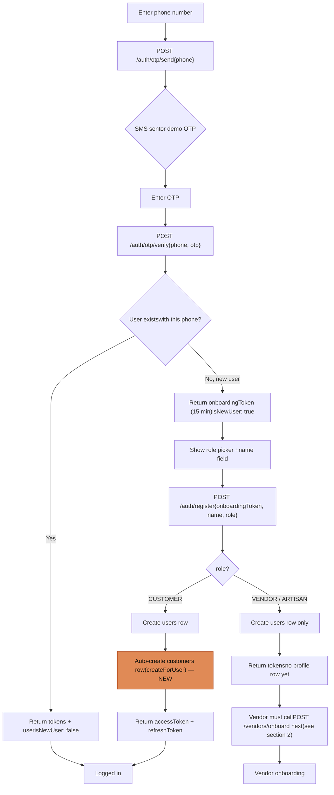
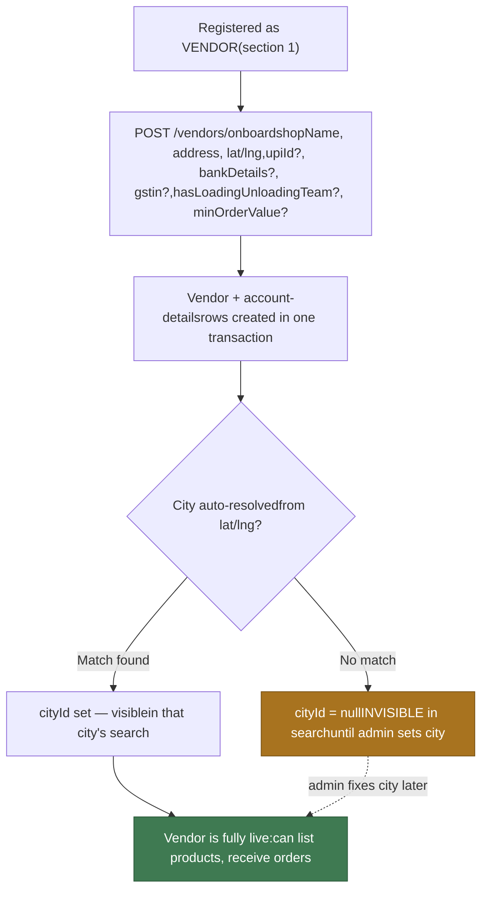
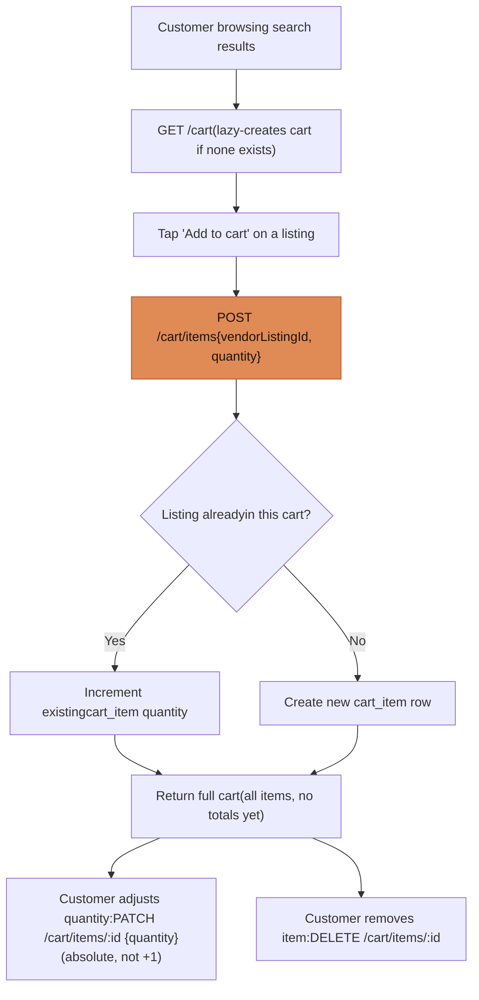
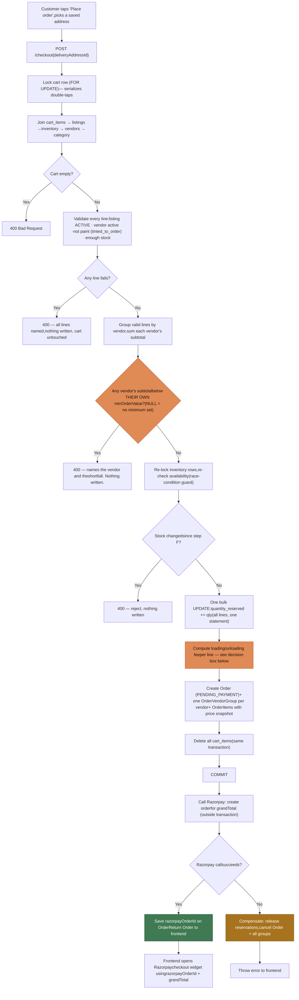
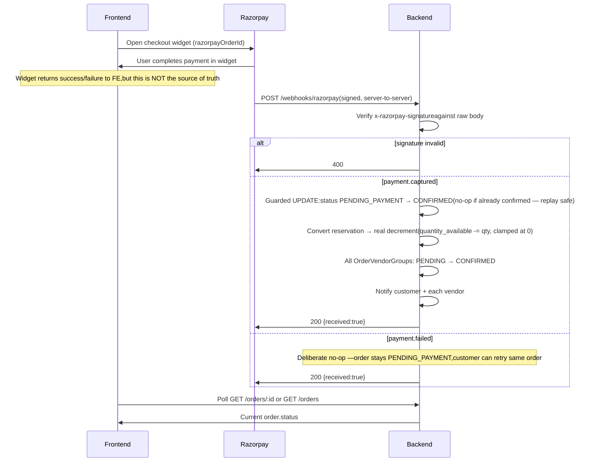
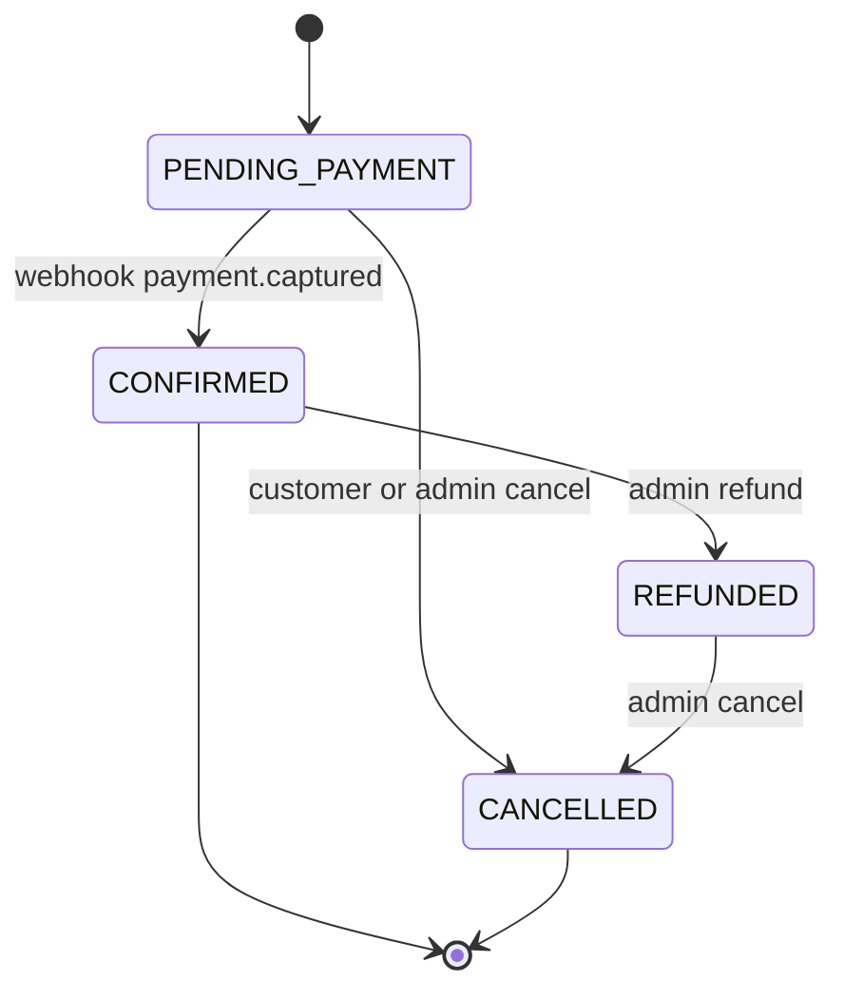
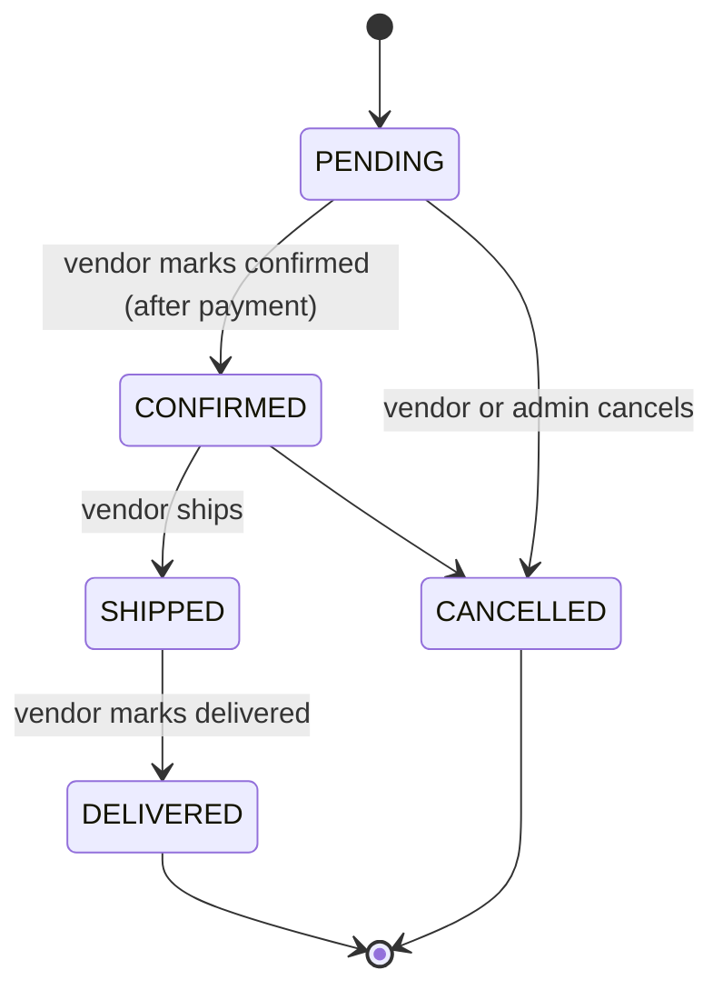
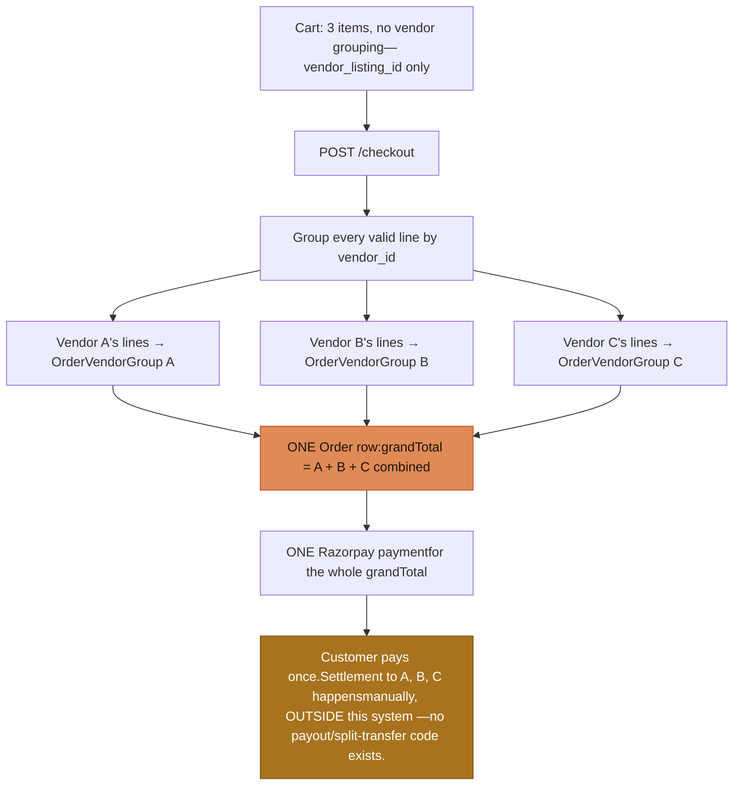
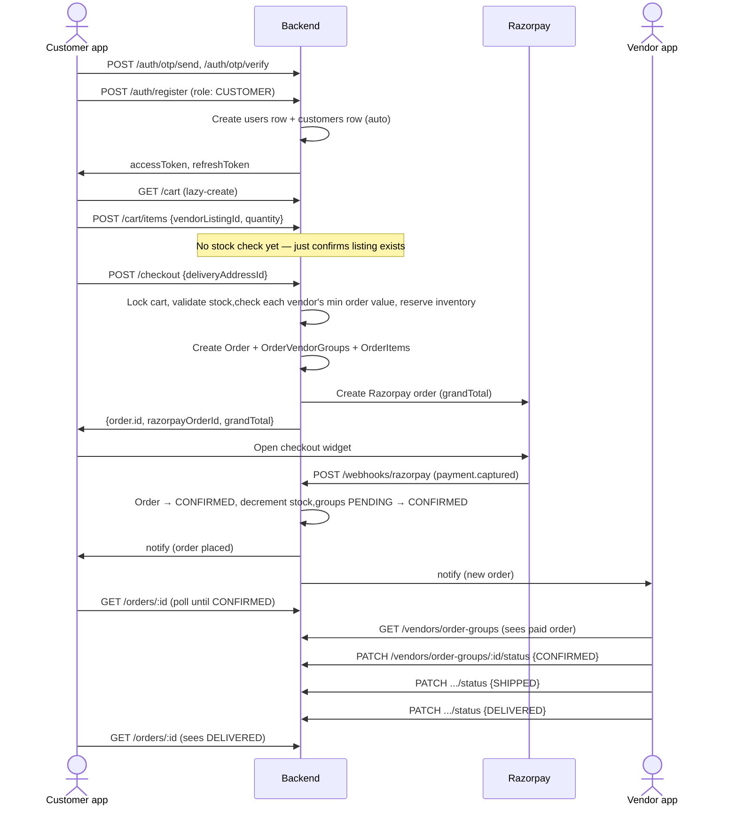

Golden Abode — Backend reference, built from main after merging PRs #20, #21 & #22

# Registration, Cart, Checkout & Order Flows

Every diagram and table below is sourced directly from the merged code on `main` — exact endpoint paths, field names, and status enums, not a summary. Hand this to the frontend dev building the customer and vendor apps.

[1. Registration & auth](#auth)

[2. Vendor onboarding](#vendor)

[3. Add to cart](#cart)

[4. Checkout](#checkout)

[5. Payment confirmation](#payment)

[6. Order lifecycle](#orders)

[7. Multi-vendor split](#multivendor)

[8. Delivery tracking](#delivery)

[9. End-to-end sequence](#e2e)

01

## Registration & authentication

OTP-based login for customers and vendors; separate email/password path for admins. A `customers` row is now created automatically the moment a CUSTOMER registers — this was the bug we just fixed, so the cart works immediately after signup.

Auth endpoints — apps/backend/src/modules/auth

| Method | Path                 | Body                                 | Notes                                                                                                            |
| ------ | -------------------- | ------------------------------------ | ---------------------------------------------------------------------------------------------------------------- |
| POST   | /auth/otp/send       | `{phone}`                            | Phone must match `^+91[6-9]\d{9}$`. Rate-limited 3/hr. Response includes `devOtp` in demo mode (fixed `123456`). |
| POST   | /auth/otp/verify     | `{phone, otp}`                       | Existing user → tokens directly. New user → 15-min `onboardingToken`.                                            |
| POST   | /auth/register       | `{onboardingToken, name, role}`      | role ∈ CUSTOMER / VENDOR / ARTISAN (ADMIN blocked). CUSTOMER auto-gets a `customers` row here.                   |
| POST   | /auth/admin/register | `{name, email, password, secretKey}` | secretKey checked against server config, not user-facing.                                                        |
| POST   | /auth/admin/login    | `{email, password}`                  | role must be ADMIN.                                                                                              |
| POST   | /auth/refresh        | `{refreshToken}`                     | Rotates both tokens. Reuse of a revoked token revokes _all_ of that user's tokens.                               |
| POST   | /auth/logout         | `{refreshToken}`                     | Revokes that one token.                                                                                          |
| GET    | /auth/me             | —                                    | Returns user + `vendorProfile`, `isApproved`, `onboardingStage`.                                                 |

→ Frontend: store `accessToken` (short-lived, \~15 min) and `refreshToken` (\~30 days). Call `/auth/refresh` on 401, not on a timer.

02

## Vendor onboarding

Vendors get no automatic profile row — they register (role: VENDOR), then separately submit shop/address/bank details. **No admin-approval gate blocks any of this** — a vendor can onboard, list products, and receive orders the moment they finish the onboarding call. `isApproved` exists but is only tracked for the admin dashboard today.

Vendor endpoints — apps/backend/src/modules/vendors

| Method | Path                        | Notes                                                                                                                                                                                                               |
| ------ | --------------------------- | ------------------------------------------------------------------------------------------------------------------------------------------------------------------------------------------------------------------- |
| POST   | /vendors/onboard            | 409 if profile already exists. `hasLoadingUnloadingTeam` drives the checkout fee logic (section 4). `minOrderValue` (optional, ≥ 0) drives the minimum-order-value check (section 4) — omit to leave unconstrained. |
| GET    | /vendors/me                 | Own profile + account details + resolved city.                                                                                                                                                                      |
| PATCH  | /vendors/me                 | Partial update. lat/lng must be sent together; re-resolves city unless admin pinned one.                                                                                                                            |
| PATCH  | /vendors/me/account-details | Full replace — all fields required, not partial.                                                                                                                                                                    |
| GET    | /vendors/me/categories      | Read-only list of registered leaf categories.                                                                                                                                                                       |

! Frontend heads-up: if lat/lng doesn't resolve to a known city, the vendor's listings are silently invisible to customers until an admin fixes it. Consider surfacing city-resolution status in the vendor UI.

03

## Add to cart

Cart is intentionally "dumb" — no stock check and no minimum-order-value check happens here. It only confirms the listing exists. All real validation happens once, at checkout. This means a customer can freely add items below a vendor's minimum — don't block that in the cart UI; only checkout knows whether the combination clears the bar.

Cart endpoints — apps/backend/src/modules/cart (role: CUSTOMER)

| Method | Path            | Body                          | Notes                                                                               |
| ------ | --------------- | ----------------------------- | ----------------------------------------------------------------------------------- |
| GET    | /cart           | —                             | Lazily creates the cart on first call. Returns cart + items array.                  |
| POST   | /cart/items     | `{vendorListingId, quantity}` | 404 if listing doesn't exist. Merges into existing row if same listing added twice. |
| PATCH  | /cart/items/:id | `{quantity}`                  | Sets quantity directly, not incrementally. 404 if item isn't in the caller's cart.  |
| DELETE | /cart/items/:id | —                             | 404 if not found/not owned.                                                         |

! No stock check at this stage. A customer can "add to cart" more than is actually available — the UI should not assume a successful add-to-cart means the item is reserved. Real validation and locking happens only at checkout.

04

## Checkout

`POST /checkout` is the one real transaction in this whole domain — validation, stock locking, order creation and the Razorpay call all happen here, in that order.

\# **Minimum order value (updated 2026-10-21)** — checkout no longer checks a per-listing minimum quantity. Instead, every vendor's lines in the cart are summed into a subtotal (`price × quantity`, across every valid line from that vendor), and checked against that vendor's own `minOrderValue` (set via `POST /vendors/onboard` or `PATCH /vendors/me`). `NULL` means the vendor hasn't set one — treated as no minimum, not as a block. If the subtotal falls short, checkout rejects the _whole order_ (all vendors, not just the short one) naming the vendor and the shortfall — the frontend should surface this as "add ₹X more from \<vendor> to check out," not a generic error.

$ **Loading/unloading fee decision** — applies per line when: (1) category path starts with `tiles/` or `stone/`, AND (2) the vendor's `hasLoadingUnloadingTeam` flag is NOT `true` (false or null both charge — null is treated as "no crew," charged defensively). Fee = `quantity × rate_per_sqft` (rate currently 0 — placeholder until client gives a real number). It's added to the customer's `grandTotal` and shown per vendor-group as `loadingUnloadingFee`.

What the frontend needs from the checkout response

| Field                   | Use                                                                                                                        |
| ----------------------- | -------------------------------------------------------------------------------------------------------------------------- |
| `order.id`              | Your own reference — use for polling/display after payment.                                                                |
| `order.razorpayOrderId` | Pass to the Razorpay Checkout widget as `order_id`.                                                                        |
| `order.grandTotal`      | Amount to display; Razorpay widget itself reads amount from the order it already created server-side.                      |
| Razorpay key id         | **Not in this response.** The publishable key must come from the frontend's own config/env, paired with `razorpayOrderId`. |

05

## Payment confirmation (server-to-server)

The frontend never confirms a payment itself — only Razorpay's webhook does, hitting the backend directly. The frontend's job after opening the widget is just to poll/display the order's status.

! Frontend must poll `GET /orders/:id` after the Razorpay widget closes — don't trust the widget's own success callback as proof of payment. The order only becomes `CONFIRMED` once the webhook round-trip completes, which can lag slightly behind the widget closing.

06

## Order lifecycle — all three roles

Two status machines: the `Order` itself (payment state) and each `OrderVendorGroup` (fulfilment state, one per vendor in a multi-vendor cart).

↑ Order.status — the payment state (one per checkout)

↑ OrderVendorGroup.status — fulfilment state (one per vendor per order). Forward-only — vendors cannot skip or go backward.

PENDING CONFIRMED SHIPPED DELIVERED (terminal) CANCELLED (terminal)

Customer-facing — apps/backend/src/modules/orders (role: CUSTOMER)

| Method | Path               | Notes                                                                                                                                        |
| ------ | ------------------ | -------------------------------------------------------------------------------------------------------------------------------------------- |
| GET    | /orders            | List own orders, newest first, with groups + items included.                                                                                 |
| GET    | /orders/:id        | 404 if not owned.                                                                                                                            |
| PATCH  | /orders/:id/cancel | Only works while `PENDING_PAYMENT`. Once `CONFIRMED` (paid), the customer can no longer self-cancel — show a "contact support" path instead. |

Vendor-facing — apps/backend/src/modules/vendors (role: VENDOR)

| Method | Path                             | Notes                                                                                                                             |
| ------ | -------------------------------- | --------------------------------------------------------------------------------------------------------------------------------- |
| GET    | /vendors/order-groups            | Unpaid (PENDING_PAYMENT) orders are invisible to vendors — only shows groups whose parent order has been paid.                    |
| GET    | /vendors/order-groups/:id        | Same visibility rule, 404 otherwise. Vendor only sees their own group's items/subtotal — never other vendors' or the order total. |
| PATCH  | /vendors/order-groups/:id/status | `{status}` — forward-only table above. 400 on an invalid jump, or if the parent order is REFUNDED/CANCELLED.                      |

Admin-facing — apps/backend/src/modules/orders/admin-orders.controller.ts (role: ADMIN)

| Method | Path                                                | Notes                                                                             |
| ------ | --------------------------------------------------- | --------------------------------------------------------------------------------- |
| GET    | /admin/orders                                       | All orders.                                                                       |
| GET    | /admin/orders/:id                                   | One order, full detail.                                                           |
| GET    | /admin/orders/:id/payment-events                    | Full raw-webhook audit trail, ascending.                                          |
| POST   | /admin/orders/:id/refund                            | Only from CONFIRMED. Full refund only, no partial-line refunds yet.               |
| PATCH  | /admin/orders/:id/cancel                            | Only from PENDING_PAYMENT or REFUNDED — a CONFIRMED order must be refunded first. |
| PATCH  | /admin/orders/vendor-group/:groupId/override-status | `{status, reason}` — bypasses the forward-only table, reason required and logged. |

07

## Multi-vendor cart & order split

One cart can mix listings from any number of vendors with zero vendor-awareness in the cart itself. The split into separate vendor groups happens entirely at checkout.

! **Checkout is all-or-nothing across every vendor, not just one.** If Vendor A is out of stock, Vendor B and C's otherwise-valid lines are rejected too — nothing is written for anyone until every line from every vendor in the cart passes validation. Don't design a UI that lets a customer "just skip the broken vendor and check out with the rest" — that's not how the backend works today.

→ **Vendors can't see each other.** Vendor A's app only ever sees Group A — never Group B/C, never the combined order total, never that other vendors exist on the same order. Each vendor's screen should read purely as "my part of someone's order," with no indication a bigger multi-vendor order exists.

What this means for the frontend, concretely

| Screen                          | Shows                                                                                                                                                                                                                                                                             |
| ------------------------------- | --------------------------------------------------------------------------------------------------------------------------------------------------------------------------------------------------------------------------------------------------------------------------------- |
| Customer cart / checkout review | Group line items by vendor for display (the API doesn't group them in the cart response — do this client-side from each item's listing → vendor). Show each vendor's running subtotal so a customer can see if they're short of that vendor's minimum before attempting checkout. |
| Customer order detail           | `GET /orders/:id` already returns `vendorGroups[]` nested under the order — render as one order with per-vendor sub-sections, each showing that vendor's items, subtotal, loading/unloading fee, and fulfilment status independently.                                             |
| Vendor order list/detail        | `GET /vendors/order-groups` — only that vendor's own groups. Never surface `orderId` in a way that implies the vendor can look up or affect the parent order.                                                                                                                     |

08

## Delivery tracking — not built yet

Right now, "tracking" is nothing more than the status label on `OrderVendorGroup`. There is no tracking number, carrier, ETA, delivery OTP, or photo proof anywhere in the backend today.

! **Build the "track my order" screen against the status enum only** — `PENDING → CONFIRMED → SHIPPED → DELIVERED` (or `CANCELLED`) per vendor group, from the same `GET /orders/:id` response already described in section 6. Don't design UI around a tracking number, carrier name, delivery OTP, or open-box photo — none of that exists in the API, and none of it is scheduled yet.

→ The client has already specified a real mechanism for later: a 6-digit OTP a driver enters on-site, plus an open-box photo, both closing out that specific vendor group's delivery. This is recorded as deferred work (decision `0042`) attached to `OrderVendorGroup` — worth knowing about when you scope the tracking screen's layout, since the eventual real version will need an OTP-entry step and a photo-upload step per vendor group, not just a status label. But don't build those inputs now — there's no backend to receive them.

What exists today vs. what's deferred

| Field                                | Status                                                   |
| ------------------------------------ | -------------------------------------------------------- |
| `OrderVendorGroup.status`            | Built. The only tracking signal that exists.             |
| Tracking number / carrier            | Not built. No column, no endpoint.                       |
| Delivery OTP (driver enters on-site) | Deferred — named in decision 0042, not scheduled.        |
| Open-box delivery photo              | Deferred — blocked on media/storage work, not scheduled. |
| Estimated delivery date              | Not built. No column, no endpoint.                       |

09

## Full end-to-end sequence

All sections above, stitched into one request-by-request sequence — the complete path from a customer's first OTP to a vendor marking an order delivered.

[↑ top](#)
